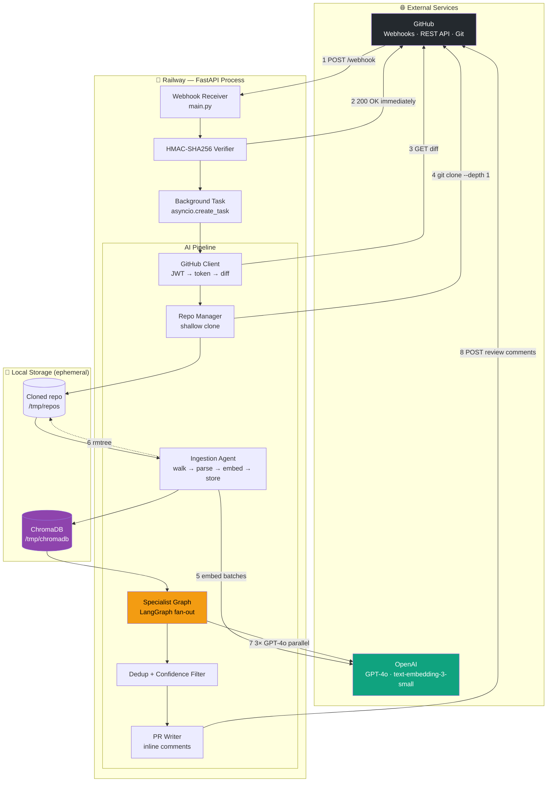
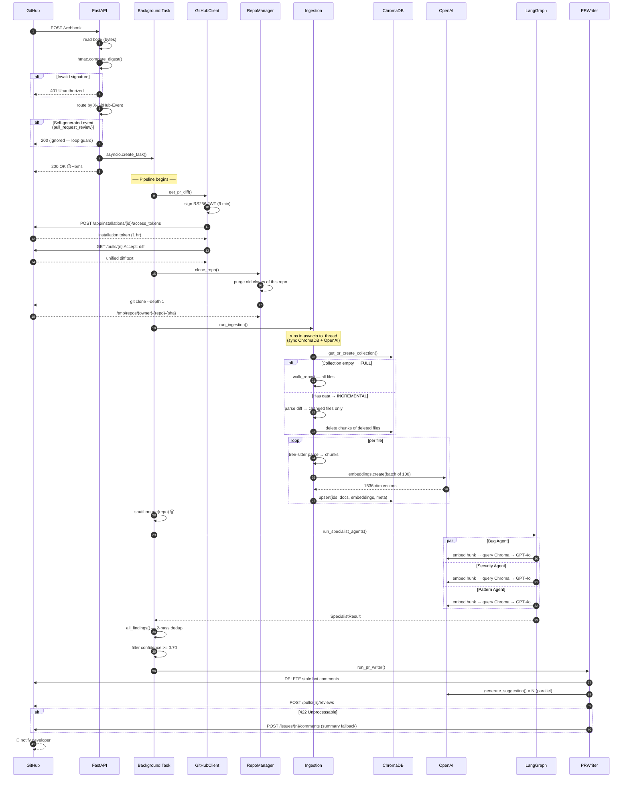
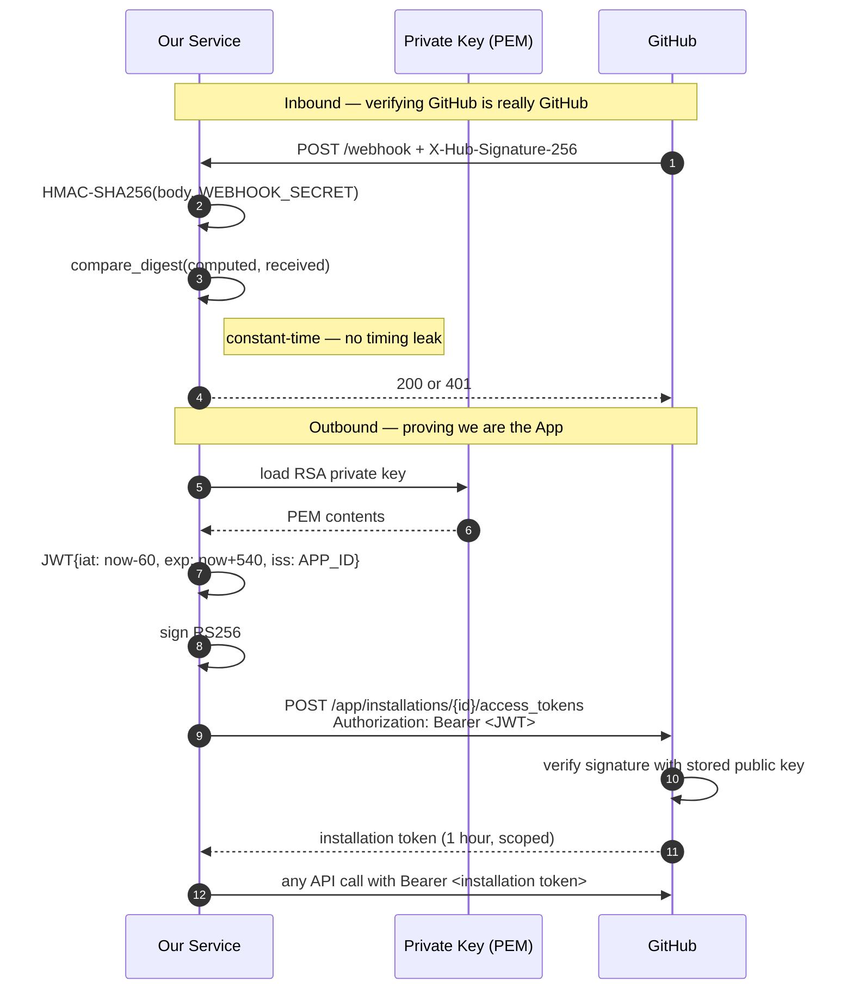
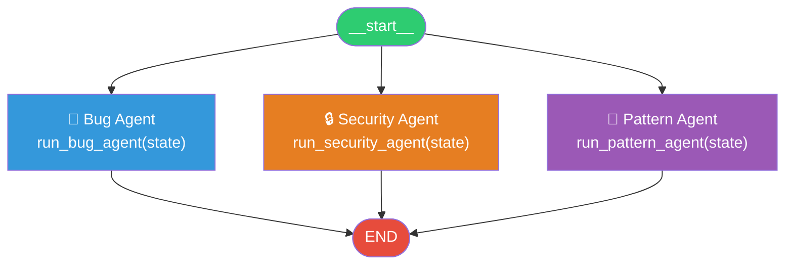
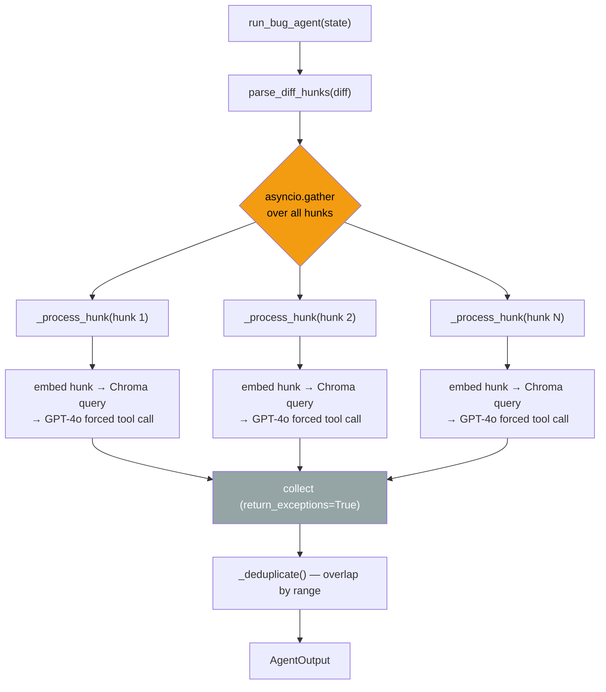
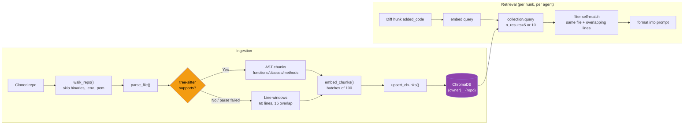
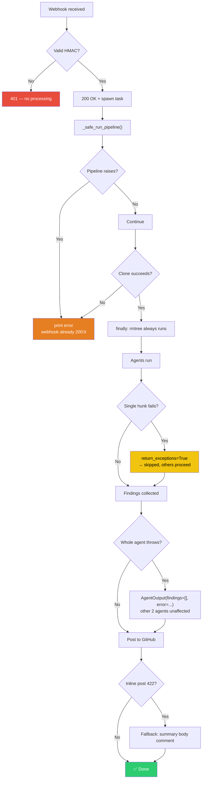
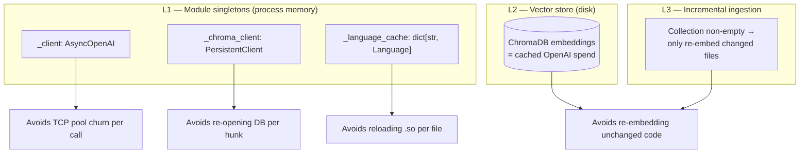
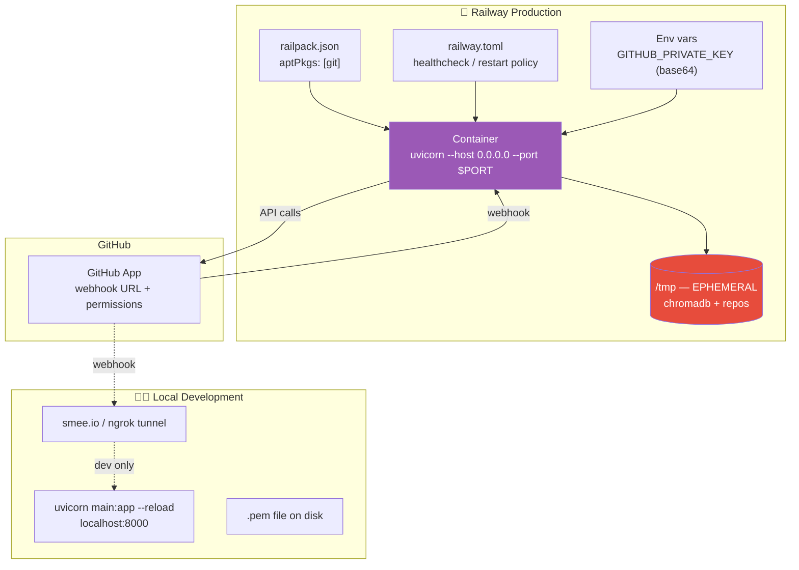

# 02 — System Architecture

## Executive Summary

PR Review Agent is a **single-process, event-driven, async Python service** built around one HTTP entry point and a five-stage AI pipeline. It has no database, no frontend, no message queue, and no cache server. Its persistence layer is a local vector store; its UI is GitHub; its queue is `asyncio.create_task`.

That minimalism is deliberate and defensible — but knowing *exactly where each missing piece would go* when the system grows is what turns "small project" into "well-scoped project" in an interview.

**Architectural style:** Event-driven pipeline with parallel fan-out/fan-in.

---

## 1. Concepts: Beginner → Advanced

### Beginner — What is "event-driven"?

Two ways for software to find out something happened:

**Polling** — ask repeatedly:
```
Every 60s: "Any new PRs?" → "No"  (wasted call)
Every 60s: "Any new PRs?" → "No"  (wasted call)
Every 60s: "Any new PRs?" → "Yes!" (up to 60s stale)
```

**Events (webhooks)** — be told:
```
[silence]
GitHub: "PR #7 just opened" → react immediately
```

| | Polling | Webhooks |
|---|---|---|
| Latency | Up to poll interval | Near-instant |
| Wasted calls | Many | Zero |
| Complexity | Simple | Needs public URL + signature verification |
| Failure mode | Self-healing (next poll retries) | Delivery can be missed |

This project uses webhooks: latency matters, and GitHub provides delivery retries plus a redelivery UI.

### Intermediate — Fan-out / fan-in

**Fan-out**: one input splits to N parallel workers. **Fan-in**: N results merge back.

```
        ┌──► Bug Agent ──────┐
Diff ───┼──► Security Agent ─┼──► Merge → Dedup → Filter → Post
        └──► Pattern Agent ──┘
```

Sequential cost = sum of all three. Parallel cost = max of the three. With three agents at ~15s each: **45s sequential vs ~15s parallel**.

### Advanced — Why async and not threads or processes?

This workload is **I/O-bound**, not CPU-bound. Almost all wall-clock time is spent *waiting*: for GitHub's API, for OpenAI's API, for network.

| Model | Concurrency unit | Memory each | Best for | Python caveat |
|---|---|---|---|---|
| **Threads** | OS thread | ~8 MB stack | I/O-bound (releases GIL on I/O) | Context-switch overhead; GIL blocks CPU parallelism |
| **Processes** | OS process | ~50+ MB | CPU-bound | Expensive IPC; heavy |
| **Async** | Coroutine | ~KB | **I/O-bound, high concurrency** | One blocking call freezes everything |

Async wins here: thousands of concurrent awaits at kilobytes each, single thread, no GIL contention because nothing is CPU-bound.

**The critical caveat** — and this project hit it hard. Async only helps if *every* call in the path is non-blocking. The original implementation used the **synchronous** `OpenAI` client inside `async def` functions. The code looked parallel; LangGraph fanned out to three nodes; but every node blocked the single event loop in turn. Result: three "parallel" agents ran strictly sequentially.

The fix, in commit `a61bfd2`: switch to `AsyncOpenAI` everywhere. See [12-Performance-Optimization.md](12-Performance-Optimization.md) and [14-Project-Challenges.md](14-Project-Challenges.md) — this is one of your best interview stories.

---

## 2. High-Level Architecture



### Every component explained

| # | Component | Responsibility | Key file | Why it exists |
|---|---|---|---|---|
| 1 | **Webhook Receiver** | HTTP ingress, event routing | `main.py:114` | Single entry point; GitHub's only way to reach us |
| 2 | **HMAC Verifier** | Reject forged requests | `main.py:26` | The endpoint is public; anyone can POST to it |
| 3 | **Background Task** | Decouple ACK from work | `main.py:161` | GitHub times out at ~10s; pipeline takes 30–90s |
| 4 | **GitHub Client** | Auth + diff fetch | `github_client.py` | Centralises JWT signing and token exchange |
| 5 | **Repo Manager** | Clone at exact SHA | `repo_manager.py` | Need full file bodies, not just the diff |
| 6 | **Ingestion Agent** | Build the vector index | `ingestion/` | Turns a repo into retrievable memory |
| 7 | **Specialist Graph** | Orchestrate 3 agents | `specialist/graph.py` | Declarative parallelism + typed state |
| 8 | **Dedup + Filter** | Quality gate | `findings.py`, `main.py:85` | Replaced the deleted critic agent |
| 9 | **PR Writer** | Format + post to GitHub | `pr_writer/` | Output adapter; isolates GitHub comment API quirks |

### Every arrow explained

| Arrow | Protocol | Payload | Failure behaviour |
|---|---|---|---|
| GitHub → Webhook | HTTPS POST | PR event JSON + `X-Hub-Signature-256` | GitHub retries; visible in Deliveries UI |
| Verifier → GitHub | HTTP 200 | `{"status":"ok"}` | If slow, GitHub marks delivery failed |
| Verifier → Background | In-process | Coroutine scheduled on event loop | ⚠️ Lost entirely if process restarts |
| Client → GitHub | HTTPS GET | `Accept: application/vnd.github.diff` | `raise_for_status()` → caught by `_safe_run_pipeline` |
| Manager → GitHub | HTTPS git | Token-authenticated clone URL | GitPython raises; pipeline aborts cleanly |
| Ingestion → OpenAI | HTTPS POST | Batches of 100 chunk texts | 1 retry with 1s sleep, then raise |
| Ingestion → ChromaDB | Local fn call | Vectors + metadata | Upsert is idempotent by chunk ID |
| Graph → OpenAI | HTTPS POST ×N | Prompt + forced tool schema | `return_exceptions=True` — one hunk failing doesn't kill the agent |
| Writer → GitHub | HTTPS POST | Review with inline comments | 422 → fall back to summary body comment |

---

## 3. Request Flow — The Complete Lifecycle



---

## 4. Authentication Flow



**Two different mechanisms, two different directions — a very common interview probe:**

| | Inbound (webhook) | Outbound (API) |
|---|---|---|
| Mechanism | HMAC-SHA256 | JWT RS256 → installation token |
| Key type | **Symmetric** shared secret | **Asymmetric** RSA private key |
| Proves | Payload authentic & untampered | We are the registered App |
| Lifetime | N/A (per-request) | JWT 9 min; token 1 hour |
| Why this type | Both sides share it; fast; no PKI needed | GitHub must verify without holding our secret |

Full detail: [07-Authentication-and-Security.md](07-Authentication-and-Security.md).

---

## 5. Agent Flow (LangGraph)



Three edges out of `__start__` = LangGraph runs all three nodes **concurrently**. Each writes to a **different** key of the shared state (`bug_output`, `security_output`, `pattern_output`), so there is no write conflict and no reducer needed.

### Inside a single agent — nested parallelism



**Two levels of parallelism multiply.** 3 agents × N hunks = 3N concurrent operations.

For a 20-hunk PR: 60 concurrent GPT-4o calls + 60 concurrent embedding calls. This is why the system is fast — and simultaneously why unbounded concurrency is the #1 scaling risk. See [13-Scalability.md](13-Scalability.md).

---

## 6. Data / Vector Store Flow



**The self-match filter (`context.py:52`) is subtle and worth explaining in interviews.** Without it, the top vector hit for a changed function is almost always *the old version of that same function*, still sitting in the index. The agent would then "compare" the new code to itself and find nothing. Filtering out chunks from the same file at overlapping line ranges forces retrieval of genuinely *other* code.

---

## 7. Error Handling Flow



### The error-handling philosophy: graceful degradation at four levels

| Level | Failure | Response | Principle |
|---|---|---|---|
| Hunk | One GPT-4o call fails | Skip that hunk | Partial review > no review |
| Agent | Whole agent throws | Empty output + error recorded | 2 agents' findings still ship |
| Post | Inline comments rejected | Summary body comment | Some feedback > silence |
| Pipeline | Anything else | Log; webhook already ACKed | Never 500 to GitHub |

**Why never 500 to GitHub?** GitHub disables webhooks that fail persistently. A 500 also tells GitHub to retry — which would re-run an expensive LLM pipeline that already partially executed. Failing loudly to GitHub is worse than failing quietly to logs. (The real gap: those logs are `print()` statements. See [10-Deployment-and-DevOps.md](10-Deployment-and-DevOps.md).)

---

## 8. Caching Flow

**No Redis. No Memcached.** Three caching mechanisms exist, all in-process or on-disk:



| Cache | Implementation | What it saves | Invalidation |
|---|---|---|---|
| OpenAI client | `_get_client()` singleton | Connection pool setup per call | Process restart |
| ChromaDB client | `_get_client()` singleton | DB handle open/close per hunk | Process restart |
| tree-sitter languages | `_language_cache` dict | Loading `.so` per file | Process restart |
| Embeddings | ChromaDB on disk | **Real money** — re-embedding unchanged files | Manual / process wipe |
| Incremental mode | `collection_has_data()` | Full repo re-ingest per PR | When collection empties |

**The singleton pattern here is a real interview topic.** Before `a61bfd2`, a new ChromaDB client was created per hunk. With 20 hunks × 3 agents that's 60 client instantiations per PR — each opening the database. The commit message explicitly says *"Add ChromaDB singleton to avoid recreating the client per hunk."*

**The honest weakness:** on Railway, `/tmp/chromadb` is ephemeral. Every deploy wipes L2, so the next PR silently pays for a full re-ingest. Fix: mount a Railway volume and point `CHROMADB_PATH` at it. See [12-Performance-Optimization.md](12-Performance-Optimization.md).

---

## 9. Deployment Diagram



### The two key deployment lessons

**1. `railpack.json` exists because of a real production failure.** GitPython shells out to the `git` binary. Railway's default build image doesn't include it. The clone failed in production but worked locally. Three commits (`c66322a`, `d87d226`, `16124db`) show the debugging: first attempt used the wrong key name, second used an array instead of an object, third landed on `{"aptPkgs": ["git"]}`.

**Interview lesson:** *"My code had an implicit system-level dependency I didn't declare. It worked locally because my machine had git; the container didn't. That's exactly the class of bug containers are supposed to prevent — and I hit it because I let the platform build my image instead of writing an explicit Dockerfile."*

**2. `GITHUB_PRIVATE_KEY` is base64-encoded.** A PEM file is multi-line; most env var systems mangle newlines. Base64 makes it one safe line. `github_client.py:14` handles both: base64 env var in production, file path locally.

---

## 10. Design Trade-offs

| Decision | Alternative | Chose because | Cost accepted |
|---|---|---|---|
| Webhooks | Polling | Instant, no wasted calls | Public URL + signature verification |
| `asyncio.create_task` | Celery/RQ + Redis | Zero infrastructure | **Tasks lost on restart; no retries** |
| Async/await | Threads | I/O-bound; cheap concurrency | One blocking call freezes all |
| Monolith | Microservices | 1,900 LOC doesn't need distribution | Can't scale stages independently |
| ChromaDB embedded | Pinecone/Weaviate | Zero cost, zero ops | Not shared across instances |
| No database | PostgreSQL | Nothing needs durable state | No history, no analytics |
| GitHub UI | Custom dashboard | Users already there | No custom views |
| LangGraph | Plain `asyncio.gather` | Typed state, extensible, visualisable | Dependency for a simple graph |

### The `asyncio.create_task` weakness — say this before they find it

> The queue is the weakest link. `asyncio.create_task` schedules work on the same process that served the request. If Railway restarts the container mid-pipeline — deploy, OOM, crash — that review is gone silently. There's no retry, no dead-letter queue, no visibility.
>
> There's also a subtler bug: I don't retain a reference to the task. Python's garbage collector can collect a task that nothing holds a reference to, mid-execution. The documented fix is keeping a module-level set with a done-callback to discard.
>
> The real fix is a proper broker — Redis + Celery, or SQS + workers. That decouples ingress from processing, survives restarts, gives retries with backoff, and lets me scale receivers and workers independently. I didn't build it because at my scale the failure mode is "one review is missed and the developer pushes again", which was acceptable. At team scale it isn't.

**This answer is gold.** It shows you know the weakness, its blast radius, the exact fix, and *why you deliberately didn't build it*. That last part is what separates pragmatism from ignorance.

---

## 11. Common Mistakes

| Mistake | Why wrong | Correct approach |
|---|---|---|
| Processing webhooks synchronously | GitHub times out ~10s; delivery marked failed | ACK immediately, process in background |
| `==` for signature comparison | Timing attack — early exit leaks byte position | `hmac.compare_digest` |
| Sync SDK inside `async def` | Blocks event loop; parallelism is fake | Async clients throughout |
| Not filtering self-referential RAG hits | Agent compares code to itself | Exclude same-file overlapping chunks |
| Unbounded `asyncio.gather` | Rate limits, cost explosion | `asyncio.Semaphore` bound |
| Trusting LLM line numbers | 422 kills the whole review | Validate against parsed hunks first |
| Ignoring your own webhook events | Infinite loop: bot comments → event → review → comment | Explicit event-type ignore list |
| `print()` as production logging | No levels, no structure, no correlation IDs | `structlog` / JSON logs |

---

## 12. Interview Questions

### Q1. "Draw and explain your architecture."

**Whiteboard order — draw in this sequence, narrating as you go:**

1. Box: **GitHub** (left)
2. Box: **FastAPI /webhook** — arrow from GitHub labelled `POST + HMAC`
3. **Arrow back to GitHub labelled `200 OK — 5ms`** ← *say "this is the most important arrow on the board"*
4. Box below: **Background Task**
5. Chain right: **Diff → Clone → Ingest**
6. Cylinder: **ChromaDB** under Ingest
7. **Three boxes side by side**: Bug, Security, Pattern — draw them *vertically stacked* to emphasise parallelism
8. Merge: **Dedup → Filter ≥0.70**
9. Box: **PR Writer** → arrow back to **GitHub**
10. Cloud on the right: **OpenAI** — dotted arrows from Ingest and all three agents

**Narration:** *"Two things make this architecture work. First, this arrow — I return 200 in five milliseconds because GitHub times out at ten seconds and my pipeline takes ninety. Second, these three boxes run concurrently, not sequentially, which took a real bug fix to actually achieve."*

**What's evaluated:** Can you communicate a system visually? Do you know which parts matter?

---

### Q2. "Why is there no message queue?"

**Beginner:** The project is small; `asyncio.create_task` was enough.

**Intermediate:** A queue adds infrastructure — a broker, workers, deployment, monitoring. At one-PR-at-a-time volume, background tasks gave me async processing with zero operational cost. The trade-off is durability: if the process restarts mid-pipeline, that review is lost.

**Advanced:** A queue buys four things: **durability** (survives restarts), **retries** (with backoff and DLQ), **backpressure** (bounded concurrency instead of unbounded fan-out), and **independent scaling** (N receivers, M workers). I have none of them.

The one I actually need most isn't durability — it's **backpressure**. Right now a 50-hunk PR fires 150 concurrent GPT-4o calls with no limit. A queue with a bounded worker pool would naturally cap that. I could get 80% of the benefit for 5% of the cost with an `asyncio.Semaphore`, which is the intermediate step I'd take first.

The migration path is clean because the pipeline is already a pure function of `(owner, repo, pr_number, installation_id, head_sha)` — all JSON-serialisable. Swapping `asyncio.create_task(...)` for `celery_task.delay(...)` is genuinely a one-line change at the call site. I designed it that way on purpose.

**Follow-ups:** "Which broker?" (Redis for simplicity, SQS for managed durability.) · "How would you handle a poison message?" (Max-retry then DLQ with the PR number for manual replay.) · "How do you prevent duplicate reviews if GitHub redelivers?" (Idempotency key on `(pr_number, head_sha)` — currently missing.)

---

### Q3. "What happens if OpenAI goes down?"

**Best answer:**
> It fails, and it fails badly — that's an honest gap.
>
> Concretely: embedding calls in ingestion get one retry with a one-second sleep, then raise, which aborts the pipeline. Agent calls fail per-hunk; `return_exceptions=True` means the agent returns partial findings rather than crashing. If all hunks fail, you get an empty review — the developer sees nothing and has no idea the system tried.
>
> There are three problems. Silent failure: nobody's told. No backoff: one retry at a fixed second doesn't help with a real outage. No circuit breaker: I'd keep hammering a dead API for every incoming PR.
>
> What I'd build: exponential backoff with jitter, a circuit breaker that trips after N consecutive failures and short-circuits for a cooldown, a durable queue so requests survive to be retried after recovery, and — most importantly — posting a "review unavailable" comment so failure is visible rather than silent.

**What's evaluated:** Do you think about failure modes? Do you distinguish *failing* from *failing silently*?

---

### Q4. "Why LangGraph? `asyncio.gather` would do the same thing."

**Best answer:**
> You're right that for the current graph it's nearly equivalent — three parallel nodes with no dependencies is exactly `asyncio.gather`. I'd defend LangGraph on three grounds, and concede a fourth.
>
> **Typed shared state.** `AgentState` is a `TypedDict`. Every node receives the same typed object and returns a partial update that gets merged. With raw `gather` I'd be passing tuples around and merging by hand.
>
> **Extensibility.** The graph I originally had was more complex — it included a critic node downstream of the specialists. Adding conditional edges, retries, or a fourth agent is a declarative change, not a rewrite of the concurrency logic.
>
> **Structure as documentation.** `graph.py` is 35 lines and the topology is visible at a glance.
>
> **The concession:** after I deleted the critic, the graph became simple enough that LangGraph is arguably over-engineering for what remains. If I were starting today with only this topology, `asyncio.gather` would be the honest choice. I kept it because the extension path — adding a test-coverage agent, a performance agent — is where it pays off.

**Why this scores well:** Defending a choice *and* conceding its current weakness is far more credible than defending it absolutely.

---

## 13. Real-World Comparison

| This project | Industry equivalent |
|---|---|
| Webhook receiver | GitHub Actions runner dispatch |
| `asyncio.create_task` | Celery / Sidekiq / AWS Lambda async invoke |
| ChromaDB | Pinecone / Weaviate / pgvector |
| LangGraph fan-out | Airflow parallel tasks / Step Functions Map state |
| Confidence threshold | ML model decision threshold tuning |
| GitHub as UI | Slack apps, Jira plugins — meet users where they are |

---

## 14. Cross-References

| Topic | File |
|---|---|
| Class-level design | [03-Low-Level-Design.md](03-Low-Level-Design.md) |
| ChromaDB internals | [04-Database-Design.md](04-Database-Design.md) |
| FastAPI specifics | [05-Backend-Architecture.md](05-Backend-Architecture.md) |
| Auth deep dive | [07-Authentication-and-Security.md](07-Authentication-and-Security.md) |
| The AI pipeline | [09-AI-System.md](09-AI-System.md) |
| Scaling this architecture | [13-Scalability.md](13-Scalability.md) |
| All diagrams together | [assets/mermaid-diagrams.md](assets/mermaid-diagrams.md) |

**Next:** [03-Low-Level-Design.md](03-Low-Level-Design.md)
