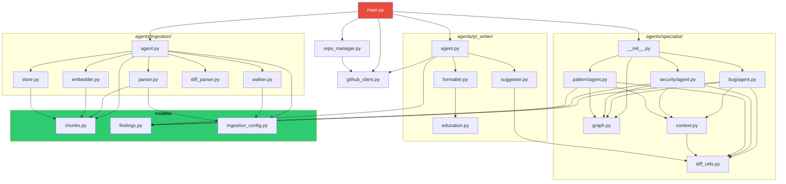
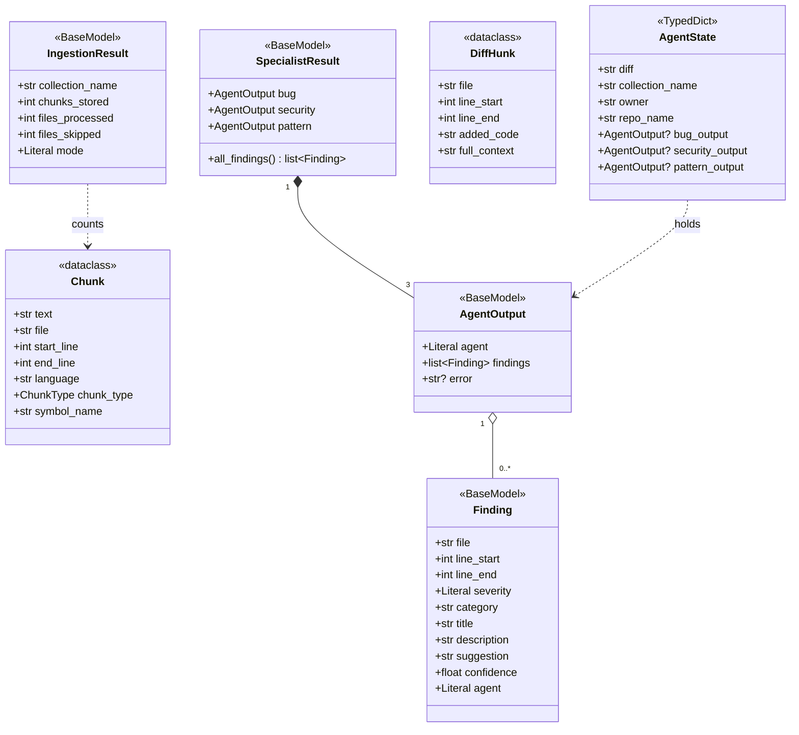
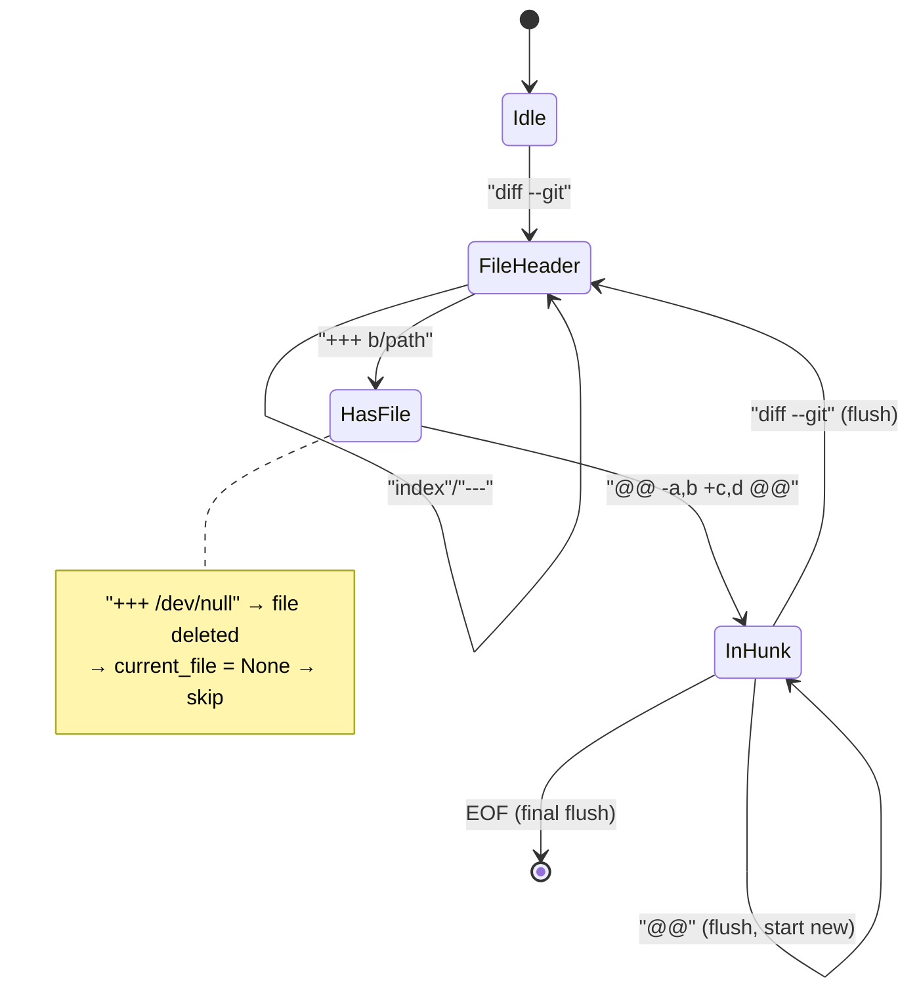
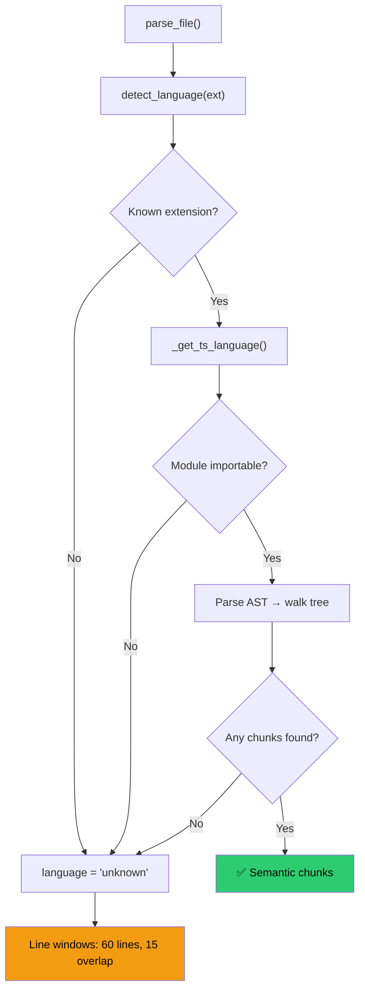

# 03 — Low-Level Design

## Executive Summary

This file drops from boxes-and-arrows to **classes, functions, data structures, and algorithms**. It covers the five data models, the module dependency graph, and detailed walkthroughs of the four non-trivial algorithms in the codebase: unified diff hunk parsing, tree-sitter chunking, two-pass deduplication, and content-addressed chunk IDs.

If [02](02-System-Architecture.md) is the map, this is the street view.

---

## 1. Module Dependency Graph



### Layering rules observed

| Layer | Modules | Depends on |
|---|---|---|
| **Entry** | `main.py` | Everything below |
| **Adapters** | `github_client`, `repo_manager` | Models only |
| **Agents** | `ingestion/`, `specialist/`, `pr_writer/` | Models, adapters, siblings within package |
| **Models** | `chunks`, `findings`, `ingestion_config` | **Nothing** — pure leaf |

**The models layer is a pure leaf.** No model imports an agent, a client, or a framework. That's the correct dependency direction: data structures should not know about the code that manipulates them. It means you can unit-test dedup logic with zero mocking.

**One notable cross-package dependency:** `pr_writer/suggester.py` imports `parse_diff_hunks` from `specialist/diff_utils.py`. That's a slight layering smell — diff parsing is a shared utility, not a specialist concern. In a refactor it belongs in a top-level `app/utils/diff.py`. Worth mentioning as self-aware technical debt.

---

## 2. Data Models — Complete Reference

### `Chunk` (dataclass) — `models/chunks.py`

```python
@dataclass
class Chunk:
    text: str           # the actual source code
    file: str           # relative path from repo root
    start_line: int     # 1-indexed, inclusive
    end_line: int       # 1-indexed, inclusive
    language: str       # "python", "java", ..., or "unknown"
    chunk_type: ChunkType  # "function"|"class"|"method"|"window"
    symbol_name: str    # "" if not extractable
```

**Why `@dataclass` and not Pydantic?** Chunks are created in hot loops — thousands per repo. Pydantic validates on every instantiation, which is wasted work for internally-constructed objects that never cross a trust boundary. Dataclasses are plain Python objects with near-zero overhead.

**The rule this demonstrates:** *Pydantic at trust boundaries, dataclasses internally.*

| | dataclass | Pydantic BaseModel |
|---|---|---|
| Validation | None | Full, on every init |
| Speed | Fast | Slower |
| Serialisation | Manual | Built in |
| Use for | Internal, trusted, hot-path | External, untrusted, API-facing |

`IngestionResult` in the *same file* **is** Pydantic — because it's a result object crossing a module boundary, created once. Same file, two different tools, chosen deliberately.

### `Finding` (Pydantic) — `models/findings.py`

```python
class Finding(BaseModel):
    file: str
    line_start: int
    line_end: int
    severity: Literal["high", "medium", "low"]
    category: str
    title: str
    description: str
    suggestion: str
    confidence: float                    # 0.0 – 1.0
    agent: Literal["bug", "security", "pattern"]
```

**This one is Pydantic for a critical reason: it is constructed from LLM output.** GPT-4o is an untrusted source. `Literal["high","medium","low"]` means a hallucinated `"critical"` raises `ValidationError` instead of silently flowing into the formatter and producing a broken comment.

**Note the design choice on `category`:** it's `str`, not `Literal`. Severity is constrained; category is open. Why? Categories evolve — the prompts list ~15 but new ones are useful, and `education.py` degrades gracefully to a severity-based fallback for unknown categories. Severity, by contrast, drives formatting logic and must be one of exactly three values.

**The known gap:** `confidence: float` has no bounds. An LLM returning `1.5` or `-0.2` passes validation. The fix is one line:
```python
from pydantic import Field
confidence: float = Field(ge=0.0, le=1.0)
```
Mentioning this unprompted is a strong signal.

### `AgentOutput` and `SpecialistResult`

```python
class AgentOutput(BaseModel):
    agent: Literal["bug", "security", "pattern"]
    findings: list[Finding]
    error: str | None = None      # ← the graceful-degradation field

class SpecialistResult(BaseModel):
    bug: AgentOutput
    security: AgentOutput
    pattern: AgentOutput
    def all_findings(self) -> list[Finding]: ...
```

**`error: str | None` is the key design element.** An agent that fails returns a *valid* `AgentOutput` with empty findings and a populated error — it does not raise. This is the difference between an exception-based and a result-based error model:

| | Exceptions | Result objects |
|---|---|---|
| Propagation | Automatic upward | Explicit |
| Partial success | Hard | Natural |
| Type safety | Invisible in signature | Visible |
| Best for | Truly exceptional | **Expected, recoverable failures** |

An LLM API timing out is *expected*, not exceptional. Modelling it as data lets two agents succeed while one fails.

### `IngestionConfig` — `models/ingestion_config.py`

```python
class IngestionConfig(BaseModel):
    max_file_bytes: int = 512_000
    binary_probe_bytes: int = 8_192
    window_size_lines: int = 60
    window_overlap_lines: int = 15
    embedding_batch_size: int = 100
    skip_dirs: list[str] = [".git", "node_modules", "__pycache__", ...]
```

Every tuning knob in one place with defaults, injectable for tests. This is the **Parameter Object pattern** — instead of `run_ingestion(diff, path, owner, repo, sha, 512000, 8192, 60, 15, 100, [...])`, you pass one object.

⚠️ **A real Python bug lurking here:** `skip_dirs: list[str] = [...]` is a mutable default. In a plain dataclass this would be the classic shared-mutable-default bug. **Pydantic saves you** — it deep-copies defaults per instance. Knowing *why* this is safe here but dangerous elsewhere is a great interview detail.

---

## 3. Class Diagram



---

## 4. Algorithm Deep Dive #1 — Unified Diff Hunk Parsing

**File:** `specialist/diff_utils.py` · **Function:** `parse_diff_hunks(diff: str) -> list[DiffHunk]`

### The problem

Given GitHub's unified diff text, extract every changed region with **correct line numbers in the new file**. Those line numbers are load-bearing: they determine where comments get posted.

### The input format

```diff
diff --git a/src/auth.py b/src/auth.py
index 83db48f..bf269f4 100644
--- a/src/auth.py
+++ b/src/auth.py
@@ -10,7 +10,8 @@ def login(user):
     if not user:
         return None
-    token = make_token(user)
+    token = make_token(user, expiry=3600)
+    log.info(f"token for {user.email}")
     return token
```

Decode the header `@@ -10,7 +10,8 @@`: old file starts at line 10 spanning 7 lines; **new file starts at line 10 spanning 8 lines**. Only the `+` numbers matter — we comment on the new version.

### The line-counting rule (the crux)

```
Line prefix │ In new file? │ Advance counter?
────────────┼──────────────┼─────────────────
' ' context │ Yes          │ ✅ +1
'+' added   │ Yes          │ ✅ +1
'-' deleted │ No           │ ❌ no
```

Deleted lines exist in the old file only. Counting them would shift every subsequent line number — and every comment would land in the wrong place.

```python
if line.startswith("+"):
    added_lines.append(line[1:])
    current_new_line += 1
elif line.startswith("-"):
    pass                      # ← deleted lines don't advance the new-file counter
else:
    current_new_line += 1     # context line
```

### The state machine



### Line-by-line walkthrough

```python
def flush_hunk():
    if current_file and added_lines:        # ① only emit hunks with additions
        end_line = max(hunk_new_start, current_new_line - 1)   # ②
        hunks.append(DiffHunk(...))
```

① **`and added_lines`** — pure deletions produce no hunk. Correct: there is nothing in the new file to comment on.

② **`current_new_line - 1`** — the counter has already advanced *past* the last line, so subtract one. The `max()` guards the degenerate case where the hunk header failed to parse and `hunk_new_start` is 0.

```python
if line.startswith("+++ "):
    raw = line[4:].strip()
    if raw == "/dev/null":
        current_file = None        # deleted file → nothing to review
    elif raw.startswith("b/"):
        current_file = raw[2:]     # strip git's "b/" prefix
```

**Why `b/` matters:** git writes `--- a/path` (before) and `+++ b/path` (after). GitHub's inline comment API wants `src/auth.py`, not `b/src/auth.py`. Getting this wrong means every comment 422s.

### Complexity

**O(n)** in diff lines, single pass, O(1) state. Memory is O(total added lines). For a 10,000-line diff this is microseconds — negligible next to the LLM calls that follow.

### Known limitations

| Case | Behaviour | Severity |
|---|---|---|
| Renames (`rename from/to`) | Treated as new file; old chunks not purged | Medium |
| Binary files | `Binary files differ` — no `@@`, no hunk. Correct. | None |
| `\ No newline at end of file` | Counted as a context line → **off-by-one risk** | Low |
| Merge diffs (`@@@`) | Not handled — `split("+")[1]` misparses | Low (GitHub sends 2-way) |

---

## 5. Algorithm Deep Dive #2 — tree-sitter Chunking

**File:** `ingestion/parser.py`

### Why not just split every 50 lines?

```python
# Naive 4-line split — semantics destroyed
def calculate_tax(income):          # chunk 1
    if income < 10000:              # chunk 1
        return 0                    # chunk 1
    rate = 0.2                      # chunk 1
    return income * rate            # chunk 2 ← orphaned from its function
```

Chunk 2 is meaningless alone. Its embedding encodes nothing useful, so it will never be a good retrieval hit. **Semantic chunking keeps whole functions and classes together**, so each vector represents one coherent unit of meaning.

### The strategy



**Three independent fallback triggers**, all landing on line windows: unknown extension, missing tree-sitter package, or a parse that yields nothing (e.g. a config-style Python file with no functions). This is defensive design — *every file gets indexed somehow*.

### The recursive walk

```python
def visit(node):
    chunk_type = NODE_TYPE_MAP.get(node.type)
    if chunk_type:
        start_line = node.start_point[0] + 1    # tree-sitter is 0-indexed
        end_line   = node.end_point[0] + 1
        text       = "\n".join(lines[start_line - 1 : end_line])
        chunks.append(Chunk(...))
    for child in node.children:
        visit(child)                             # ← recurse ALWAYS
```

**The `+1` conversions:** tree-sitter uses 0-indexed rows; humans, editors, git, and GitHub all use 1-indexed lines. Getting this wrong shifts every comment by one line.

**Critical subtlety — recursion is unconditional.** The walk descends into children *even after* emitting a chunk for the parent. So a class containing three methods produces **four chunks**: the whole class, plus each method.

```python
class UserService:          # ← chunk 1 (entire class, lines 1–20)
    def create(self): ...   # ← chunk 2 (lines 2–7)
    def update(self): ...   # ← chunk 3 (lines 9–14)
    def delete(self): ...   # ← chunk 4 (lines 16–20)
```

**Is that duplication a bug?** No — it's deliberate and it's a good RAG design decision:

- A query about "how do we validate user input" should match the *method*.
- A query about "what's our service class structure" should match the *class*.

Different granularities serve different queries. The cost is roughly 2× storage and embedding spend. The benefit is retrieval quality at multiple zoom levels. **This trade-off — redundancy for recall — is the kind of thing interviewers love to probe.**

### The language cache

```python
_language_cache: dict[str, object] = {}

def _get_ts_language(language: str):
    if language in _language_cache:
        return _language_cache[language]     # hit — including cached None
    try:
        mod = importlib.import_module(f"tree_sitter_{language}")
        lang = Language(mod.language())
        _language_cache[language] = lang
        return lang
    except Exception:
        _language_cache[language] = None     # ← negative caching
        return None
```

**Negative caching matters.** Without storing `None`, every `.rb` file in a Ruby repo would attempt a failing `importlib.import_module` — and failed imports are expensive (filesystem stat calls across every `sys.path` entry). Caching the failure makes the second attempt a dict lookup.

**Dynamic import via `importlib`** avoids eight hard imports at module load. If `tree-sitter-rust` isn't installed, only Rust files degrade — the process still starts.

---

## 6. Algorithm Deep Dive #3 — Two-Pass Deduplication

**File:** `models/findings.py` · **Method:** `SpecialistResult.all_findings()`

### The problem

Three agents review the same code independently. The same defect gets reported multiple times with different wording:

```
bug      → line 42, category "null_reference",  conf 0.85
security → line 42, category "missing_validation", conf 0.90
pattern  → line 42, category "error_handling",  conf 0.75
```

Posting all three is a terrible experience: three comments, one problem.

### The algorithm

```python
def all_findings(self) -> list[Finding]:
    # Pass 1 — exact (file, line_start, category)
    by_category: dict[tuple, Finding] = {}
    for f in self.bug.findings + self.security.findings + self.pattern.findings:
        key = (f.file, f.line_start, f.category)
        if key not in by_category or f.confidence > by_category[key].confidence:
            by_category[key] = f

    # Pass 2 — collapse to (file, line_start)
    by_line: dict[tuple, Finding] = {}
    for f in by_category.values():
        key = (f.file, f.line_start)
        if key not in by_line or f.confidence > by_line[key].confidence:
            by_line[key] = f

    return list(by_line.values())
```

**Why two passes rather than one?** Pass 2 alone would give the same final result here. Pass 1 exists as a **semantic staging step**: it first resolves "the same agent-category duplicated" before resolving "different categories on one line". The separation makes the intent readable and makes it easy to change policy — e.g. if you later wanted to *keep* one finding per category, you'd delete pass 2 only.

**Selection rule: highest confidence wins.** Simple, deterministic, defensible.

### Worked example

```
INPUT (6 findings)
  auth.py:42 null_reference      bug      0.85
  auth.py:42 missing_validation  security 0.90
  auth.py:42 error_handling      pattern  0.75
  auth.py:42 null_reference      bug      0.80   ← dup of #1
  db.py:17   sql_injection       security 0.95
  db.py:17   sql_injection       security 0.88   ← dup of #5

PASS 1 → keyed by (file, line, category)
  (auth.py,42,null_reference)     → 0.85   [0.80 dropped]
  (auth.py,42,missing_validation) → 0.90
  (auth.py,42,error_handling)     → 0.75
  (db.py,17,sql_injection)        → 0.95   [0.88 dropped]

PASS 2 → keyed by (file, line)
  (auth.py,42) → missing_validation 0.90   [0.85, 0.75 dropped]
  (db.py,17)   → sql_injection      0.95

OUTPUT: 2 findings
```

**Complexity:** O(n) time, O(n) space. Two dict passes.

### ⚠️ The known weakness — say this before they find it

Dedup keys on **`line_start` exact equality**. Findings on *overlapping but offset* ranges survive:

```
Finding A: lines 40–45   → key (file, 40)
Finding B: lines 42–47   → key (file, 42)   ← different key, both survive
```

Both describe the same region. Both get posted.

**Interestingly, the bug agent already solves this correctly** with a range-overlap algorithm (`bug/agent.py:49`):

```python
overlap = next((f for f in kept
    if f.file == new.file and f.category == new.category
    and f.line_start <= new.line_end and f.line_end >= new.line_start), None)
```

That's the standard interval-intersection test: two ranges `[a1,a2]` and `[b1,b2]` overlap iff `a1 <= b2 and a2 >= b1`.

**So the codebase contains the better algorithm — it just isn't applied globally.** The fix is lifting `_deduplicate` out of `bug/agent.py` into a shared utility and using it in `all_findings()`. It's also missing from the security and pattern agents entirely.

**This is an excellent thing to volunteer in an interview:** *"There's an inconsistency I found auditing my own code — I wrote a correct interval-overlap dedup for the bug agent but the global dedup still uses exact line matching, and the other two agents don't dedupe internally at all. Same concept, three different levels of rigour. It's on my fix list."*

---

## 7. Algorithm Deep Dive #4 — Content-Addressed Chunk IDs

**File:** `ingestion/store.py`

```python
def _chunk_id(chunk: Chunk) -> str:
    key = f"{chunk.file}:{chunk.start_line}:{chunk.end_line}"
    return hashlib.sha256(key.encode()).hexdigest()
```

### Why hash at all?

ChromaDB requires string IDs. We could use the raw key — but hashing gives fixed-length IDs (64 hex chars) regardless of path depth, avoids any character-escaping issues with paths containing `:` or unicode, and distributes uniformly across index buckets.

### Why deterministic IDs enable idempotent upserts

Because the ID is a pure function of `(file, start, end)`, re-ingesting an unchanged file produces **identical IDs** — so `upsert` overwrites in place rather than duplicating. Run ingestion five times on an unchanged repo and you get the same row count. That's idempotency, and it's what makes the incremental path safe.

### ⚠️ The stale-chunk bug — a genuine defect

**The ID includes line numbers. Line numbers change when code changes.**

```
BEFORE:  auth.py, login(), lines 10–25  → ID = sha256("auth.py:10:25") = abc123...
         [developer adds 5 lines above login()]
AFTER:   auth.py, login(), lines 15–30  → ID = sha256("auth.py:15:30") = def456...
```

The upsert writes `def456` — but **`abc123` is never deleted**. The index now holds two versions of `login()`: the current one and a phantom describing code that no longer exists.

Over many PRs, the collection fills with phantom chunks. The pattern agent — whose entire job is comparing new code against codebase conventions — starts retrieving deleted code as "the convention".

**Why does the deletion path not catch this?** Look at `ingestion/agent.py:46`:

```python
modified_paths, deleted_paths = parse_diff_file_paths(diff)
if deleted_paths:
    delete_chunks_for_files(collection, deleted_paths)    # only DELETED files
files_to_ingest = [... for p in modified_paths ...]        # modified: upsert only
```

Only *deleted* files are purged. *Modified* files are upserted over — leaving orphans.

**The one-line fix:**
```python
if deleted_paths:
    delete_chunks_for_files(collection, deleted_paths)
if modified_paths:
    delete_chunks_for_files(collection, modified_paths)   # ← purge before re-adding
```
Delete-then-insert per file, instead of upsert. Slightly more write traffic; correctness guaranteed.

**Alternative fix:** content-address on the *code text* rather than line numbers — `sha256(chunk.text)`. Then identical code keeps its ID regardless of position. But you'd still need to purge chunks whose text changed, so delete-before-insert is the cleaner answer.

This is documented as a P0 in [20-Future-Improvements.md](20-Future-Improvements.md).

---

## 8. Design Patterns Used

| Pattern | Where | Why |
|---|---|---|
| **Singleton** | `_get_client()` in 5 modules | One expensive client per process |
| **Strategy** | tree-sitter vs line-window chunking | Interchangeable algorithms, same interface |
| **Template Method** | The three specialist agents | Identical skeleton, different prompts/schema |
| **Adapter** | `github_client`, `pr_writer` | Isolate third-party API shape |
| **Parameter Object** | `IngestionConfig` | Bundle many tuning knobs |
| **Result Object** | `AgentOutput.error` | Model failure as data, not exception |
| **Pipeline** | `_run_pipeline` | Sequential stages, each transforming |
| **Fan-out/Fan-in** | LangGraph + `asyncio.gather` | Parallel independent work |
| **Null Object** | `AgentOutput(findings=[])` on failure | Callers need no null checks |
| **Content-addressed storage** | `_chunk_id` | Deterministic IDs → idempotent writes |

### The Template Method smell — and the honest defence

The three agents are ~90% identical. `FINDINGS_SCHEMA` is **byte-for-byte duplicated** across `bug/agent.py`, `security/agent.py`, and `pattern/agent.py` — 27 lines × 3.

**How to discuss this well:**

> That's real duplication and I'd refactor it. The right shape is a `BaseSpecialistAgent` holding the shared skeleton — parse hunks, gather over hunks, call OpenAI with a forced tool call, filter by 0.6, dedupe — with subclasses supplying only the system prompt, the agent name, and any post-processing hook.
>
> Right now each agent has one genuinely distinct behaviour: bug does interval dedup, security enforces the hardcoded-secret override, pattern skips hunks with no retrieved context. Those three become overrides of a `post_process()` hook; everything else collapses to the base class. It'd cut about 200 lines.
>
> Why it exists: I built the agents in sequence and copy-paste was faster than designing the abstraction before I knew what varied. That's a defensible way to *start* — you can't abstract well until you've seen the variation — but I've now seen it, so leaving it duplicated is technical debt rather than pragmatism.

**Why this answer is strong:** it names the pattern, proposes a concrete refactor, and explains the *timing* of abstraction (premature abstraction is also a sin). Interviewers testing for "does this person understand DRY as a principle rather than a reflex" will like it.

---

## 9. Common Mistakes

| Mistake | Consequence | Correct |
|---|---|---|
| Counting `-` lines in the new-file counter | Every comment off by N | Only `+` and context advance |
| Forgetting tree-sitter is 0-indexed | Everything off by one | `+1` at the boundary |
| Not stripping `b/` from diff paths | Every comment 422s | `raw[2:]` |
| Mutable default in a dataclass | Shared state across instances | Pydantic copies; dataclass needs `field(default_factory=...)` |
| Pydantic in hot loops | Wasted validation cycles | Dataclass internally, Pydantic at boundaries |
| Upsert without purge on modify | Stale phantom chunks accumulate | Delete-then-insert |
| Dedup on exact line equality | Overlapping duplicates survive | Interval overlap test |
| Unbounded `confidence: float` | LLM can return 1.5 | `Field(ge=0.0, le=1.0)` |

---

## 10. Interview Questions

### Q1. "Walk me through your diff parser."

**Beginner:** It reads the diff line by line and pulls out which lines were added in each file.

**Intermediate:** It's a line-oriented state machine. `diff --git` starts a new file, `+++ b/path` captures the filename (stripping the `b/` prefix, and treating `/dev/null` as a deletion), `@@` headers give the starting line in the new file. Then I walk the body maintaining a counter: `+` and context lines advance it, `-` lines don't, because deleted lines don't exist in the new file. Each hunk becomes a `DiffHunk` with the file, line range, and the added code.

**Advanced:** The load-bearing invariant is that `line_start`/`line_end` must be **new-file coordinates**, because GitHub's inline comment API positions comments by new-file line number. Any drift means comments land on the wrong code or get rejected with 422.

The subtle correctness point is the counter rule — deleted lines must not advance it. If you naively count every body line, then in a hunk with three deletions, every subsequent finding is three lines off.

It's O(n) single-pass with O(1) state, which matters because it runs four times per PR — once per agent plus once in the suggester. Known gaps: renames aren't tracked so the old path's vectors are never purged, and combined merge diffs with `@@@` headers would misparse, though GitHub sends two-way diffs for PRs.

**What's evaluated:** Precision about off-by-one errors and coordinate systems — a classic source of production bugs.

**Follow-ups:** "What if the LLM returns a line outside the hunk?" (Currently 422 kills the review — should validate first.) · "How would you test this?" (Table-driven tests with fixture diffs: pure additions, pure deletions, mixed, renames, binary, empty.)

---

### Q2. "Why do you produce overlapping chunks for a class and its methods?"

**Best answer:**
> It's intentional, and it's a recall-versus-cost trade-off.
>
> The AST walk recurses unconditionally — after emitting a chunk for a class node, it still descends into that class's methods. So a class with three methods yields four chunks: the class as a whole plus each method.
>
> The reason is that different queries want different granularity. If a diff hunk is a small validation change, the best retrieval match is a *method* that does similar validation. If the hunk adds a whole new service class, the best match is another *class* showing the structural convention. Indexing only methods loses the structural view; indexing only classes makes every retrieval hit a 200-line blob where the relevant part is 5 lines.
>
> The cost is roughly double the storage and double the embedding spend, since the method bodies are embedded twice — once alone, once inside the class chunk. At `text-embedding-3-small` pricing that was acceptable to me. If I were optimising cost, I'd cap it: emit the class chunk only for classes under some line threshold, or emit a class *signature* chunk — the declaration plus method names, without bodies — which gives the structural view at a fraction of the tokens.

**Follow-ups:** "Does duplication skew similarity search?" (Somewhat — the same code appearing twice can occupy two of your five slots. A dedup-by-file-overlap step on retrieval results would help.) · "What chunk size is optimal?" (No universal answer; it depends on embedding model context and query granularity. Semantic boundaries beat fixed sizes because they preserve meaning.)

---

### Q3. "Your two-pass dedup — why two passes?"

**Best answer:**
> Functionally, pass 2 subsumes pass 1 — I'd get the same output with pass 2 alone. I kept both because they express two different policies, and separating them makes the policy editable.
>
> Pass 1 answers "the same agent found the same category on the same line twice — keep the more confident one." Pass 2 answers "different agents found different problems on the same line — the developer only wants one comment there, so keep the most confident."
>
> Those are separable decisions. If I later decided that a security finding and a bug finding on the same line are *both* worth showing, I'd delete pass 2 and keep pass 1 untouched. Collapsing them into one pass would entangle the policies.
>
> The real weakness isn't the pass count — it's that both passes key on `line_start` exact equality, so findings at lines 40–45 and 42–47 both survive despite describing the same region. My bug agent already has the correct interval-overlap version. I should lift that into a shared utility and use it globally. Same concept implemented at two different levels of rigour in one codebase is exactly the kind of inconsistency that bites later.

**What's evaluated:** Do you understand your own code deeply enough to critique it? Can you separate "works" from "correct"?

---

### Q4. "Why dataclass for Chunk but Pydantic for Finding?"

**Best answer:**
> Trust boundary. Pydantic's value is runtime validation, and validation is only worth paying for where data is untrusted.
>
> `Chunk` objects are constructed by my own parser in a hot loop — thousands per repository ingest. The parser controls every field; there's no adversary and no malformed input. Paying Pydantic's validation cost per chunk would be burning cycles to check my own code against itself.
>
> `Finding` objects are constructed from **GPT-4o's JSON output**. That's an untrusted source that can hallucinate. `severity: Literal["high","medium","low"]` means a hallucinated `"critical"` raises a `ValidationError` at the boundary instead of silently reaching my formatter, which does a dict lookup on severity and would emit a broken comment.
>
> The general rule I follow: **Pydantic at trust boundaries, dataclasses internally.** You can see me applying it deliberately — `models/chunks.py` contains both. `Chunk` is a dataclass, `IngestionResult` in the same file is Pydantic, because the latter is a result object crossing a module boundary and constructed once.
>
> One gap I'd fix: `confidence: float` is unbounded, so an LLM returning 1.5 passes validation. It should be `Field(ge=0.0, le=1.0)`.

**What's evaluated:** Do you choose tools deliberately or by habit? The "same file, two different tools" detail proves deliberateness.

---

## 11. Real-World Analogy

**Chunking = indexing a textbook.** You don't index a book by "every 50 words" — you index by chapter, section, and subsection, because those are the units a reader searches for. tree-sitter finds the semantic sections; line-windows are the crude fallback for a book with no headings.

**Deduplication = merging bug reports.** Three QA testers file tickets for one crash. A triager merges them into a single ticket, keeping the most detailed reproduction steps. That's `all_findings()` keeping the highest confidence.

**Content-addressed IDs = a library call number derived from the book's contents.** Re-shelving the same book gives the same number, so you never end up with two copies. The stale-chunk bug is what happens when the call number encodes the *shelf position* rather than the book — move the shelf, and the old entry stays in the catalogue pointing at nothing.

---

## 12. Cross-References

| Topic | File |
|---|---|
| How modules connect at runtime | [02-System-Architecture.md](02-System-Architecture.md) |
| ChromaDB schema and metadata | [04-Database-Design.md](04-Database-Design.md) |
| Pydantic and validation in FastAPI | [05-Backend-Architecture.md](05-Backend-Architecture.md) |
| Chunking strategy for RAG quality | [09-AI-System.md](09-AI-System.md) |
| Line-by-line code reading | [16-Code-Walkthrough.md](16-Code-Walkthrough.md) |
| The bugs named here, with fixes | [20-Future-Improvements.md](20-Future-Improvements.md) |

**Next:** [04-Database-Design.md](04-Database-Design.md)
