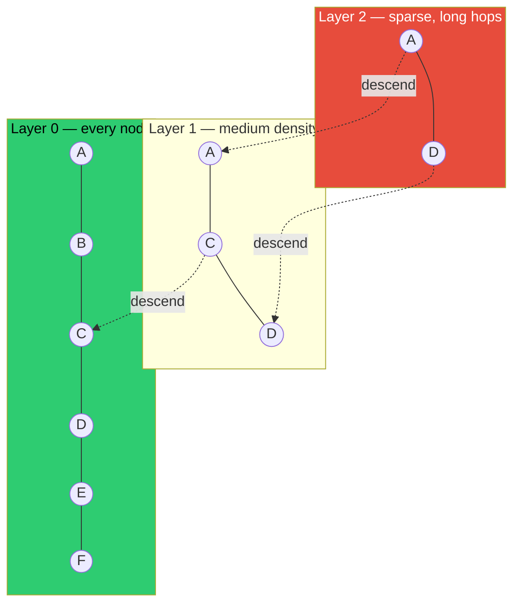
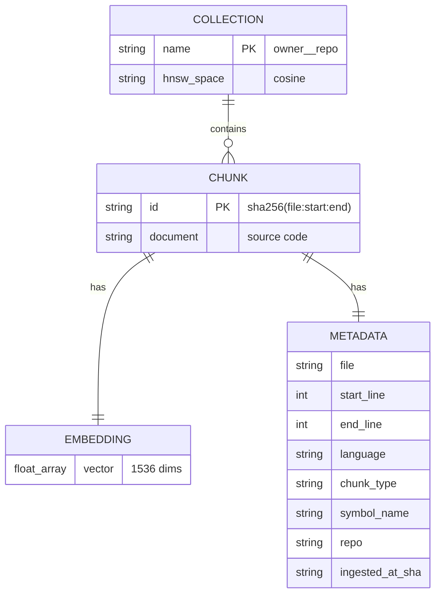
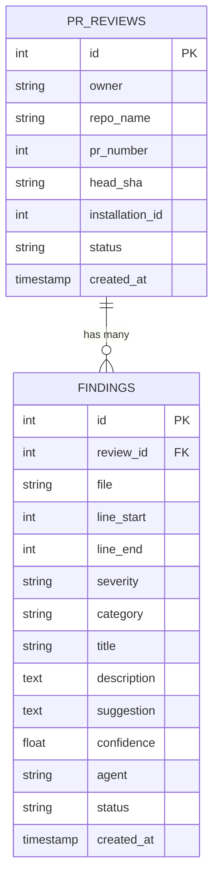
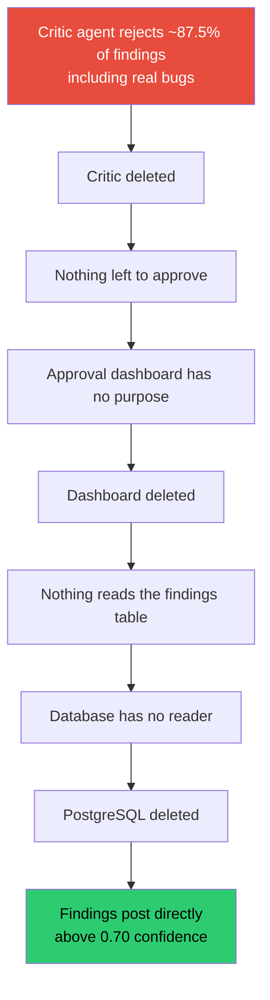
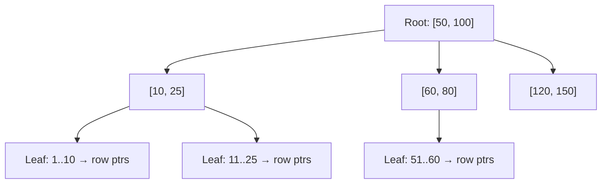
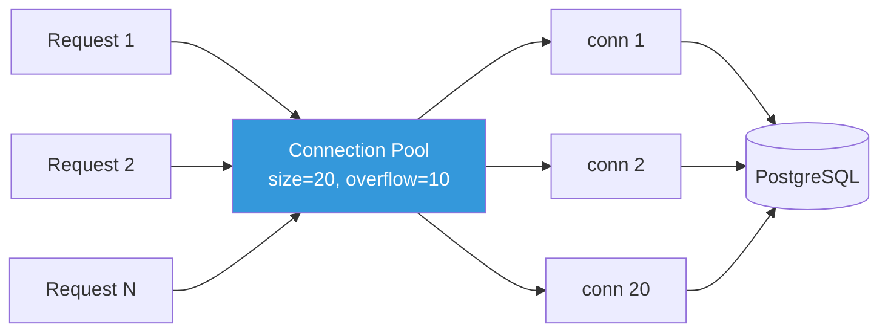

# 04 — Database Design

## Executive Summary

**This project has no relational database.** Its only datastore is **ChromaDB**, an embedded vector database holding code embeddings for retrieval. A PostgreSQL findings store was built and then deleted in commit `a61bfd2`; `backend/alembic/` is its only remaining trace and is not wired into the application.

This file has three parts:

1. **Part A — The real datastore**: ChromaDB schema, indexing (HNSW), query patterns, and its actual limitations.
2. **Part B — The deleted database**: what it was, why it went, and how to talk about it.
3. **Part C — Relational theory**: normalization, indexes, transactions, isolation levels, locks, connection pooling, N+1, SQL injection. **You will be asked these regardless of whether your project used them.** This section teaches them properly, using this project's domain for examples.

---

# PART A — ChromaDB: The Actual Datastore

## A1. What is a vector database?

### Beginner

A normal database finds things by **exact match**: `WHERE name = 'login'`. A vector database finds things by **meaning**: "code that looks like this code".

It works by turning text into a list of numbers (a **vector** / **embedding**) that captures meaning. Similar meanings produce vectors that point in similar directions.

```
"def authenticate(user, password)"  → [0.021, -0.443, 0.881, ... ]  (1536 numbers)
"def login(username, pwd)"          → [0.019, -0.451, 0.877, ... ]  ← very close
"def calculate_shipping_cost(kg)"   → [0.812,  0.114, -0.223, ... ] ← far away
```

### Intermediate — cosine similarity

This project uses **cosine similarity**, configured in `store.py:22` as `metadata={"hnsw:space": "cosine"}`.

Cosine similarity measures the **angle** between two vectors, ignoring their magnitude:

$$\text{similarity}(A,B) = \cos\theta = \frac{A \cdot B}{\|A\| \|B\|} = \frac{\sum_{i=1}^{n} A_i B_i}{\sqrt{\sum A_i^2}\sqrt{\sum B_i^2}}$$

| Value | Meaning |
|---|---|
| `1.0` | Identical direction — same meaning |
| `0.0` | Orthogonal — unrelated |
| `-1.0` | Opposite direction |

**Why cosine and not Euclidean distance?** Because magnitude in text embeddings largely encodes *length*, not *meaning*. A 5-line function and a 50-line function doing the same thing have vectors pointing the same direction but with different magnitudes. Euclidean distance would call them dissimilar; cosine correctly calls them similar.

| Metric | Measures | Sensitive to length? | Use when |
|---|---|---|---|
| **Cosine** | Angle | ❌ No | **Text/code embeddings** ✅ |
| Euclidean (L2) | Straight-line distance | ✅ Yes | Coordinates, images |
| Dot product | Angle × magnitude | ✅ Yes | Pre-normalised vectors (fastest) |

**Interview note:** OpenAI's embeddings are already L2-normalised, which means cosine and dot product give identical *rankings*. Choosing cosine is still correct and self-documenting.

### Advanced — HNSW indexing

With 50,000 chunks, comparing a query against every vector (**brute force / flat index**) is O(n) — 50,000 × 1536 multiply-adds per query. Too slow when you do it 60 times per PR.

ChromaDB uses **HNSW (Hierarchical Navigable Small World)**, an approximate nearest-neighbour index.



**The mental model:** it's a skip list in high-dimensional space. Start at the top layer where nodes are sparse and edges span long distances — get roughly into the right region in a few hops. Descend a layer, refine. Repeat until layer 0, where you do fine-grained local search.

| Property | Brute force | HNSW |
|---|---|---|
| Query complexity | O(n) | **O(log n)** |
| Build complexity | O(1) | O(n log n) |
| Memory | Vectors only | Vectors + graph edges (~1.5×) |
| Accuracy | 100% exact | ~95–99% approximate |

**The trade-off is recall for speed.** HNSW might miss the true 5th-nearest neighbour and return the 6th. For code review context retrieval that is completely acceptable — "five reasonably relevant chunks" is as useful as "the five most relevant chunks."

**Interview gold:** knowing that vector search is *approximate* and being able to say why that's acceptable for your use case (and when it wouldn't be — e.g. deduplication or exact-match compliance search) is a strong signal.

---

## A2. The Schema

There is no SQL DDL. The "schema" is the structure of each ChromaDB record, defined in `store.py:49`.

### Collection naming

```python
collection_name = f"{owner}__{repo_name}"     # e.g. "Sujeethh03__pr-review-agent-demo"
```

**One collection per repository.** The double underscore avoids collision with the single underscore GitHub allows in repo names.

**Why per-repo isolation?**

| Benefit | Explanation |
|---|---|
| **Correctness** | The pattern agent must compare against *this* repo's conventions. Cross-repo contamination would suggest another project's style. |
| **Security** | Hard tenancy boundary. Repo A's code can never leak into repo B's prompts. |
| **Performance** | Smaller index = faster HNSW traversal. |
| **Lifecycle** | Drop one collection to reset one repo. |

**The alternative** — one collection with a `repo` metadata filter — would work but relies on *every* query remembering the filter. One forgotten `where` clause becomes a cross-tenant data leak. Physical separation makes that class of bug impossible.

### Record structure

| Field | Type | Example | Purpose |
|---|---|---|---|
| `id` | string (64 hex) | `a3f5b8...` | `sha256(f"{file}:{start}:{end}")` — idempotent upsert |
| `document` | string | `def login(user):\n...` | Raw source, returned to the prompt |
| `embedding` | float[1536] | `[0.021, -0.443, ...]` | The searchable vector |
| `metadata.file` | string | `src/auth.py` | Repo-relative path |
| `metadata.start_line` | int | `10` | 1-indexed |
| `metadata.end_line` | int | `25` | 1-indexed |
| `metadata.language` | string | `python` | From extension map |
| `metadata.chunk_type` | string | `function` | function/class/method/window |
| `metadata.symbol_name` | string | `login` | `""` if unextractable |
| `metadata.repo` | string | `owner/repo` | Redundant with collection, useful for debugging |
| `metadata.ingested_at_sha` | string | `a1b2c3d...` | Provenance — which commit produced this |

### "ER diagram" for a vector store



**Note the shape:** this is effectively a single denormalised table. There are no joins, no foreign keys, no referential integrity. That's typical of vector stores — they optimise for one operation (similarity search with metadata filtering) rather than relational flexibility.

---

## A3. Query Patterns

### The only read query

```python
results = collection.query(
    query_embeddings=[query_vector],       # the hunk's embedding
    n_results=n_results,                   # 5 for bug/security, 10 for pattern
    include=["documents", "metadatas"],    # not embeddings — saves bandwidth
)
```

**`include` matters.** By default ChromaDB would return the 1536-float embeddings too. We never use them — we only need the code text and its location. Excluding them cuts response payload dramatically (1536 floats × 5 results × 60 queries per PR is a lot of wasted serialisation).

### The post-query self-match filter

```python
if (meta.get("file") == hunk.file
    and meta.get("start_line", 0) <= hunk.line_end
    and meta.get("end_line", 0) >= hunk.line_start):
    continue        # skip — this chunk IS the code we're reviewing
```

**Why this is essential.** The index contains the *pre-change* version of the file being reviewed. Semantically, the nearest neighbour of a modified function is almost always its own previous version. Without this filter, the agent's "context" would be the code it's already looking at, and the pattern agent — whose entire purpose is comparison against *other* code — would find nothing.

**Note it's an interval-overlap test**, the same `a1 <= b2 and a2 >= b1` pattern as the bug agent's dedup.

**A subtle cost:** the filter runs *after* retrieval, so if 3 of 5 results are self-matches you're left with 2 chunks of context. A more robust design would over-fetch (`n_results=10`, filter, take top 5) or push the exclusion into ChromaDB's `where` clause. Worth mentioning as a refinement.

### The write path

```python
collection.upsert(ids=ids, documents=documents,
                  embeddings=embeddings, metadatas=metadatas)
```

**Upsert, not insert** — deterministic IDs mean re-ingesting the same chunk overwrites rather than duplicates. This is what makes ingestion idempotent and safely re-runnable.

### The delete path

```python
def delete_chunks_for_files(collection, file_rel_paths):
    for file_path in file_rel_paths:
        collection.delete(where={"file": file_path})
```

⚠️ **Two issues here.**

**1. N+1 query pattern.** One delete call per file. A PR deleting 50 files makes 50 round trips. ChromaDB supports `$in`:
```python
collection.delete(where={"file": {"$in": file_rel_paths}})   # one call
```
This is a textbook N+1 — and having a *real* N+1 in your own code to discuss is far better than reciting the definition. See Part C.

**2. It's only called for deleted files** — the stale-chunk bug documented in [03-Low-Level-Design.md](03-Low-Level-Design.md). Modified files are upserted over, orphaning chunks whose line ranges shifted.

---

## A4. Indexes in this system

| "Index" | Type | What it accelerates |
|---|---|---|
| HNSW graph | Approximate NN | The similarity search itself |
| Metadata index | Key-value | `where={"file": ...}` filters |
| ID index | Hash | Upsert collision detection |

**Analogy to relational indexes:** HNSW is to vector search what a B-tree is to `WHERE age > 30`. Both convert an O(n) scan into O(log n) traversal by pre-building a navigable structure. The difference: a B-tree gives exact answers, HNSW gives approximate ones — because exact nearest-neighbour search in 1536 dimensions is subject to the *curse of dimensionality* and provably degenerates to brute force.

**The curse of dimensionality, briefly:** as dimensions increase, all points become roughly equidistant from each other, and space-partitioning structures (KD-trees, R-trees) stop pruning effectively. This is why high-dimensional search abandoned exactness and moved to graph-based approximations like HNSW.

---

## A5. Real Limitations of the Current Setup

| Limitation | Impact | Fix |
|---|---|---|
| **Ephemeral storage** (`/tmp/chromadb`) | Wiped on every Railway deploy → silent full re-ingest, unbudgeted cost | Mount a Railway volume, set `CHROMADB_PATH` |
| **Embedded, not shared** | Two app instances = two divergent indexes | Chroma server mode, or pgvector/Pinecone |
| **Stale chunks accumulate** | Index pollutes with phantom code | Delete-before-insert on modified files |
| **No rename handling** | Old path's vectors orphaned forever | Parse `rename from/to` in diff |
| **Unbounded growth** | No TTL, no compaction | Periodic rebuild or `ingested_at_sha` pruning |
| **Sync client in async code** | `collection.query()` blocks the event loop | `asyncio.to_thread` or async client |
| **N+1 deletes** | 50 round trips for 50 files | `$in` operator |

**The ephemeral-storage point is the most important and the most interview-relevant.** Say it like this:

> My vector store lives at `/tmp/chromadb` on Railway, and Railway's filesystem is ephemeral. So every deploy silently wipes the index. Functionally it still works — the next PR just sees an empty collection and does a full ingest instead of an incremental one. But it means my "incremental ingestion" optimisation is defeated at unpredictable intervals, and I'm paying full embedding cost for repos I've already indexed. The fix is a mounted volume; I've kept `CHROMADB_PATH` configurable specifically so that's a config change, not a code change.

---

# PART B — The Deleted PostgreSQL Layer

## B1. What existed

From `git show a61bfd2 --stat`, these files were deleted:

```
backend/app/db/connection.py      -22 lines    SQLAlchemy engine + session
backend/app/db/models.py          -56 lines    ORM models
backend/app/db/findings_repo.py  -221 lines    Repository pattern
backend/app/api/findings.py      -120 lines    REST endpoints for the dashboard
```

Plus `backend/alembic/` — still present, still dead. Its four migrations tell the schema's story:

| Migration | What it did |
|---|---|
| `eafd158f8628_create_tables` | Initial `pr_reviews` + `findings` |
| `56d198f22187_add_installation_id_to_pr_reviews` | Needed installation ID to post comments later |
| `e6cb41cac4c4_drop_critic_columns` | **The critic's death, recorded in schema** |
| `e5f2bb331013_composite_unique_review_finding` | Unique constraint to stop duplicate findings |

**That migration history is a gift in interviews.** It's documentary evidence of schema evolution driven by real problems.

## B2. The reconstructed schema



**The composite unique constraint** added in `e5f2bb331013` would have been something like:

```sql
ALTER TABLE findings
ADD CONSTRAINT uq_review_finding
UNIQUE (review_id, file, line_start, category);
```

**Why it was needed:** on `synchronize` events the pipeline re-runs and re-inserts the same findings. Without the constraint you accumulate duplicates. This is **enforcing idempotency at the database layer** — a genuinely good pattern, and exactly the mechanism the current codebase reimplements in Python via `_chunk_id` and `all_findings()`.

**Great interview line:** *"When I removed the database, I didn't remove the need for idempotency — I moved it into application code. Deterministic chunk IDs replaced the unique constraint. Same invariant, different enforcement layer, and honestly the database was doing it more reliably."*

## B3. Why it was deleted



**The causal chain matters.** The database wasn't deleted because databases are bad — it was deleted because it had exactly one consumer, and that consumer's purpose evaporated. A datastore with no reader is pure liability: migrations to maintain, connections to pool, backups to run, and a failure mode that can take down your service.

## B4. How to answer "why don't you have a database?"

**Beginner:** The system doesn't need to store anything permanently — findings go straight to GitHub.

**Intermediate:** GitHub *is* my persistence layer. Every finding lives as a PR comment, durably stored, versioned, searchable, with GitHub's own permissions and retention. Duplicating that into my own Postgres would mean maintaining a second copy of data I don't own, with no consumer reading it.

**Advanced:**
> I did have one — SQLAlchemy, PostgreSQL, Alembic migrations, a repository layer, and REST endpoints. I deleted it, and the reasoning is a chain.
>
> The database's only consumer was an approval dashboard. The dashboard's only purpose was letting a human approve findings before posting. That workflow existed because I had a critic agent whose confidence I didn't trust. When I measured the critic and found it rejecting about 87.5% of findings including true positives, I removed it — and the whole downstream chain lost its reason to exist.
>
> What replaced it is a 0.70 confidence threshold, one line in `main.py`. Findings go straight to GitHub.
>
> The trade-off I accepted is real: I lost historical analytics. I can't answer "what's our most common finding category across all repos" or "is our false-positive rate improving." If I wanted those, the database comes back — but as an *analytics sink* written asynchronously off the hot path, not as a *blocking approval queue* in the critical path. That's a completely different architectural role for the same technology.
>
> The general principle: a datastore with no reader is a liability, not an asset. It has operational cost, failure modes, and migration burden, and it returns nothing.

**Why this scores at senior level:** it reframes "no database" from a gap into a decision, shows measurement-driven reasoning, names the cost honestly, and demonstrates that you understand *the same technology serves different architectural roles*.

---

# PART C — Relational Database Theory

> **📚 THEORY.** This project doesn't currently use a relational database. Do **not** claim you built these. But you *will* be asked about them — the deleted schema gives you legitimate ground to discuss them from.

## C1. Normalization

Normalization eliminates redundancy so that each fact is stored exactly once.

### The un-normalized starting point

```
| pr_id | repo        | owner     | finding_title      | agent | agent_desc          |
|-------|-------------|-----------|--------------------|-------|---------------------|
| 7     | demo-repo   | Sujeethh03| Infinite loop      | bug   | Finds logic errors  |
| 7     | demo-repo   | Sujeethh03| SQL injection      | sec   | Finds vulns         |
| 7     | demo-repo   | Sujeethh03| Naming mismatch    | bug   | Finds logic errors  |
```

Problems: `demo-repo`/`Sujeethh03` repeat per row; `agent_desc` repeats per agent. Renaming the repo requires updating every row (**update anomaly**); deleting the last finding loses the PR (**delete anomaly**); you can't record a PR with no findings (**insert anomaly**).

### 1NF — atomic values, no repeating groups

```
❌ | finding_id | affected_lines        |
   | 1          | "10,11,12,15"         |   ← multiple values in one cell

✅ | finding_id | line_start | line_end |
   | 1          | 10         | 15       |
```

### 2NF — 1NF + no partial dependency on part of a composite key

If PK is `(review_id, finding_id)` and `repo_name` depends only on `review_id`, that's a partial dependency. Split it out.

### 3NF — 2NF + no transitive dependency

```
❌ findings(id, agent, agent_description)
        agent_description depends on agent, which depends on id → transitive

✅ findings(id, agent_id FK)
   agents(id, name, description)
```

### BCNF — every determinant is a candidate key

A stricter 3NF. Rarely a practical concern beyond 3NF for most applications.

### The normalized design

```sql
CREATE TABLE repositories (
    id            SERIAL PRIMARY KEY,
    owner         VARCHAR(100) NOT NULL,
    name          VARCHAR(100) NOT NULL,
    installation_id INTEGER NOT NULL,
    CONSTRAINT uq_repo UNIQUE (owner, name)
);

CREATE TABLE pr_reviews (
    id            SERIAL PRIMARY KEY,
    repository_id INTEGER NOT NULL REFERENCES repositories(id) ON DELETE CASCADE,
    pr_number     INTEGER NOT NULL,
    head_sha      CHAR(40) NOT NULL,
    status        VARCHAR(20) NOT NULL DEFAULT 'pending',
    created_at    TIMESTAMPTZ NOT NULL DEFAULT NOW(),
    CONSTRAINT uq_review UNIQUE (repository_id, pr_number, head_sha),
    CONSTRAINT ck_status CHECK (status IN ('pending','running','completed','failed'))
);

CREATE TABLE findings (
    id            SERIAL PRIMARY KEY,
    review_id     INTEGER NOT NULL REFERENCES pr_reviews(id) ON DELETE CASCADE,
    file          VARCHAR(500) NOT NULL,
    line_start    INTEGER NOT NULL,
    line_end      INTEGER NOT NULL,
    severity      VARCHAR(10) NOT NULL,
    category      VARCHAR(50) NOT NULL,
    title         VARCHAR(200) NOT NULL,
    description   TEXT NOT NULL,
    suggestion    TEXT,
    confidence    NUMERIC(3,2) NOT NULL,
    agent         VARCHAR(20) NOT NULL,
    created_at    TIMESTAMPTZ NOT NULL DEFAULT NOW(),
    CONSTRAINT ck_severity   CHECK (severity IN ('high','medium','low')),
    CONSTRAINT ck_confidence CHECK (confidence >= 0 AND confidence <= 1),
    CONSTRAINT ck_lines      CHECK (line_end >= line_start),
    CONSTRAINT uq_finding    UNIQUE (review_id, file, line_start, category)
);
```

**Note `ck_confidence`** — the exact bound missing from the Pydantic model. A nice demonstration that constraints belong at every layer.

### When to denormalize

| Denormalize when | Example |
|---|---|
| Read:write ratio is very high | Store `finding_count` on `pr_reviews` |
| Joins dominate query cost | Duplicate `repo_name` onto `findings` |
| Analytics workload | Star schema with wide fact tables |

**The rule:** *Normalize until it hurts, denormalize until it works.*

---

## C2. Indexes

### How a B-tree index works



Balanced tree, sorted keys, all leaves at equal depth. Lookup is O(log n) — a table with 1 million rows needs ~20 comparisons instead of 1 million.

### Index types

| Type | Structure | Best for | Postgres syntax |
|---|---|---|---|
| **B-tree** | Balanced tree | `=`, `<`, `>`, `BETWEEN`, `ORDER BY`, prefix `LIKE 'abc%'` | default |
| **Hash** | Hash table | `=` only | `USING HASH` |
| **GIN** | Inverted index | JSONB, arrays, full-text | `USING GIN` |
| **GiST** | Generalised search tree | Geometric, ranges | `USING GIST` |
| **BRIN** | Block range | Huge naturally-ordered tables | `USING BRIN` |
| **HNSW** | Proximity graph | **Vector similarity** ← this project | pgvector |

### Indexes for this schema

```sql
-- Foreign keys: Postgres does NOT auto-index these
CREATE INDEX idx_findings_review    ON findings(review_id);
CREATE INDEX idx_reviews_repository ON pr_reviews(repository_id);

-- Common filter: high-severity findings
CREATE INDEX idx_findings_severity  ON findings(severity)
    WHERE severity IN ('high','medium');   -- partial index: smaller, faster

-- Composite for "recent reviews of this repo"
CREATE INDEX idx_reviews_repo_time  ON pr_reviews(repository_id, created_at DESC);

-- Covering index — index-only scan, never touches the heap
CREATE INDEX idx_findings_summary   ON findings(review_id) INCLUDE (severity, category);
```

### The leftmost-prefix rule (very commonly asked)

For `INDEX (a, b, c)`:

| Query | Uses index? |
|---|---|
| `WHERE a = 1` | ✅ Yes |
| `WHERE a = 1 AND b = 2` | ✅ Yes |
| `WHERE a = 1 AND b = 2 AND c = 3` | ✅ Fully |
| `WHERE b = 2` | ❌ No — skips leftmost |
| `WHERE a = 1 AND c = 3` | ⚠️ Partially (a only) |

**Mental model:** a phone book sorted by (surname, firstname). You can find "all Smiths" and "Smith, John". You cannot efficiently find "everyone named John".

### When indexes hurt

| Cost | Detail |
|---|---|
| Write amplification | Every INSERT/UPDATE/DELETE updates every index |
| Storage | Often 10–30% of table size each |
| Planner confusion | Too many choices → bad plans |
| Low selectivity | Index on a boolean column is usually useless — a seq scan is cheaper |

**Rule of thumb:** an index pays off when it filters to **<10%** of rows.

---

## C3. Transactions & ACID

| Property | Meaning | Failure without it |
|---|---|---|
| **Atomicity** | All-or-nothing | Review saved, findings lost |
| **Consistency** | Constraints always hold | Finding pointing at a non-existent review |
| **Isolation** | Concurrent txns don't corrupt each other | Two pipelines double-insert |
| **Durability** | Committed = survives crash | "Saved" data vanishes on restart |

```python
# What the deleted repo layer would have looked like
async def save_review_with_findings(session, review, findings):
    async with session.begin():                  # BEGIN
        session.add(review)
        await session.flush()                    # get review.id, no commit
        for f in findings:
            session.add(Finding(review_id=review.id, **f.model_dump()))
    # COMMIT on clean exit; ROLLBACK on any exception
```

**The invariant:** you never want a `pr_reviews` row with half its findings. Either the whole review lands or none of it does.

### Isolation levels

| Level | Dirty read | Non-repeatable read | Phantom read | Cost |
|---|---|---|---|---|
| READ UNCOMMITTED | ✅ possible | ✅ | ✅ | Lowest |
| **READ COMMITTED** ← PG default | ❌ | ✅ | ✅ | Low |
| REPEATABLE READ | ❌ | ❌ | ✅* | Medium |
| SERIALIZABLE | ❌ | ❌ | ❌ | Highest |

\* Postgres's REPEATABLE READ uses snapshot isolation and actually prevents phantoms too — stricter than the SQL standard requires.

**The three anomalies, concretely:**

- **Dirty read** — you read a row another transaction wrote but hasn't committed; it then rolls back. You acted on data that never existed.
- **Non-repeatable read** — you read a row twice in one transaction and get different values, because someone committed an UPDATE in between.
- **Phantom read** — you run the same `WHERE` query twice and get different *row counts*, because someone committed an INSERT matching your predicate.

**For this project's workload**, READ COMMITTED is correct: pipelines operate on independent PRs, so contention is near zero. You'd reach for SERIALIZABLE only for something like "increment a shared per-repo review counter."

### Locks

| Lock | Blocks | Use |
|---|---|---|
| Row-level shared (`FOR SHARE`) | Writers | Read that must stay stable |
| Row-level exclusive (`FOR UPDATE`) | Readers+writers of that row | Read-modify-write |
| Table-level | Depends on mode | DDL |
| Advisory | Application-defined | **Distributed mutex** |

**Advisory locks would be genuinely useful here.** Two rapid pushes to the same PR trigger two overlapping pipelines that both post comments:

```sql
SELECT pg_try_advisory_lock(hashtext('pr-review:owner/repo:7'));
-- returns false if another worker holds it → skip this duplicate run
```

**Deadlock** — two transactions each holding what the other wants:
```
T1: lock A ─────► wants B
T2: lock B ─────► wants A      ← circular wait
```
Postgres detects the cycle and kills one. **Prevention:** always acquire locks in a consistent global order (e.g. always by ascending primary key).

---

## C4. Connection Pooling

Opening a Postgres connection costs 20–50ms (TCP + TLS + auth + backend process fork). Doing that per request is ruinous.



```python
engine = create_async_engine(
    DATABASE_URL,
    pool_size=20,          # persistent connections
    max_overflow=10,       # burst capacity
    pool_timeout=30,       # wait before erroring
    pool_recycle=1800,     # recycle at 30 min (beats idle timeouts/NAT drops)
    pool_pre_ping=True,    # validate before handing out — catches dead conns
)
```

**Sizing formula:** `pool_size ≈ (core_count × 2) + effective_spindle_count`. For most web apps, **10–20 per instance** is right. The classic mistake is setting it huge — Postgres's `max_connections` default is 100, and each connection is a forked OS process consuming memory. Ten app instances × pool_size 50 = 500 connections = server refuses new ones.

**PgBouncer** sits between app and database in transaction-pooling mode, multiplexing thousands of client connections onto a few dozen server connections. Essential above ~5 app instances.

---

## C5. The N+1 Problem

**The canonical version:**

```python
reviews = session.query(PRReview).all()          # 1 query
for review in reviews:
    print(review.findings)                        # N queries — one per review!
# 100 reviews → 101 queries
```

**Fix — eager loading:**
```python
reviews = session.query(PRReview).options(
    selectinload(PRReview.findings)               # 2 queries total
).all()
```

| Strategy | Queries | Mechanism | Best when |
|---|---|---|---|
| Lazy (default) | 1+N | Load on access | Rarely accessed relations |
| `joinedload` | 1 | LEFT JOIN | To-one relations |
| `selectinload` | 2 | `WHERE id IN (...)` | **To-many relations** |
| `subqueryload` | 2 | Subquery | Legacy alternative |

**This project's real N+1** is in `store.py:77` — one `collection.delete()` per file instead of one `$in` call. Being able to say *"I have an actual N+1 in my code, here's where and here's the fix"* is far more convincing than reciting the ORM example.

---

## C6. Query Optimization

```sql
EXPLAIN (ANALYZE, BUFFERS)
SELECT f.severity, COUNT(*)
FROM findings f
JOIN pr_reviews r ON r.id = f.review_id
WHERE r.repository_id = 42 AND f.confidence >= 0.70
GROUP BY f.severity;
```

**Reading the plan — the hierarchy of scans:**

| Node | Meaning | Good? |
|---|---|---|
| `Seq Scan` | Read every row | ❌ on big tables (fine on small ones) |
| `Index Scan` | Traverse index, fetch heap rows | ✅ |
| `Index Only Scan` | Answer entirely from index | ✅✅ Best |
| `Bitmap Heap Scan` | Index → bitmap → batched heap reads | ✅ for medium selectivity |
| `Nested Loop` | For each outer row, probe inner | ✅ small outer, indexed inner |
| `Hash Join` | Build hash of one side | ✅ large unsorted sets |
| `Merge Join` | Both sides sorted | ✅ pre-sorted / indexed |

**Watch for:** `rows=1000` (estimate) vs `actual rows=1000000` — a huge gap means stale statistics. Run `ANALYZE`.

**Optimization checklist:**
1. Index the columns in `WHERE`, `JOIN`, `ORDER BY`
2. `SELECT` only needed columns — enables index-only scans
3. Keyset pagination (`WHERE id > ?`) instead of `OFFSET` — `OFFSET 100000` still scans 100,000 rows
4. Avoid functions on indexed columns: `WHERE DATE(created_at) = ...` kills the index; use a range instead, or build an expression index
5. `ANALYZE` after bulk loads

---

## C7. SQL vs NoSQL vs Vector

| | SQL | Document (Mongo) | Vector (Chroma) |
|---|---|---|---|
| Model | Tables, rows | JSON documents | Vectors + metadata |
| Schema | Rigid, enforced | Flexible | Fixed dims |
| Query | SQL, joins | Query DSL, `$lookup` | Similarity search |
| Consistency | Strong (ACID) | Tunable | Eventual |
| Scaling | Vertical, then read replicas | Horizontal (sharding) | Horizontal |
| Best for | Relations, transactions | Varying shape, hierarchies | **Semantic search** |
| Weakness | Horizontal scaling is hard | No cross-doc transactions historically | Can't do exact/relational queries |

**Why this project uses a vector DB:** its single query is *"find code semantically similar to this diff hunk."* SQL cannot express that. `LIKE '%login%'` matches strings, not meaning. Even full-text search matches tokens, not semantics — it would never connect `authenticate()` to `verify_credentials()`.

**Modern nuance worth knowing:** with **pgvector**, PostgreSQL does both. You could store findings relationally *and* embeddings with an HNSW index in one database, gaining transactions and joins over your vectors. If I were rebuilding this to need history and analytics, pgvector would be my choice — one database instead of two.

---

## C8. MongoDB Equivalent

> 📚 Theory — for interviews that assume Mongo.

```javascript
db.findings.insertOne({
  reviewId: ObjectId("..."),
  file: "src/auth.py",
  lineStart: 42, lineEnd: 45,
  severity: "high", category: "sql_injection",
  confidence: 0.95, agent: "security",
  createdAt: new Date()
});

// Compound index — same leftmost-prefix rule as SQL
db.findings.createIndex({ reviewId: 1, severity: 1 });

// Aggregation: severity breakdown per repo
db.findings.aggregate([
  { $match: { confidence: { $gte: 0.70 } } },
  { $lookup: { from: "pr_reviews", localField: "reviewId",
               foreignField: "_id", as: "review" } },
  { $unwind: "$review" },
  { $group: { _id: { repo: "$review.repoName", sev: "$severity" },
              count: { $sum: 1 } } },
  { $sort: { count: -1 } }
]);
```

**Embed vs reference:** embed findings inside the review document if they're always read together and bounded in size (Mongo's 16 MB document limit); reference them if findings are queried independently or unbounded. Here, findings are read with their review and bounded — **embedding would be the better Mongo design.**

---

## C9. Interview Questions

### Q1. "Explain your database schema."

**Best answer:**
> The honest answer is I don't have a relational schema — my only datastore is a vector database, and I can explain both that and the relational one I deleted.
>
> ChromaDB holds one collection per repository, named `owner__repo`. Each record is a code chunk: an ID that's the SHA-256 of file-plus-line-range, the raw source text, a 1536-dimension embedding from `text-embedding-3-small`, and metadata — file path, start and end line, language, chunk type, symbol name, and the commit SHA it was ingested at. The index is HNSW with cosine distance.
>
> Three design points. The ID is content-addressed so re-ingestion upserts rather than duplicates — that's idempotency. Cosine rather than Euclidean because embedding magnitude tracks text length, not meaning, and I want a 5-line and 50-line function doing the same thing to be similar. And per-repo collections rather than one collection with a filter, because physical isolation makes cross-repo context leakage structurally impossible rather than dependent on remembering a `where` clause.
>
> I did previously have PostgreSQL — `pr_reviews` one-to-many `findings`, with a composite unique constraint on review-file-line-category to make re-runs idempotent. I deleted it when the dashboard it served was removed. The Alembic migrations are still in the repo as dead code; one of them is literally called `drop_critic_columns`, which is the history of that decision written into the schema.

---

### Q2. "How would you add analytics without hurting performance?"

**Best answer:**
> I'd reintroduce PostgreSQL, but in a completely different architectural role than before. Previously it was a *blocking* store in the critical path — findings went in, a human approved, then they posted. That coupling is what made it a liability.
>
> As an analytics sink it's write-only and off the hot path: after posting to GitHub, fire an async insert of the findings and pipeline metrics. If that write fails, the review has already shipped — I log it and move on. The database becoming unavailable degrades analytics, never reviews.
>
> Schema-wise: `repositories` → `pr_reviews` → `findings`, third normal form, with a composite unique on `(review_id, file, line_start, category)` for idempotency on redelivery. Indexes on the foreign keys, plus a partial index on high-severity findings since that's the common filter.
>
> For scale, findings are naturally time-series, so I'd partition by month — `PARTITION BY RANGE (created_at)`. Old partitions detach and archive cheaply, and queries with a date filter prune to one partition.
>
> The queries I'd want: false-positive rate by category, which would need feedback — I could infer it from whether the developer resolved the comment or dismissed it. That's the metric I most lack right now, because without a labelled dataset I can't measure precision at all.

**What's evaluated:** Can you distinguish architectural *roles* for the same technology? Do you think about failure isolation?

---

### Q3. "What's the difference between a vector database and a regular one?"

**Beginner:** A regular database finds exact matches; a vector database finds things that are similar in meaning.

**Intermediate:** Relational databases index scalar values in B-trees for exact and range queries. Vector databases store high-dimensional embeddings and index them with approximate-nearest-neighbour structures like HNSW, answering "what's closest to this point in embedding space." Different index, different question.

**Advanced:**
> The fundamental difference is that vector search is **approximate by necessity**, not by choice.
>
> In low dimensions you can partition space exactly — KD-trees, R-trees. In 1536 dimensions the curse of dimensionality kicks in: distances concentrate, nearly all points become roughly equidistant, and space-partitioning stops pruning anything. Exact nearest-neighbour search degenerates to a full scan.
>
> So the field moved to graph-based approximation. HNSW builds a multi-layer proximity graph — conceptually a skip list in metric space — giving roughly O(log n) search at maybe 95–99% recall. You explicitly trade exactness for speed.
>
> For my use case that trade is free. If HNSW returns the 6th-nearest chunk instead of the 5th, my agent gets a slightly different but still relevant piece of context. Nobody notices. But that trade would be unacceptable for, say, exact-duplicate detection or a compliance search where missing one record is a legal problem.
>
> The line is blurring, though — pgvector gives Postgres HNSW indexes, so you can have ACID transactions, joins, and vector search in one system. If I rebuilt this with an analytics requirement, I'd use pgvector and run one database instead of two.

**Follow-ups:** "What's the recall/latency knob?" (`ef_search` — higher means more graph exploration, better recall, slower.) · "How do you handle updates?" (HNSW handles inserts well; deletes are usually tombstoned and reclaimed on rebuild — which is precisely why my stale-chunk bug matters.)

---

### Q4. "Explain ACID with an example from your system."

**Best answer:**
> When I had the database, the operation that needed ACID was saving a review with its findings.
>
> **Atomicity** — a review and its ten findings insert as one unit. Without it, a crash after inserting the review but before the findings leaves an empty review that looks like "we reviewed this and found nothing," which is actively misleading.
>
> **Consistency** — a foreign key from findings to reviews means you can never have a finding pointing at a review that doesn't exist, and my check constraint on confidence between 0 and 1 means the LLM can't write a nonsense value. Notably my current Pydantic model *lacks* that bound, so the database was enforcing an invariant my application code doesn't.
>
> **Isolation** — two rapid pushes to the same PR spawn two overlapping pipelines. At READ COMMITTED they can't see each other's uncommitted rows, and the composite unique constraint makes the second insert fail cleanly rather than duplicating.
>
> **Durability** — once committed, a WAL flush means it survives a crash.
>
> What's interesting is what happened when I removed the database: the *need* for these guarantees didn't disappear, I just moved enforcement into application code. Deterministic chunk IDs replaced the unique constraint for idempotency. But I lost atomicity entirely — if my pipeline crashes halfway through posting ten comments, five are on GitHub and five aren't, and there's no rollback. GitHub's API has no transaction. That's a real regression I accepted knowingly.

**Why this scores well:** it applies ACID to a concrete case, notices the constraint that application code lost, and honestly names a regression rather than presenting the removal as pure win.

---

## C10. Common Mistakes

| Mistake | Consequence | Fix |
|---|---|---|
| No index on foreign keys | Slow joins, slow cascade deletes | Postgres doesn't auto-index FKs — do it |
| Indexing everything | Write amplification | Index for actual query patterns |
| `SELECT *` | No index-only scans, wasted I/O | Name the columns |
| `OFFSET` pagination | O(n) at deep pages | Keyset: `WHERE id > last_seen` |
| Function on indexed column | Index unusable | Range predicate or expression index |
| Huge connection pool | Postgres refuses connections | 10–20/instance + PgBouncer |
| Long-running transactions | Locks held, bloat, replication lag | Keep transactions short |
| String-concatenated SQL | **SQL injection** | Parameterised queries always |
| Storing floats for money | Rounding errors | `NUMERIC`/`DECIMAL` |
| No `ON DELETE` policy | Orphans or failed deletes | Explicit CASCADE/RESTRICT |

---

## C11. Cross-References

| Topic | File |
|---|---|
| Chunk data structures | [03-Low-Level-Design.md](03-Low-Level-Design.md) |
| Ingestion pipeline | [09-AI-System.md](09-AI-System.md) |
| SQL injection prevention | [07-Authentication-and-Security.md](07-Authentication-and-Security.md) |
| Caching and query performance | [12-Performance-Optimization.md](12-Performance-Optimization.md) |
| Sharding and replication at scale | [13-Scalability.md](13-Scalability.md) |
| Why the DB was deleted | [15-Design-Decisions.md](15-Design-Decisions.md) |

**Next:** [05-Backend-Architecture.md](05-Backend-Architecture.md)
