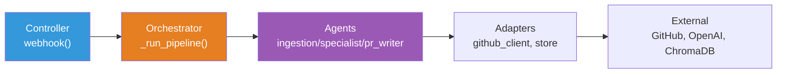
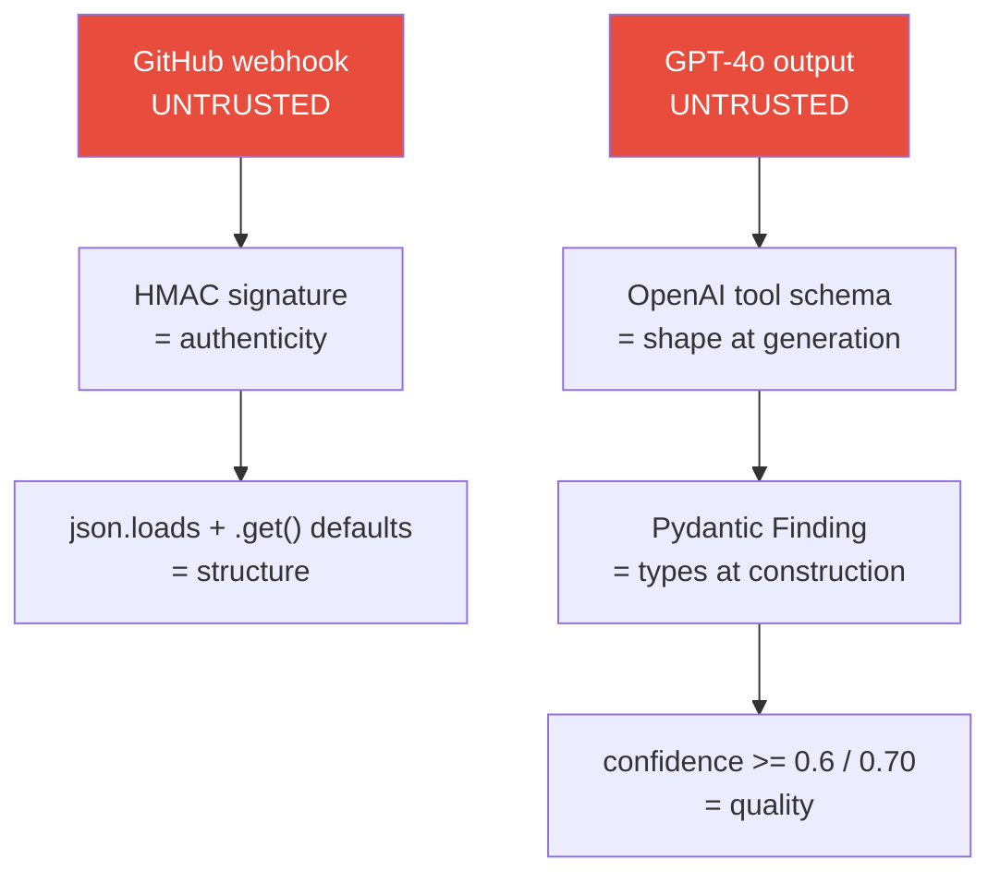

# 05 — Backend Architecture

## Executive Summary

The backend is a **single FastAPI application** — ~1,900 lines of Python across 41 files — organised as an entry point, two adapters, three agent packages, and a pure models layer. It exposes exactly **two HTTP endpoints** and does all real work asynchronously.

Notably absent, and deliberately so: no ORM, no dependency-injection container, no repository layer, no middleware stack, no service classes. This file explains what's there, what isn't, and — critically — the *names* for the patterns you did use, because interviewers ask by name.

---

## 1. Folder Structure

```
backend/
├── main.py                    # FastAPI app: webhook receiver + orchestration
├── requirements.txt
├── railway.toml               # deploy config
├── railpack.json              # build config (aptPkgs: git)
├── test_ingestion.py          # standalone script
├── test_specialist.py         # standalone script
├── alembic/                   # 🗑️ DEAD — from the removed DB layer
└── app/
    ├── github_client.py       # ADAPTER: JWT auth, token exchange, diff fetch
    ├── repo_manager.py        # ADAPTER: shallow clone
    ├── models/                # PURE DATA — depends on nothing
    │   ├── chunks.py          #   Chunk (dataclass), IngestionResult
    │   ├── findings.py        #   Finding, AgentOutput, SpecialistResult
    │   └── ingestion_config.py#   IngestionConfig
    └── agents/
        ├── ingestion/         # STAGE 1: repo → vectors
        │   ├── agent.py       #   orchestrator (full vs incremental)
        │   ├── walker.py      #   file discovery + filtering
        │   ├── parser.py      #   tree-sitter chunking
        │   ├── embedder.py    #   batched OpenAI embedding
        │   ├── store.py       #   ChromaDB operations
        │   └── diff_parser.py #   diff → changed file paths
        ├── specialist/        # STAGE 2: diff → findings
        │   ├── graph.py       #   LangGraph topology + AgentState
        │   ├── diff_utils.py  #   diff → DiffHunk objects
        │   ├── context.py     #   RAG retrieval
        │   ├── bug/           #   agent.py + prompts.py
        │   ├── security/      #   agent.py + prompts.py
        │   └── pattern/       #   agent.py + prompts.py
        └── pr_writer/         # STAGE 3: findings → GitHub
            ├── agent.py       #   posting + stale cleanup
            ├── formatter.py   #   markdown assembly
            ├── suggester.py   #   GPT-4o fix generation
            └── education.py   #   OWASP reference map
```

### The organising principle: package-by-feature, not package-by-layer

```
❌ Package-by-layer               ✅ Package-by-feature (this project)
   app/                              app/agents/
     controllers/                      ingestion/    ← everything ingestion needs
       ingestion_controller.py         specialist/   ← everything analysis needs
       specialist_controller.py        pr_writer/    ← everything posting needs
     services/
       ingestion_service.py
       specialist_service.py
     repositories/
       chunk_repository.py
```

**Why feature-first wins here:** a change to how chunking works touches only `ingestion/`. In the layered version it touches `controllers/`, `services/`, and `repositories/` — three directories for one logical change. Feature packages give **high cohesion, low coupling**: things that change together live together.

**The consistent internal pattern** — each agent package has an orchestrator (`agent.py`) plus focused single-responsibility modules. `ingestion/` is textbook:

| Module | Single responsibility |
|---|---|
| `walker.py` | *Which* files? |
| `parser.py` | *How* to split them? |
| `embedder.py` | *How* to vectorise? |
| `store.py` | *Where* to persist? |
| `agent.py` | *In what order?* |

Each is independently testable. You can test the walker with a temp directory and zero API calls.

---

## 2. FastAPI Fundamentals

### Beginner — why FastAPI?

| Feature | FastAPI | Flask | Django |
|---|---|---|---|
| Async native | ✅ ASGI | ⚠️ Bolted on | ⚠️ Partial |
| Auto validation | ✅ Pydantic | ❌ Manual | ✅ Forms/DRF |
| Auto docs | ✅ OpenAPI/Swagger | ❌ Extension | ⚠️ DRF only |
| Type hints drive behaviour | ✅ | ❌ | ❌ |
| Performance | Very high | Medium | Medium |
| Batteries included | Minimal | Minimal | Everything |

**The choice for this project:** the workload is I/O-bound (GitHub API, OpenAI API, network) with zero HTML rendering and no user model. FastAPI's async-native design is exactly right; Django's ORM, admin, templates, and auth would all be dead weight.

### Intermediate — ASGI vs WSGI

```
WSGI (Flask, old Django)          ASGI (FastAPI)
─────────────────────────         ────────────────────────
1 request = 1 worker blocked      1 worker = many concurrent requests
Waiting on I/O = worker idle      Waiting on I/O = worker serves others
No WebSockets                     WebSockets, SSE, HTTP/2
Sync only                         Sync + async
```

For a request spending 95% of its time waiting on OpenAI, WSGI would need one worker *per in-flight request*. ASGI needs one worker for hundreds.

### Advanced — the `def` vs `async def` trap

This is the single most important FastAPI performance concept and a very common interview question.

```python
@app.get("/a")
async def handler_a():
    time.sleep(5)              # ❌ BLOCKS THE ENTIRE EVENT LOOP
                               #    every other request freezes for 5s

@app.get("/b")
async def handler_b():
    await asyncio.sleep(5)     # ✅ yields; other requests proceed

@app.get("/c")
def handler_c():
    time.sleep(5)              # ✅ SAFE — FastAPI runs plain `def`
                               #    handlers in a threadpool automatically
```

**The counterintuitive rule:** if you must call blocking code, a plain `def` handler is *safer* than an `async def` one, because FastAPI offloads sync handlers to a thread pool. Putting blocking code inside `async def` is the dangerous combination.

**Where this project applies the correct pattern** — `ingestion/agent.py:28`:

```python
async def run_ingestion(...) -> IngestionResult:
    return await asyncio.to_thread(
        _run_ingestion_sync, diff, repo_path, owner, repo_name, head_sha, config,
    )
```

ChromaDB's client and the sync `OpenAI` client used by the embedder are both blocking. Rather than pretending otherwise, ingestion is written as a **sync function explicitly pushed to a worker thread**. The event loop stays free.

**Say this in an interview:** *"I have one deliberately synchronous module. ChromaDB's Python client is blocking, so instead of wrapping it in `async def` and lying to the event loop, I wrote it as a plain sync function and called it through `asyncio.to_thread`. That's honest about what it is and keeps the loop free."*

---

## 3. The Two Endpoints

### `POST /webhook`

```python
@app.post("/webhook")
async def webhook(request: Request):
    payload_body = await request.body()                          # ①
    signature_header = request.headers.get("X-Hub-Signature-256", "")

    if not verify_signature(payload_body, signature_header):     # ②
        raise HTTPException(status_code=401, detail="Invalid signature")

    payload = json.loads(payload_body)                           # ③
    event_type = request.headers.get("X-GitHub-Event", "unknown")

    if event_type in (...):                                      # ④ loop guard
        return {"status": "ok", "event": event_type}

    elif event_type == "pull_request":
        ...
        if action in ("opened", "synchronize") and installation_id and head_sha:
            asyncio.create_task(                                 # ⑤
                _safe_run_pipeline(owner, repo_name, number, installation_id, head_sha)
            )
    return {"status": "ok", "event": event_type}                 # ⑥
```

**① `await request.body()` — raw bytes, not a parsed model.**

This is the one place where **not** using a Pydantic request model is correct. HMAC must be computed over the **exact bytes GitHub sent**. If you let FastAPI parse JSON into a model, you lose the original byte sequence — re-serialising produces different whitespace and key ordering, and the signature will never match.

**This is a genuinely good interview point:** *"I deliberately bypassed FastAPI's automatic validation on my only real endpoint, because signature verification requires the raw bytes. Parsing first and re-serialising to verify would break the HMAC. Validation happens after verification, not before."*

**② Verification before anything else.** Nothing is parsed, logged, or acted on until authenticity is proven. Correct security ordering.

**③ Manual `json.loads`** — only after verification.

**④ The feedback-loop guard.** Ignoring `pull_request_review` and `pull_request_review_comment` prevents infinite recursion: bot posts comment → GitHub fires event → pipeline runs → bot posts comment → ∞. Commit `021d87e` is literally titled *"silence review webhook feedback loop"* — this was a real bug that was hit and fixed.

**⑤ `asyncio.create_task`** — fire-and-forget. The function returns immediately.

**⑥ Always 200.** Even unhandled events return OK, because GitHub disables webhooks that persistently fail.

### `GET /` — health check

```python
@app.get("/")
async def root():
    return {"status": "code review agent is running"}
```

Referenced by `railway.toml` as `healthcheckPath = "/"`. Railway polls it; failure triggers restart.

**Weakness worth naming:** this is a *liveness* check (is the process up?), not a *readiness* check (can it do work?). It returns 200 even if `OPENAI_API_KEY` is invalid or ChromaDB is corrupted. A better version would verify dependencies:

```python
@app.get("/health")
async def health():
    checks = {
        "openai":   await _ping_openai(),
        "chromadb": _chroma_reachable(),
        "github":   bool(os.getenv("GITHUB_APP_ID")),
    }
    ok = all(checks.values())
    return JSONResponse(
        {"status": "healthy" if ok else "degraded", "checks": checks},
        status_code=200 if ok else 503,
    )
```

---

## 4. Dependency Injection

> **Status: mostly NOT used.** This project uses module-level singletons instead. Know both, and know the difference.

### What FastAPI's DI looks like

```python
from fastapi import Depends

async def get_openai_client() -> AsyncOpenAI:
    return AsyncOpenAI(api_key=os.getenv("OPENAI_API_KEY"))

@app.post("/analyze")
async def analyze(client: AsyncOpenAI = Depends(get_openai_client)):
    ...
```

FastAPI resolves the dependency graph per request, caches within a request, and — crucially — lets tests override it:

```python
app.dependency_overrides[get_openai_client] = lambda: MockClient()
```

### What this project does instead

```python
_client: AsyncOpenAI | None = None

def _get_client() -> AsyncOpenAI:
    global _client
    if _client is None:
        _client = AsyncOpenAI(api_key=os.getenv("OPENAI_API_KEY"))
    return _client
```

This **lazy singleton** appears in five modules: `context.py`, `embedder.py`, `store.py`, `suggester.py`, and each specialist agent.

| | Singleton (used) | FastAPI `Depends` (not used) |
|---|---|---|
| Testability | ❌ Must monkey-patch module globals | ✅ `dependency_overrides` |
| Lifecycle control | ❌ Process-lifetime only | ✅ Per-request/scoped |
| Explicitness | ❌ Hidden dependency | ✅ Visible in signature |
| Simplicity | ✅ Three lines | ⚠️ More ceremony |
| Works outside HTTP | ✅ Yes | ❌ Only in request context |

**The honest defence — and it's a good one:**

> `Depends` only works inside a request context. My entire pipeline runs *outside* the request — it's a background task detached from the HTTP handler. So `Depends` was structurally unavailable to me for the code that matters; it could only have injected into the webhook handler, which barely needs anything.
>
> The singleton is genuinely the right pattern for the constraint: one expensive client per process, created lazily so import is cheap. The real cost isn't architectural purity — it's **testability**. To test the bug agent I'd have to monkey-patch `app.agents.specialist.bug.agent._client`, which is fragile and order-dependent.
>
> If I were refactoring, I'd introduce a small `Container` object created at startup and threaded explicitly through the pipeline functions — manual constructor injection rather than a framework. That gets me testability without pulling `Depends` into non-HTTP code.

**Why this scores well:** it identifies a *structural constraint* (background tasks aren't in request scope) rather than pleading simplicity, names the real cost (testability, not purity), and proposes a fix that fits the constraint.

---

## 5. Layered Architecture — What's There and What Isn't

### The classic layering

```
Controller  →  Service  →  Repository  →  Database
(HTTP)         (logic)     (data access)
```

### What this project actually has



| Classic layer | Present? | This project's equivalent |
|---|---|---|
| Controller | ✅ | `webhook()` — thin, verify + route + dispatch |
| Service | ✅ (unnamed) | `_run_pipeline()` — orchestration |
| Domain logic | ✅ | The agent packages |
| Repository | ⚠️ Partial | `store.py` is effectively a repository for ChromaDB |
| DTO | ✅ | Pydantic models |

**`store.py` genuinely is the Repository pattern**, even though it's not called that:

```python
def get_or_create_collection(owner, repo_name) -> Collection
def collection_has_data(collection) -> bool
def upsert_chunks(collection, embedded_chunks, head_sha, repo_full) -> int
def delete_chunks_for_files(collection, file_rel_paths) -> None
```

It's a collection-like abstraction over persistence. No caller ever touches `chromadb` directly — swapping to pgvector would mean rewriting this one file. **That's exactly what the Repository pattern buys you**, and you should name it as such in interviews.

**The `_run_pipeline` "service layer" is a function, not a class.** Defensible: it's a pure sequence with no state to hold. A class would be `class PipelineService` with one method — a function wearing a costume.

---

## 6. Validation

### Three validation boundaries



### Defensive parsing in the webhook

```python
pr              = payload.get("pull_request", {})
number          = pr.get("number")
repo            = payload.get("repository", {}).get("full_name", "unknown")
installation_id = payload.get("installation", {}).get("id")
head_sha        = pr.get("head", {}).get("sha")

if "/" not in repo:
    raise HTTPException(status_code=400, detail=f"Unexpected repo format: {repo}")
owner, repo_name = repo.split("/", 1)

if action in ("opened", "synchronize") and installation_id and head_sha:
    asyncio.create_task(...)
```

Every access uses `.get()` with a default — no `KeyError` on an unexpected payload shape. Then a **guard clause** validates the repo format, and the dispatch condition requires the two fields the pipeline cannot run without.

**`split("/", 1)` with `maxsplit=1`** is a small correctness detail: it handles the theoretical case of extra slashes without silently producing three values and raising a tuple-unpacking error.

### The double-layer LLM validation

```python
# Layer 1 — OpenAI enforces the schema at generation time
tools=[{"type":"function","function":{"name":"report_findings",
        "parameters": FINDINGS_SCHEMA}}],
tool_choice={"type":"function","function":{"name":"report_findings"}},

# Layer 2 — Pydantic enforces types at construction time
Finding(**item, agent="bug")
```

**Why both?** The JSON Schema constrains generation but the API doesn't *guarantee* conformance. Pydantic is the backstop. `severity: Literal["high","medium","low"]` catches a hallucinated `"critical"` before it reaches the formatter.

**The gap:** `confidence: float` is unbounded. `Field(ge=0.0, le=1.0)` would close it.

---

## 7. Exception Handling

### The four-level strategy

```python
# LEVEL 1 — pipeline-wide: never let a background task crash silently *upward*
async def _safe_run_pipeline(*args, **kwargs) -> None:
    try:
        await _run_pipeline(*args, **kwargs)
    except Exception as e:
        print(f"Pipeline error: {e}")

# LEVEL 2 — resource cleanup guaranteed regardless of outcome
try:
    ...clone, ingest...
finally:
    if repo_path:
        shutil.rmtree(repo_path, ignore_errors=True)

# LEVEL 3 — per-agent isolation
async def run_bug_agent(state) -> dict:
    try:
        ...
    except Exception as e:
        return {"bug_output": AgentOutput(agent="bug", findings=[], error=str(e))}

# LEVEL 4 — per-unit-of-work isolation
results = await asyncio.gather(*[...], return_exceptions=True)
for r in results:
    if isinstance(r, list):    # exceptions are silently skipped
        all_findings.extend(r)
```

**`return_exceptions=True` is the key primitive.** Default `gather` behaviour is to propagate the *first* exception and abandon the rest. With `return_exceptions=True`, failures come back as exception *objects* in the results list, so one failed hunk doesn't destroy nineteen successful ones.

**`ignore_errors=True` on rmtree** — cleanup should never mask the original error. If the directory is already gone, that's fine.

### Weaknesses to acknowledge

| Issue | Problem | Fix |
|---|---|---|
| `except Exception` catches everything | Programming bugs (`TypeError`) look like transient failures | Catch specific types; re-raise unexpected |
| `print(e)` loses the traceback | Can't debug from logs | `logger.exception()` |
| Exceptions silently dropped in gather | Failure count invisible | Count and log them |
| No retry/backoff | Transient 429s become permanent failures | `tenacity` with exponential backoff |
| No exception handler middleware | Unhandled errors → default 500 | `@app.exception_handler(Exception)` |

**Concrete improvement:**
```python
for r in results:
    if isinstance(r, list):
        all_findings.extend(r)
    elif isinstance(r, Exception):
        logger.warning("hunk_failed", exc_info=r, agent="bug")   # ← don't swallow
```

---

## 8. Logging

> **Current state: `print()` statements only.** This is the weakest part of the backend, and you should say so before an interviewer finds it.

```python
print(f"\n{'='*50}")
print(f"Pipeline starting — PR #{pr_number} ({owner}/{repo_name} @ {head_sha[:7]})")
print(f"Diff fetched: {len(diff)} characters")
print(f"Posting {len(to_post)} finding(s), dropped {dropped} below {CONFIDENCE_THRESHOLD:.0%}")
```

**What's good about it:** the *content* is genuinely well chosen — entry/exit of each stage, counts, timing markers, and a per-finding summary. The observability instinct is right.

**What's wrong with it:**

| Problem | Consequence |
|---|---|
| No levels | Can't filter DEBUG vs ERROR in production |
| No structure | Can't query "all failures for repo X" |
| No timestamps | Can't measure stage durations |
| No correlation ID | Concurrent PRs interleave; can't separate them |
| No tracebacks | `print(e)` gives the message, not the stack |
| stdout only | No aggregation, no alerting |

**The concurrency problem is the serious one.** Two PRs processing simultaneously produce interleaved output with no way to tell which line belongs to which review.

**The fix:**

```python
import structlog
logger = structlog.get_logger()

log = logger.bind(pr=pr_number, repo=f"{owner}/{repo_name}", sha=head_sha[:7])
log.info("pipeline.started")
log.info("diff.fetched", chars=len(diff))
log.info("ingestion.complete", chunks=result.chunks_stored, mode=result.mode)
log.info("findings.filtered", posted=len(to_post), dropped=dropped, threshold=0.70)
```

Output as JSON:
```json
{"event":"findings.filtered","pr":7,"repo":"owner/demo","sha":"a1b2c3d",
 "posted":10,"dropped":1,"threshold":0.70,"timestamp":"2026-07-20T10:15:32Z"}
```

Now `repo="owner/demo" AND event="pipeline.failed"` is a query, and every line from one PR shares a correlation context.

**The interview framing:**
> Logging is my weakest area. I have `print()` statements — the content is right, I log stage boundaries and counts, but the mechanism is wrong. No levels, no structure, no correlation IDs. The concrete failure: two PRs processing concurrently interleave their output and I can't tell them apart, which is exactly when I'd most need the logs. The fix is `structlog` with a bound context per pipeline run, emitting JSON. That's maybe two hours of work and it's the first thing I'd do before putting this in front of a team.

---

## 9. Middleware

> **Status: NOT USED.** No custom middleware exists.

### What middleware is


Middleware wraps every request — an onion where each layer sees the request going in and the response coming out.

### What this project should add

```python
@app.middleware("http")
async def add_request_context(request: Request, call_next):
    request_id = str(uuid.uuid4())
    start = time.perf_counter()
    with structlog.contextvars.bound_contextvars(request_id=request_id):
        response = await call_next(request)
    duration_ms = (time.perf_counter() - start) * 1000
    logger.info("http.request",
                method=request.method, path=request.url.path,
                status=response.status_code, duration_ms=round(duration_ms, 2))
    response.headers["X-Request-ID"] = request_id
    return response
```

**Why CORS middleware isn't needed here:** CORS is a *browser* security mechanism. GitHub's webhook is a server-to-server POST — no browser, no Origin header, no preflight. When the Next.js dashboard existed, CORS *was* needed (commit `952f068`: *"fix CORS for PATCH"*). Deleting the frontend deleted the CORS requirement.

**That's a clean way to answer "explain CORS":** *"I needed it, then I didn't, and I can tell you exactly why. When I had a Next.js dashboard on a different origin calling my FastAPI backend, the browser blocked it until I added `CORSMiddleware` — and I hit the classic gotcha where PATCH wasn't in `allow_methods`, so preflight failed. Once the frontend was deleted, CORS became irrelevant, because my only client is GitHub's server, and servers don't enforce CORS. It's a browser policy, not a server one."*

---

## 10. Background Tasks

### Two options in FastAPI

```python
# Option A — FastAPI's BackgroundTasks (NOT used here)
@app.post("/webhook")
async def webhook(background_tasks: BackgroundTasks):
    background_tasks.add_task(process, data)
    return {"ok": True}        # runs AFTER response is sent

# Option B — asyncio.create_task (USED here)
asyncio.create_task(_safe_run_pipeline(...))
return {"status": "ok"}        # runs CONCURRENTLY with response
```

| | `BackgroundTasks` | `asyncio.create_task` |
|---|---|---|
| Starts | After response sent | Immediately |
| Tied to request | ✅ | ❌ Fully detached |
| Survives handler return | ✅ | ✅ |
| Survives process restart | ❌ | ❌ |
| Reference retained | ✅ By framework | ❌ **By nothing** |

### ⚠️ The garbage collection bug

```python
asyncio.create_task(_safe_run_pipeline(...))    # ← return value discarded
```

Python's docs are explicit:

> *"Important: Save a reference to the result of this function, to avoid a task disappearing mid-execution. The event loop only keeps weak references to tasks."*

If nothing holds a strong reference, the GC may collect a running task. It's rare — it requires a GC cycle at the wrong moment — but it's real, and it produces the worst class of bug: silent, non-deterministic disappearance.

**The fix:**
```python
_background_tasks: set[asyncio.Task] = set()

task = asyncio.create_task(_safe_run_pipeline(...))
_background_tasks.add(task)
task.add_done_callback(_background_tasks.discard)   # prevent unbounded growth
```

Three lines. Also gives you `len(_background_tasks)` for a readiness/metrics endpoint.

**Volunteering this bug is a strong move** — it shows you read the standard library documentation carefully, not just the happy-path tutorials.

### The durability gap

Neither option survives a restart. Railway redeploys, OOM kills, and crashes all silently drop in-flight reviews. See [13-Scalability.md](13-Scalability.md) for the queue migration.

---

## 11. Not Implemented — Be Honest

| Feature | Status | Why absent | Where it'd go |
|---|---|---|---|
| **Redis** | ❌ | No shared state between requests | Task queue + rate limiter + embedding cache |
| **Caching layer** | ⚠️ Partial | Singletons + ChromaDB only | Redis for cross-instance |
| **WebSockets** | ❌ | No client to push to | Live review progress if a UI returned |
| **SSE** | ❌ | Same | Streaming findings as they're found |
| **Streaming** | ❌ | Findings need full structure before posting | Could stream to a UI |
| **Pagination** | ❌ | No list endpoints | The deleted `/api/findings` had it |
| **Filtering/Sorting** | ❌ | Same | Same |
| **Rate limiting** | ❌ | **Real gap** — endpoint is public | `slowapi` on `/webhook` |
| **ORM** | ❌ | No relational DB | SQLAlchemy if analytics return |

### How to answer "do you use Redis?"

> No. Nothing in the current design needs shared state across requests — each PR review is independent and self-contained.
>
> But I can name exactly three places it would go the moment I scaled past one instance.
>
> **Task queue** — `asyncio.create_task` doesn't survive restarts. Redis as a Celery broker gives durability, retries with backoff, and a dead-letter queue.
>
> **Distributed rate limiting** — I have no cap on concurrent OpenAI calls. In-process semaphores work for one instance; with three instances I'd need a shared token bucket in Redis, since each process would otherwise independently think it's under the limit.
>
> **Embedding cache** — identical code chunks across repos currently get embedded repeatedly. A Redis hash from content-SHA to vector would deduplicate that spend globally. Right now ChromaDB gives me this per-repo, but not across repos.
>
> The reason I didn't add it: Redis is a stateful service to deploy, monitor, and back up, and at one-instance scale it would have solved no problem I actually had. Adding infrastructure before you have the problem it solves is how you end up maintaining things nobody needs.

---

## 12. Interview Questions

### Q1. "Walk me through a request through your backend."

**Best answer:**
> GitHub POSTs to `/webhook`. First thing I do is read the raw body as bytes — deliberately, because HMAC has to be computed over exactly what GitHub sent. If I let FastAPI parse it into a Pydantic model, re-serialising would change whitespace and key order and the signature would never match. So this is the one endpoint where I bypass automatic validation on purpose.
>
> I compute HMAC-SHA256 over those bytes with my webhook secret and compare using `hmac.compare_digest` — constant-time, so an attacker can't binary-search the signature by measuring response latency. Mismatch is a 401 and nothing else happens.
>
> Then I parse the JSON and route on the `X-GitHub-Event` header. There's an explicit ignore list for events my own bot generates — `pull_request_review`, `pull_request_review_comment` — because without it I'd loop forever: I post a comment, GitHub fires an event, I review again, I post again. That was a real bug I hit and fixed.
>
> For a `pull_request` event with action `opened` or `synchronize`, I extract the owner, repo, PR number, installation ID, and head SHA — all with `.get()` and defaults so a malformed payload can't `KeyError`. Then `asyncio.create_task` fires the pipeline and I return 200 immediately. That's about five milliseconds, and it matters because GitHub times out around ten seconds while my pipeline takes ninety.
>
> The pipeline then runs detached: fetch diff, clone, ingest to vectors, fan out three agents, dedupe, filter at 0.70, post comments. Wrapped in `_safe_run_pipeline` so an exception logs rather than escaping into the event loop as an unhandled task exception.

---

### Q2. "Your project has no service layer or repository pattern. Why?"

**Best answer:**
> It has both — they're just not named that way, and I'd argue the naming is the only thing missing.
>
> `_run_pipeline` is my service layer: it orchestrates the sequence, holds no state, and contains no HTTP or persistence detail. It's a function rather than a class because there's genuinely no state to hold — a `PipelineService` class with a single method is a function wearing a costume.
>
> `store.py` is a repository. It exposes `get_or_create_collection`, `upsert_chunks`, `delete_chunks_for_files` — a collection-like interface over persistence — and no caller anywhere imports `chromadb` directly. That's exactly the abstraction the pattern is for: swapping to pgvector means rewriting one file.
>
> What I genuinely don't have is dependency injection, and that's a real cost rather than a stylistic one. My clients are module-level singletons, so testing the bug agent means monkey-patching `_client` on the module. Fragile and order-dependent.
>
> The structural reason is that FastAPI's `Depends` only resolves inside a request context, and my entire pipeline runs *outside* the request as a detached background task. So `Depends` wasn't available where it would have mattered. The fix that fits the constraint is manual constructor injection — a small container built at startup and threaded through the pipeline functions.

**What's evaluated:** Do you recognise patterns by structure rather than by label? Can you distinguish stylistic gaps from functional ones?

---

### Q3. "How do you prevent one slow request blocking others?"

**Best answer:**
> Three mechanisms, and one place where I explicitly opted out.
>
> First, the webhook never does the work. It validates, spawns a task, and returns in five milliseconds. Whether the pipeline takes thirty seconds or three minutes, ingress latency is constant.
>
> Second, everything I/O-bound is genuinely async — `AsyncOpenAI`, `httpx.AsyncClient`. That matters more than it sounds, because I originally had a bug here: I was using the *synchronous* OpenAI client inside `async def` functions. LangGraph fanned out to three nodes, the code looked parallel, but every call blocked the single event loop in turn. My three "parallel" agents ran strictly sequentially and I didn't notice until I looked at timings. The fix was switching to `AsyncOpenAI` throughout.
>
> Third — the opt-out — my ingestion module is deliberately synchronous. ChromaDB's client blocks and there's no async version. Rather than wrapping it in `async def` and lying to the event loop, I wrote it as a plain sync function and call it via `asyncio.to_thread`. It runs on a worker thread; the loop stays free.
>
> The gap I'll name before you do: I have no concurrency *limit*. Three agents times N hunks means a fifty-hunk PR fires a hundred and fifty concurrent GPT-4o calls with nothing bounding them. Nothing blocks, but I'd hit OpenAI's rate limits and the cost is unbounded. The fix is an `asyncio.Semaphore` around the API calls — maybe ten concurrent — which is genuinely a five-line change and is top of my list.

**Why this is strong:** it demonstrates the concept, tells a real debugging story, explains a deliberate exception, and volunteers the remaining gap with a specific fix.

---

### Q4. "How would you test this backend?"

**Best answer:**
> Honestly, my current testing is the weakest part. I have two scripts — `test_ingestion.py` and `test_specialist.py` — that run real pipelines and print results. They were genuinely useful for development because they let me iterate on prompts without opening PRs. But they're not tests: they hit live OpenAI, they cost money, they're not deterministic, and they can't run in CI.
>
> What I'd build, in priority order.
>
> **Pure unit tests first**, because the highest-value logic has zero dependencies. `parse_diff_hunks` is a pure function — table-driven tests with fixture diffs covering pure additions, pure deletions, mixed hunks, renames, binary files, and the `\ No newline at end of file` edge case. Same for `all_findings` dedup and `_chunk_id` determinism. That's maybe 80% of my correctness risk covered with zero mocking and zero cost.
>
> **Then the agents with a mocked OpenAI client.** The agent code — parse, gather, validate, filter, dedupe — is deterministic; only the LLM isn't. I'd inject a fake client returning canned tool-call responses and assert that a malformed severity raises `ValidationError`, that a 0.5-confidence finding gets dropped, and that one failing hunk doesn't kill the others.
>
> **Then integration tests** with FastAPI's `TestClient`: a signed webhook payload returns 200, an unsigned one returns 401, and a `pull_request_review` event doesn't spawn a task.
>
> **Then a small evaluation suite** — the thing that actually matters for an AI system. A handful of files with known planted bugs, run nightly, asserting the agents find them. That's regression testing for prompt changes, which is otherwise completely invisible: I could make a prompt worse and have every unit test still pass.
>
> The blocker on all of this is dependency injection. Module-level singletons make mocking awkward, so improving testability starts with making dependencies injectable.

---

## 13. Common Mistakes

| Mistake | Why wrong | Fix |
|---|---|---|
| Blocking call in `async def` | Freezes the whole loop | `await`, or `asyncio.to_thread` |
| Parsing webhook body before HMAC | Signature can't be verified | Raw bytes first |
| `==` on signatures | Timing attack | `hmac.compare_digest` |
| Discarding `create_task` return | GC can collect it mid-run | Keep a set + done-callback |
| `print()` for logging | No levels, structure, or correlation | `structlog` JSON |
| Bare `except Exception: pass` | Hides bugs | Catch specific, log with traceback |
| Returning 500 to a webhook | Provider disables the hook | Always 200, log internally |
| Unbounded `gather` | Rate limits, cost blowout | `Semaphore` |
| Pydantic in hot loops | Wasted validation | Dataclasses internally |

---

## 14. Cross-References

| Topic | File |
|---|---|
| Module dependency graph | [03-Low-Level-Design.md](03-Low-Level-Design.md) |
| ChromaDB repository details | [04-Database-Design.md](04-Database-Design.md) |
| Auth implementation | [07-Authentication-and-Security.md](07-Authentication-and-Security.md) |
| Endpoint reference | [08-API-Documentation.md](08-API-Documentation.md) |
| Agent internals | [09-AI-System.md](09-AI-System.md) |
| Async performance | [12-Performance-Optimization.md](12-Performance-Optimization.md) |
| Line-by-line code | [16-Code-Walkthrough.md](16-Code-Walkthrough.md) |

**Next:** [06-Frontend-Architecture.md](06-Frontend-Architecture.md)
