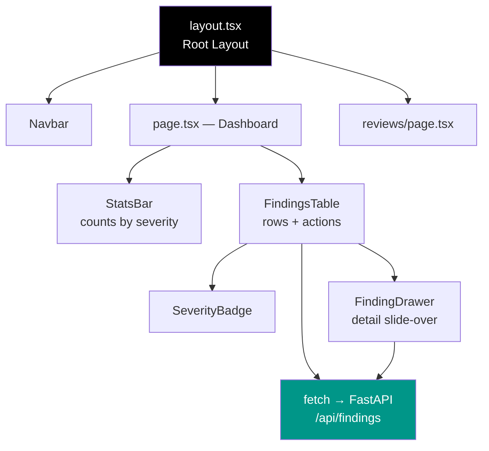
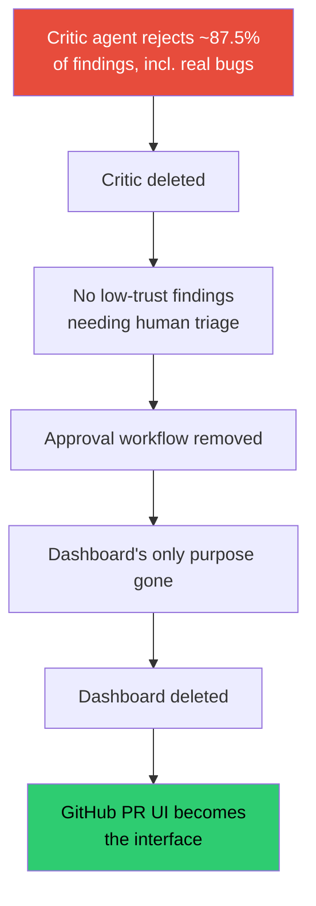
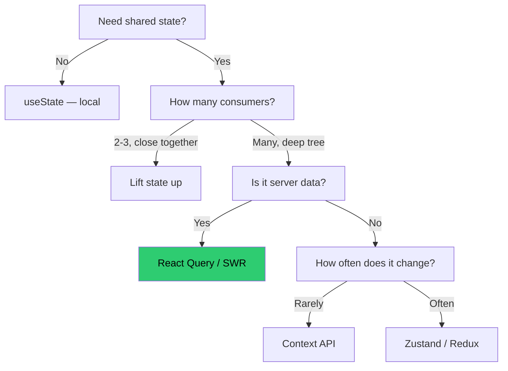

# 06 — Frontend Architecture

## Executive Summary

**This project has no frontend.** A Next.js 14 + React + TypeScript + TailwindCSS approval dashboard was built across three feature commits and then **deleted in `a61bfd2`**. The user interface is now GitHub's native PR review UI.

This file covers three things:
1. **What was built** — reconstructed from git history, so you can discuss it credibly.
2. **Why it was deleted** — the strongest product-judgement story in this project.
3. **📚 Frontend theory** — React, Next.js, state management, hooks, performance, accessibility. You will be asked these if your CV mentions React, regardless of whether this project uses it.

---

# PART A — What Was Built

## A1. Evidence from git history

```
3d010b9  add Next.js approval dashboard — findings table with approve/dismiss
4539e12  convert dashboard pages to client components to fix fetch error
952f068  fix CORS for PATCH and improve button loading feedback
b9fc8e7  add finding detail drawer, GitHub links, and status tabs to dashboard
bca1967  overhaul dashboard UI — dark navbar, stats bar, severity colors
a61bfd2  simplify pipeline — drop DB/frontend, fix async parallelism   ← deleted
```

Files removed in `a61bfd2`:

```
frontend/app/layout.tsx              -23    root layout
frontend/app/page.tsx                -95    dashboard home
frontend/app/reviews/page.tsx        -93    reviews list
frontend/app/globals.css            -130    Tailwind + theme
frontend/components/FindingsTable.tsx -130   main table
frontend/components/FindingDrawer.tsx -115   detail slide-over
frontend/components/StatsBar.tsx      -63    aggregate counts
frontend/components/Navbar.tsx        -36    dark navbar
frontend/components/SeverityBadge.tsx -15    colour-coded pill
frontend/components/ui/{badge,button,card}.tsx  -213  shadcn/ui primitives
frontend/components.json              -25    shadcn config
```

## A2. Reconstructed architecture

```
frontend/
├── app/                        # Next.js App Router (13+)
│   ├── layout.tsx              # Root layout — Navbar + global shell
│   ├── page.tsx                # "/" — dashboard with StatsBar + FindingsTable
│   ├── reviews/page.tsx        # "/reviews" — per-PR review list
│   └── globals.css             # Tailwind directives + CSS variables
├── components/
│   ├── Navbar.tsx              # dark top nav
│   ├── StatsBar.tsx            # aggregate counts by severity
│   ├── FindingsTable.tsx       # main data table, approve/dismiss actions
│   ├── FindingDrawer.tsx       # slide-over with full description + GitHub link
│   ├── SeverityBadge.tsx       # colour-coded severity pill
│   └── ui/                     # shadcn/ui: badge, button, card
└── components.json             # shadcn/ui configuration
```



## A3. The three bugs the commit history records

These are real debugging stories you can tell.

### Bug 1 — Server Components can't fetch a localhost API

**Commit `4539e12`: "convert dashboard pages to client components to fix fetch error"**

Next.js App Router defaults every component to a **Server Component**. Server Components run on the Node server during rendering — so `fetch("http://localhost:8000/api/findings")` executed *server-side*, where it either couldn't resolve the backend or ran at build time with no data.

```tsx
// ❌ Server Component (default) — runs on the Next.js server
export default async function Page() {
  const res = await fetch("http://localhost:8000/api/findings");
  const findings = await res.json();
  return <FindingsTable findings={findings} />;
}

// ✅ Client Component — runs in the browser
"use client";
export default function Page() {
  const [findings, setFindings] = useState<Finding[]>([]);
  useEffect(() => {
    fetch("http://localhost:8000/api/findings")
      .then(r => r.json())
      .then(setFindings);
  }, []);
  return <FindingsTable findings={findings} />;
}
```

**The lesson:** `"use client"` is not a style choice — it's a declaration of *where the code executes*. Interactivity (`useState`, `useEffect`, `onClick`) requires the client.

**The better fix, in hindsight:** keep it a Server Component but fetch from a server-reachable URL, or use a Next.js API route as a proxy. Converting to a Client Component solved the error but gave up server-side rendering benefits — worth acknowledging.

### Bug 2 — CORS preflight rejected PATCH

**Commit `952f068`: "fix CORS for PATCH and improve button loading feedback"**

The approve/dismiss buttons issued `PATCH /api/findings/{id}`. The browser sent a **preflight `OPTIONS`** request first; FastAPI's `CORSMiddleware` didn't list `PATCH` in `allow_methods`, so the browser blocked the real request.

```python
app.add_middleware(
    CORSMiddleware,
    allow_origins=["http://localhost:3000"],
    allow_methods=["GET", "POST", "PATCH"],   # ← PATCH was missing
    allow_headers=["*"],
)
```

**Why preflight exists:** the browser refuses to send a "non-simple" request (anything beyond GET/POST/HEAD with simple headers) until the server confirms it will accept it. It's protecting the *user*, not the server.

### Bug 3 — no loading feedback

Same commit. Clicking "Approve" fired an async request with no visual change, so users clicked repeatedly, firing duplicate requests.

```tsx
const [pending, setPending] = useState(false);

async function approve(id: number) {
  setPending(true);
  try {
    await fetch(`/api/findings/${id}`, {
      method: "PATCH",
      headers: { "Content-Type": "application/json" },
      body: JSON.stringify({ status: "approved" }),
    });
  } finally {
    setPending(false);   // ← finally: reset even on error
  }
}

<button disabled={pending} onClick={() => approve(f.id)}>
  {pending ? "Approving…" : "Approve"}
</button>
```

**The principle:** every async user action needs three visual states — idle, pending, and error. Missing the pending state causes duplicate submissions; missing the error state causes silent failure.

---

# PART B — Why It Was Deleted

## B1. The causal chain



## B2. Dashboard vs GitHub UI — the honest comparison

| Capability | Custom dashboard | GitHub PR UI |
|---|---|---|
| Shows code in context | ❌ File path + line number as text | ✅ Inline on the actual diff |
| Syntax highlighting | ⚠️ Would need to build it | ✅ Native, every language |
| One-click fix application | ❌ Impossible | ✅ ` ```suggestion ` blocks |
| Threaded discussion | ❌ Would need to build it | ✅ Native |
| Resolve/unresolve | ❌ Would need to build it | ✅ Native |
| Notifications | ❌ Would need email/Slack integration | ✅ Native, already configured |
| Permissions | ❌ Would need auth from scratch | ✅ Inherits repo permissions |
| Where developers already are | ❌ Second tab | ✅ Already open |
| Mobile | ⚠️ Responsive work needed | ✅ GitHub mobile app |
| Custom analytics views | ✅ Possible | ❌ Not possible |

**Every row except the last favours GitHub.** That's not a close call.

## B3. The `suggestion` block — the decisive capability

```markdown
```suggestion
    token = make_token(user, expiry=3600)
```
```

GitHub renders this as a diff with an **"Apply suggestion"** button that commits the change. One click, no context switch, no copy-paste.

**No custom dashboard can replicate this.** It requires write access to the branch, commit authoring, and deep integration with the diff view. Building it would mean reimplementing a substantial part of GitHub.

`suggester.py` exists specifically to generate these — GPT-4o produces the replacement code, `formatter.py` wraps it in a suggestion fence. The whole feature only works *because* the output target is GitHub.

## B4. How to answer "why no frontend?"

**Beginner:** The output goes to GitHub as PR comments, so a separate UI wasn't needed.

**Intermediate:** I built one — a Next.js dashboard with an approval queue — then deleted it when the approval workflow was removed. GitHub's review UI does the job better and it's where developers already work.

**Advanced (the full answer):**
> I built it and deleted it, and the reasoning is worth walking through because it wasn't about the frontend at all.
>
> The dashboard existed to serve one workflow: a human approving each finding before it posted. That workflow existed because I had a critic agent I didn't trust. When I measured the critic and found it rejecting roughly 87.5% of findings — including real bugs — I removed it. And with it, the approval step. At which point the dashboard had nothing to do.
>
> Even setting that aside, GitHub's PR UI beats anything I'd build. It shows findings inline on the actual diff with syntax highlighting, threads replies, tracks resolution, sends notifications through channels developers have already configured, and inherits repo permissions so I don't build auth at all. Most decisively, it supports suggestion blocks — a one-click "Apply" that commits the fix. That's not something I could replicate without reimplementing GitHub.
>
> The general principle: **build UI where your users already are, not where it's convenient for you to build.** A separate dashboard means a second tab, a second login, and a second notification channel to ignore. Adoption cost is real and usually underestimated.
>
> The one thing I lost is analytics — I can't show "most common finding category across all repos" or trend false-positive rate over time. If I wanted that, I'd bring back a read-only analytics view. But that's a fundamentally different product from an approval queue, and I'd build it only once I had users asking for it.

**Why this scores at senior level:** it traces the decision to its actual root cause, quantifies the evidence, states the general principle, and names the specific cost accepted.

---

# PART C — Frontend Theory

> 📚 **THEORY.** Necessary for interviews if your CV mentions React/Next.js. Frame honestly: *"I built this in the dashboard before removing it"* or *"I haven't used this here, but…"*

## C1. React fundamentals

### Components and JSX

```tsx
interface SeverityBadgeProps {
  severity: "high" | "medium" | "low";
}

export function SeverityBadge({ severity }: SeverityBadgeProps) {
  const styles = {
    high:   "bg-red-100 text-red-800 border-red-300",
    medium: "bg-amber-100 text-amber-800 border-amber-300",
    low:    "bg-blue-100 text-blue-800 border-blue-300",
  } as const;
  return (
    <span className={`px-2 py-1 rounded-full text-xs font-medium border ${styles[severity]}`}>
      {severity.toUpperCase()}
    </span>
  );
}
```

**The union type `"high" | "medium" | "low"`** is the TypeScript mirror of the backend's Pydantic `Literal["high","medium","low"]`. Same constraint, two languages — a nice detail to mention as end-to-end type safety.

### The Virtual DOM and reconciliation

```
State change → new Virtual DOM tree → diff against previous → minimal real DOM patch
```

Direct DOM manipulation is expensive (layout, reflow, repaint). React diffs cheap in-memory trees and applies only the minimum real mutations.

**Why keys matter:**
```tsx
{findings.map(f => <FindingRow key={f.id} finding={f} />)}    // ✅ stable identity
{findings.map((f, i) => <FindingRow key={i} finding={f} />)}  // ❌ index as key
```
With index keys, deleting the first item makes React think every subsequent item *changed* rather than *moved* — losing component state and forcing unnecessary re-renders.

### Hooks

| Hook | Purpose | Gotcha |
|---|---|---|
| `useState` | Local state | Updates are async and batched |
| `useEffect` | Side effects | Missing deps → stale closures |
| `useMemo` | Cache a computed value | Don't overuse — memoisation isn't free |
| `useCallback` | Cache a function identity | Only helps with memoised children |
| `useRef` | Mutable box, no re-render | Changing it doesn't trigger render |
| `useContext` | Read context | Any change re-renders all consumers |
| `useReducer` | Complex state transitions | Better than many `useState`s |

**The rules of hooks:** only at the top level (never in conditions or loops), only in components or custom hooks. React tracks hooks **by call order** — a conditional hook shifts the order between renders and corrupts state.

```tsx
// ❌ stale closure — count is captured from first render
useEffect(() => {
  const id = setInterval(() => setCount(count + 1), 1000);
  return () => clearInterval(id);
}, []);

// ✅ functional update — always operates on current value
useEffect(() => {
  const id = setInterval(() => setCount(c => c + 1), 1000);
  return () => clearInterval(id);
}, []);
```

## C2. Next.js

### App Router vs Pages Router

| | Pages Router (legacy) | App Router (13+, used here) |
|---|---|---|
| Directory | `pages/` | `app/` |
| Data fetching | `getServerSideProps` | `async` Server Components |
| Layouts | `_app.tsx` | Nested `layout.tsx` |
| Default component | Client | **Server** |
| Streaming | ❌ | ✅ with Suspense |

### Server vs Client Components

```tsx
// Server Component (default) — runs on server, zero JS shipped
async function ReviewsList() {
  const data = await db.query("SELECT ...");   // direct DB access!
  return <ul>{data.map(r => <li key={r.id}>{r.title}</li>)}</ul>;
}

// Client Component — runs in browser, ships JS
"use client";
function ApproveButton({ id }: { id: number }) {
  const [pending, setPending] = useState(false);
  return <button disabled={pending} onClick={...}>Approve</button>;
}
```

| | Server Component | Client Component |
|---|---|---|
| Runs | Server only | Server (SSR) + browser |
| Bundle cost | **Zero JS** | Ships to browser |
| Can use hooks | ❌ | ✅ |
| Can use `onClick` | ❌ | ✅ |
| Direct DB/secret access | ✅ | ❌ Never |

**Best practice:** keep `"use client"` as far down the tree as possible. Make the page a Server Component and mark only the interactive leaf (a button, a form) as client. Commit `4539e12` converted whole *pages* to client, which is heavier than necessary — a legitimate self-critique.

### Rendering strategies

| Strategy | When HTML is built | Use for |
|---|---|---|
| **SSG** | Build time | Marketing pages, docs |
| **ISR** | Build + revalidate interval | Blogs, catalogues |
| **SSR** | Per request | Personalised, always-fresh |
| **CSR** | In the browser | Dashboards behind auth |

The findings dashboard was correctly CSR-ish — data is user-specific, changes constantly, and is behind auth, so there's nothing to pre-render.

## C3. State Management



| Tool | Best for | Avoid when |
|---|---|---|
| `useState` | Local UI state | Shared across distant components |
| Lifting state | 2–3 nearby consumers | Deep trees (prop drilling) |
| Context | Theme, auth, locale — rarely changing | Frequently changing (re-renders all consumers) |
| **React Query / SWR** | **Server state** — caching, refetch, invalidation | Pure client state |
| Redux Toolkit | Complex client state, time-travel debugging | Simple apps (boilerplate) |
| Zustand | Simple global store | When you need middleware ecosystem |

**The most important distinction:** **server state ≠ client state.** Findings from an API are server state — they have caching, staleness, refetch, and error semantics. Redux treats them as client state and makes you write all of that by hand. React Query exists precisely for this.

**What the dashboard should have used:**
```tsx
const { data: findings, isLoading, error } = useQuery({
  queryKey: ["findings"],
  queryFn: () => fetch("/api/findings").then(r => r.json()),
  staleTime: 30_000,
});

const approve = useMutation({
  mutationFn: (id: number) =>
    fetch(`/api/findings/${id}`, { method: "PATCH", body: JSON.stringify({status:"approved"}) }),
  onSuccess: () => queryClient.invalidateQueries({ queryKey: ["findings"] }),
});
```

That's loading state, error state, caching, and automatic refetch-after-mutation for free — replacing the hand-rolled `useState` + `useEffect` + manual `pending` flag.

**Good self-critique:** *"I hand-rolled fetch-and-loading-state with `useState` and `useEffect`. React Query would have given me caching, deduplication, and refetch-on-mutate for free, and it would have prevented the duplicate-submit bug I had to fix manually."*

## C4. Performance

| Technique | What it fixes |
|---|---|
| `React.memo` | Re-render when props unchanged |
| `useMemo` / `useCallback` | Recomputation / broken memo on children |
| Virtualisation (`react-window`) | Rendering 10,000 rows |
| Code splitting (`next/dynamic`) | Large initial bundle |
| `next/image` | Unoptimised images, CLS |
| Debouncing | Request-per-keystroke |

**Virtualisation would have mattered here.** A findings table across many repos could be thousands of rows. The DOM struggles past ~1,000 nodes; virtualisation renders only the ~20 visible.

**Core Web Vitals:** LCP < 2.5s (largest element painted), INP < 200ms (interaction responsiveness), CLS < 0.1 (layout shift).

## C5. Accessibility

```tsx
// ❌ Not keyboard accessible, not announced by screen readers
<div onClick={approve}>Approve</div>

// ✅
<button onClick={approve} aria-label={`Approve finding: ${finding.title}`}>
  Approve
</button>
```

| Requirement | Implementation |
|---|---|
| Semantic HTML | `<button>`, `<nav>`, `<main>`, `<table>` — not `<div>` for everything |
| Keyboard navigation | All interactive elements tabbable; visible focus ring |
| Colour contrast | 4.5:1 for body text (WCAG AA) |
| Not colour alone | SeverityBadge shows **text** + colour — ✅ correct |
| Screen reader labels | `aria-label`, `aria-live` for async updates |
| Focus management | Trap focus in the drawer; restore on close |

**The `SeverityBadge` got this right**: it renders the word "HIGH" alongside red styling. Colour-only severity would be invisible to ~8% of men with colour vision deficiency.

**The drawer was likely wrong:** a slide-over needs `role="dialog"`, `aria-modal="true"`, focus trapping, Escape-to-close, and focus restoration to the trigger element. Easy to miss.

## C6. Interview Questions

### Q1. "Explain Server vs Client Components."

**Best answer:**
> In the Next.js App Router every component is a Server Component by default. It renders on the server, ships zero JavaScript to the browser, and can directly access the database or secrets. A Client Component is opted into with `"use client"` — it runs in the browser, ships JS, and can use hooks, state, and event handlers.
>
> I hit the boundary as a real bug. My dashboard pages were Server Components fetching `http://localhost:8000/api/findings`. That `fetch` executed on the Next.js *server*, not the browser — which couldn't reach my backend the way I expected. The commit that fixed it is literally called "convert dashboard pages to client components to fix fetch error."
>
> In hindsight that fix was heavier than necessary. Converting the whole page to a Client Component gave up server rendering for everything on it. The better fix is keeping the page a Server Component, fetching from a server-reachable URL, and marking only the interactive leaves — the approve button — as client. The general rule is push `"use client"` as far down the tree as possible.

### Q2. "How would you manage state in a findings dashboard?"

**Best answer:**
> The key question is what *kind* of state it is. Findings from an API are **server state**, not client state — they have caching, staleness, refetching, and error semantics that client state doesn't. Conflating the two is the most common mistake I see, and it's the one I made.
>
> I hand-rolled it: `useState` for the findings array, `useEffect` to fetch on mount, another `useState` for a pending flag on each button. That works, but I wrote by hand what React Query gives for free — loading and error states, request deduplication, cache invalidation, and refetch after mutation. It's also why I had to manually fix a duplicate-submit bug: without a pending state, users clicked Approve repeatedly. React Query's `isPending` would have handled that.
>
> What I'd build now: React Query for all server data, keyed by resource. `useState` for genuinely local UI state like "is the drawer open." Context only for things that rarely change — theme, current user. And no Redux, because there's no complex client-side state machine here; Redux would be boilerplate around what is fundamentally a cache.

### Q3. "Your project has no frontend. Doesn't that limit you?"

**Best answer:** *(see Part B4 above — the full deletion narrative)*

Then add:
> If you're asking whether I can do frontend work — I built this dashboard with Next.js App Router, TypeScript, Tailwind, and shadcn/ui, and I debugged three genuine issues in it: the Server Component fetch boundary, a CORS preflight failure on PATCH, and missing loading states causing duplicate submits. I removed it because it stopped serving a purpose, not because I couldn't build it.

**Why this works:** it demonstrates competence through specific debugging detail rather than assertion.

---

## C7. Common Mistakes

| Mistake | Consequence | Fix |
|---|---|---|
| Array index as `key` | Lost state, wrong re-renders | Stable unique ID |
| Missing `useEffect` deps | Stale closures | Complete dep array + functional updates |
| Redux for server data | Reinventing a cache badly | React Query / SWR |
| `"use client"` at page level | Loses SSR for whole subtree | Push down to leaves |
| `<div onClick>` | Not keyboard accessible | `<button>` |
| Colour-only status | Invisible to colour-blind users | Colour **+** text |
| No pending state | Duplicate submissions | Disable + spinner |
| Fetching in render body | Infinite loop | `useEffect` or React Query |

---

## C8. Cross-References

| Topic | File |
|---|---|
| Why the dashboard was removed | [15-Design-Decisions.md](15-Design-Decisions.md) |
| The critic agent failure | [14-Project-Challenges.md](14-Project-Challenges.md) |
| The deleted API it consumed | [08-API-Documentation.md](08-API-Documentation.md) |
| CORS in depth | [07-Authentication-and-Security.md](07-Authentication-and-Security.md) |
| If a UI returned | [20-Future-Improvements.md](20-Future-Improvements.md) |

**Next:** [07-Authentication-and-Security.md](07-Authentication-and-Security.md)
