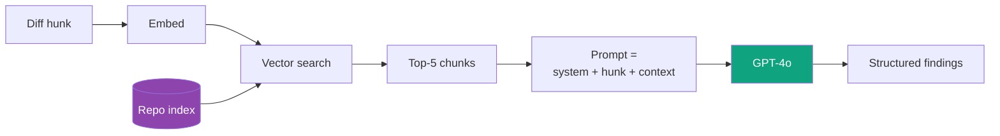
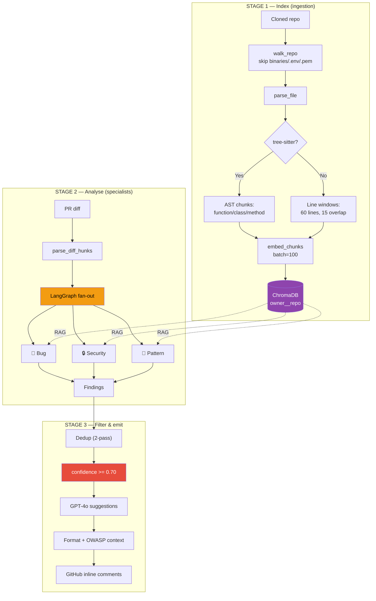
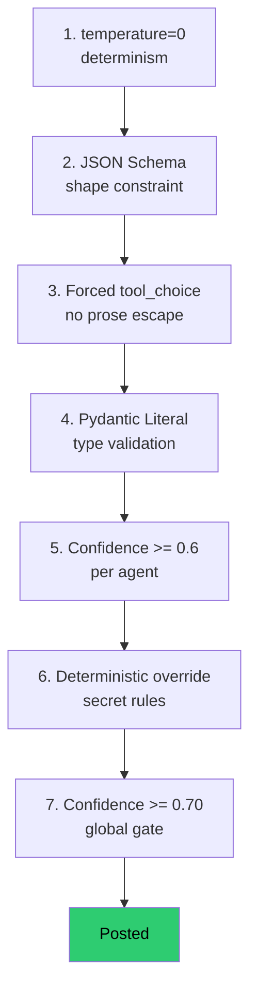

# 09 — AI System

## Executive Summary

This is the heart of the project and the file to know best. The AI system is a **RAG-powered multi-agent pipeline**: a per-repository vector index built with tree-sitter and OpenAI embeddings, queried by three specialised GPT-4o agents that run concurrently via LangGraph, each producing structured findings through forced tool calling, filtered by a two-stage confidence gate.

**The core insight:** an LLM reviewing a diff in isolation can only find *local* problems. Give it retrieved context from the rest of the codebase and it can find *relational* problems — inconsistency with conventions, duplication of existing logic, deviation from established patterns. That retrieval step is what separates this from "paste your diff into ChatGPT."

---

## 1. Concepts: Beginner → Advanced

### Beginner — What is an embedding?

An embedding turns text into a list of numbers that captures **meaning**.

```
"authenticate the user"  → [0.021, -0.443, 0.881, ...]   (1536 numbers)
"verify user login"      → [0.019, -0.451, 0.877, ...]   ← nearly identical
"calculate shipping"     → [0.812,  0.114, -0.223, ...]  ← very different
```

Texts with similar meanings produce vectors pointing in similar directions — even with **no words in common**. That's the crucial property: `authenticate` and `verify_credentials` share zero characters but land close together in embedding space. Keyword search could never connect them.

### Intermediate — What is RAG?

**Retrieval-Augmented Generation** solves a hard constraint: LLMs have a fixed context window, and your codebase doesn't fit in it.

```
❌ Without RAG:
   "Review this diff." → LLM sees only the diff → misses codebase-relative issues

✅ With RAG:
   1. Embed the diff hunk
   2. Search the vector index for the 5 most similar code chunks
   3. "Review this diff. Here is related code from the same repository: ..."
   4. LLM now reasons with context
```



### Advanced — Why multiple agents beats one

You could put "find bugs, security issues, and convention violations" in one prompt. Three specialised agents beat it for four measurable reasons:

| Reason | Explanation |
|---|---|
| **Attention dilution** | A prompt asking for three things splits the model's attention. Each specialist prompt is entirely about one concern, so more of the context budget and more attention weight goes to depth in that concern. |
| **Prompt specificity** | The security agent lists 15 OWASP categories with definitions. Cramming bug, security, *and* pattern taxonomies into one prompt would exceed useful prompt length and blur the categories. |
| **Independent calibration** | Security's `hardcoded_secret` rule forces confidence 1.0. The pattern agent skips hunks with no retrieved context. These are per-domain policies that would conflict in one prompt. |
| **Parallelism** | Three concurrent calls take max(t₁,t₂,t₃) instead of t₁+t₂+t₃. Roughly 3× faster. |

**The honest counter-argument** — and you should raise it yourself:

> One call would cost a third as much and produce naturally deduplicated output. My multi-agent design costs 3× the tokens *and* requires a dedup pass precisely because agents overlap. The trade is cost and complexity for depth and speed. For a code review tool where a missed vulnerability is expensive and latency is user-facing, I think depth and speed win — but it's a genuine trade-off, not a free lunch, and at very high volume the economics might flip.

---

## 2. The Full AI Pipeline



---

## 3. Stage 1 — Building the Index

### Chunking strategy

Covered in depth in [03-Low-Level-Design.md](03-Low-Level-Design.md). The key RAG-relevant points:

**Semantic chunks beat fixed-size chunks** because embeddings of coherent units carry coherent meaning. A chunk that starts mid-function and ends mid-loop encodes noise.

**Overlapping granularity is deliberate:** a class emits a chunk for itself *and* for each method. Different queries want different zoom levels.

**The line-window fallback uses 15-line overlap.** Why overlap at all? Because a hard boundary can split a logical unit:

```
Window 1: lines 1–60    ends mid-function
Window 2: lines 46–105  ← the 15-line overlap means the function
                           start appears in window 2 as well
```

Without overlap, a concept spanning the boundary is fully represented in neither chunk. 25% overlap (15/60) is a common heuristic.

### Embedding

```python
def embed_chunks(chunks, batch_size=100, model="text-embedding-3-small"):
    for i in range(0, len(chunks), batch_size):
        batch = chunks[i:i+batch_size]
        texts = [c.text for c in batch]
        for attempt in range(2):
            try:
                response = client.embeddings.create(input=texts, model=model)
                vectors = [item.embedding for item in response.data]
                results.extend(zip(batch, vectors))
                break
            except Exception:
                if attempt == 1:
                    raise
                time.sleep(1)
```

**Batching (100 per call)** — 1,000 chunks becomes 10 requests instead of 1,000. The dominant saving is network round-trip latency, not compute.

**`zip(batch, vectors)`** relies on OpenAI returning embeddings **in input order**. It does, and the response objects also carry an `index` field. Relying on order is fine but sorting by `index` would be more defensive.

**⚠️ The retry is weak:**

| Problem | Impact |
|---|---|
| Only 2 attempts | A 3-second outage fails permanently |
| Fixed 1s delay | No exponential backoff |
| No jitter | Concurrent retries thunder together |
| Catches all exceptions | Retries a 401 auth error pointlessly |
| Ignores `Retry-After` | Fights the rate limiter instead of obeying it |

**The fix:**
```python
from tenacity import retry, stop_after_attempt, wait_exponential_jitter, retry_if_exception_type
from openai import RateLimitError, APIConnectionError

@retry(stop=stop_after_attempt(5),
       wait=wait_exponential_jitter(initial=1, max=30),
       retry=retry_if_exception_type((RateLimitError, APIConnectionError)))
def _embed_batch(texts, model): ...
```
Note `retry_if_exception_type` — retry only *transient* failures. Retrying an authentication error five times just wastes 30 seconds before failing anyway.

### Full vs incremental ingestion

```python
if collection_has_data(collection):
    mode = "incremental"
    modified_paths, deleted_paths = parse_diff_file_paths(diff)
    if deleted_paths:
        delete_chunks_for_files(collection, deleted_paths)
    files_to_ingest = [os.path.join(repo_path, p) for p in modified_paths
                       if os.path.isfile(os.path.join(repo_path, p))]
else:
    mode = "full"
    files_to_ingest = walk_repo(repo_path, config)
```

| Mode | When | Cost |
|---|---|---|
| **Full** | First PR on a repo | Every file — minutes, dollars |
| **Incremental** | Later PRs | Changed files only — seconds, cents |

**This is the single biggest cost optimisation in the system.** A 500-file repo costs a full ingest once; every subsequent PR re-embeds maybe 5 files.

⚠️ **Two problems, both documented elsewhere:**
1. **Stale chunks** — modified files are upserted without purging old line-range IDs ([03](03-Low-Level-Design.md))
2. **Ephemeral storage** — Railway wipes `/tmp/chromadb` on deploy, silently forcing full re-ingests ([04](04-Database-Design.md))

---

## 4. Stage 2 — Retrieval (RAG)

```python
async def get_context_for_hunk(hunk, collection_name, n_results=5) -> list[dict]:
    if not hunk.added_code.strip():
        return []                                          # ① no query, no search

    try:
        collection = _get_chroma().get_collection(collection_name)
    except Exception:
        return []                                          # ② missing index → degrade

    response = await _get_client().embeddings.create(
        input=[hunk.added_code], model="text-embedding-3-small")
    query_vector = response.data[0].embedding               # ③

    results = collection.query(
        query_embeddings=[query_vector], n_results=n_results,
        include=["documents", "metadatas"])                 # ④

    chunks = []
    for doc, meta in zip(results["documents"][0], results["metadatas"][0]):
        if (meta.get("file") == hunk.file                   # ⑤ self-match filter
            and meta.get("start_line", 0) <= hunk.line_end
            and meta.get("end_line", 0) >= hunk.line_start):
            continue
        chunks.append({...})
    return chunks
```

**① Empty guard** — a hunk with only deletions has no added code to embed.

**② Graceful degradation** — if the collection doesn't exist (first run, or a wiped `/tmp`), return empty context rather than crashing. The agents still work; they just review without codebase context. **Degrade, don't fail.**

**③ Same embedding model for indexing and querying.** This is *mandatory* — vectors from different models live in incomparable spaces. Querying an index built with `text-embedding-3-small` using a `3-large` vector produces meaningless results (and a dimension mismatch, here — 1536 vs 3072). A subtle production bug when models get upgraded without reindexing.

**④ `include` excludes embeddings** — we need the text and location, not 1536 floats × 5 results.

**⑤ The self-match filter** — the most important line in the file.

### Why the self-match filter is essential

The index contains the **pre-change** version of the file being reviewed. The nearest neighbour of a modified function is almost always its own previous version.

```
Reviewing: src/auth.py lines 40–55 (modified login function)
Top hits without filter:
  1. src/auth.py lines 38–52  ← THE OLD VERSION OF THIS FUNCTION
  2. src/auth.py lines 40–55  ← same region
  3. src/session.py lines 12–30  ← actually useful
```

Without the filter, 2 of 5 context slots are wasted on the code being reviewed. The pattern agent — whose entire job is comparing against *other* code — would find nothing to compare against.

**⚠️ A refinement worth naming:** the filter runs *after* retrieval, so if 3 of 5 results are self-matches you're left with 2 chunks. Better: over-fetch (`n_results=10`), filter, then take the top 5. Or push the exclusion into ChromaDB's `where` clause so the index does the work.

### Why the pattern agent uses `n_results=10`

```python
context_chunks = await get_context_for_hunk(hunk, collection_name, n_results=10)
if not context_chunks:
    return []       # no context → nothing to compare → skip entirely
```

Bug and security agents can find problems from the diff alone — a null dereference is a null dereference regardless of the rest of the codebase. **The pattern agent literally cannot function without context**; "this deviates from your conventions" is meaningless with nothing to compare to. So it fetches twice as much context and **skips hunks entirely** when retrieval returns nothing.

**This is well-designed and worth highlighting:** an agent that knows when it has no basis for judgement and stays silent, rather than hallucinating a convention. Most false positives in LLM systems come from models answering when they should abstain.

---

## 5. Stage 2 — The Three Agents

### The shared skeleton

All three follow an identical structure:

```python
async def run_X_agent(state: AgentState) -> dict:
    try:
        hunks = parse_diff_hunks(state["diff"])
        results = await asyncio.gather(
            *[_process_hunk(h, state["collection_name"]) for h in hunks],
            return_exceptions=True,
        )
        all_findings = [f for r in results if isinstance(r, list) for f in r]
        return {"X_output": AgentOutput(agent="X", findings=all_findings)}
    except Exception as e:
        return {"X_output": AgentOutput(agent="X", findings=[], error=str(e))}
```

### Where they differ

| | Bug | Security | Pattern |
|---|---|---|---|
| `n_results` | 5 | 5 | **10** |
| Skips no-context hunks | ❌ | ❌ | ✅ |
| Post-processing | Interval dedup | Secret-rule override | None |
| Confidence floor | 0.6 | 0.6 | 0.6 |
| System prompt focus | Logic errors, null refs, leaks | OWASP Top 10 | Codebase conventions |

**The inconsistency worth admitting:** only the bug agent deduplicates internally. Security and pattern can emit overlapping findings from adjacent hunks. Same concept, three levels of rigour — see [03](03-Low-Level-Design.md).

### The security agent's deterministic override

```python
def _enforce_secret_rules(findings: list[Finding]) -> list[Finding]:
    return [
        f.model_copy(update={"severity": "high", "confidence": 1.0})
        if f.category == "hardcoded_secret" else f
        for f in findings
    ]
```

**This is the most defensible AI design decision in the project.**

The system prompt *already* says hardcoded secrets must be high severity with confidence 1.0. But prompts are **suggestions**, not guarantees — an LLM can and will ignore instructions occasionally. So the rule is enforced deterministically in code afterwards.

**The principle: never rely on a prompt for an invariant you can enforce in code.**

Why this specific rule matters: a hardcoded secret is one of the few findings with **zero ambiguity**. There's no context in which an API key in source is acceptable. So it should never be filtered out by a confidence threshold. Forcing 1.0 guarantees it passes the 0.70 gate every time.

**Say this in an interview:**
> The prompt tells the model that hardcoded secrets are always high severity with full confidence. But a prompt is a suggestion — models drift, especially across versions. So I enforce it in code after the fact with `model_copy`. Prompts express intent; code enforces invariants. Anything I genuinely cannot afford to have wrong shouldn't depend on the model complying.

### `model_copy` — a Pydantic detail

```python
f.model_copy(update={"severity": "high", "confidence": 1.0})
```

Returns a **new** object rather than mutating in place. Immutability means the original finding is unchanged, which makes the transformation traceable and safe under concurrency. Small thing, correct instinct.

---

## 6. Tool Calling / Function Calling

### The problem it solves

LLMs emit text. You need **structured data**. Naive approaches all fail:

```python
# ❌ "Return JSON"
"Return your findings as JSON."
→ "Sure! Here are the findings:\n```json\n{...}\n```\nLet me know if..."
  Now you're regex-stripping prose and markdown fences.
```

### The solution: forced tool calling

```python
FINDINGS_SCHEMA = {
    "type": "object",
    "properties": {
        "findings": {
            "type": "array",
            "items": {
                "type": "object",
                "properties": {
                    "file":       {"type": "string"},
                    "line_start": {"type": "integer"},
                    "severity":   {"type": "string", "enum": ["high","medium","low"]},
                    "confidence": {"type": "number"},
                    ...
                },
                "required": [...all fields...],
                "additionalProperties": False,
            },
        }
    },
    "required": ["findings"],
    "additionalProperties": False,
}

response = await client.chat.completions.create(
    model="gpt-4o",
    messages=[...],
    tools=[{"type": "function", "function": {
        "name": "report_findings", "parameters": FINDINGS_SCHEMA}}],
    tool_choice={"type": "function",
                 "function": {"name": "report_findings"}},   # ← FORCED
    temperature=0,
)
tool_call = response.choices[0].message.tool_calls[0]
raw = json.loads(tool_call.function.arguments)
```

### The three constraints doing the work

| Element | Effect |
|---|---|
| `tools=[...]` | Declares the function is available |
| **`tool_choice={...}` forced** | Model **must** call it — cannot reply with prose |
| `additionalProperties: False` | No hallucinated extra fields |
| `required: [...]` | No missing fields |
| `enum: [...]` | Severity constrained to three values |

**`tool_choice` is the critical one.** With `tool_choice="auto"` the model *decides* whether to call the function — and might respond conversationally instead. Forcing it makes structured output guaranteed rather than likely.

### Why `temperature=0`

| Temperature | Behaviour |
|---|---|
| 0 | Greedy — always the highest-probability token |
| 0.7 | Balanced creativity |
| 1.5 | Highly random |

For code review you want **determinism**: the same diff should produce the same review. Creative variation is a bug here, not a feature.

**Important nuance to know** — `temperature=0` is *near*-deterministic, not bit-deterministic. Floating-point non-associativity in GPU kernels, batching effects, and backend model updates all introduce variation. So you can't write an exact-match regression test on LLM output. This is why [11-Testing.md](11-Testing.md) argues for property-based assertions ("a hardcoded secret is found with severity high") rather than exact output comparison.

### Tool calling vs alternatives

| Approach | Reliability | Notes |
|---|---|---|
| "Return JSON" in prompt | ⚠️ ~85% | Prose wrappers, fences |
| JSON mode (`response_format`) | ✅ ~99% | Valid JSON, but *any* shape |
| **Forced tool calling** | ✅✅ | Valid JSON *conforming to your schema* ← used |
| Structured Outputs (`strict: true`) | ✅✅✅ | Constrained decoding — schema guaranteed |

**Worth mentioning:** OpenAI's Structured Outputs with `strict: true` uses constrained decoding — the sampler is literally prevented from emitting tokens that would violate the schema. That's a *guarantee* rather than very-high compliance. Adding `"strict": True` to the function definition would be a free upgrade here.

---

## 7. Prompt Engineering

### Anatomy of the security system prompt

```
You are a senior application security engineer reviewing a pull request...   ← ① ROLE

You will be given:
  1. The changed code (lines added or modified in this PR)                   ← ② INPUT SPEC
  2. Related code from the same codebase for context

Your job is to identify real security vulnerabilities only...                ← ③ TASK

Do NOT flag:                                                                 ← ④ NEGATIVE
  - General code quality issues that are not security-relevant                  CONSTRAINTS
  - Missing comments or documentation
  - Performance issues
  - Anything already mitigated in the provided context chunks

Vulnerability categories you may report:                                     ← ⑤ TAXONOMY
  - hardcoded_secret     — API keys, passwords, tokens...
  - sql_injection        — user-controlled input in SQL without parameterisation
  ... (15 categories)

Special rules:                                                               ← ⑥ HARD RULE
  - hardcoded_secret findings MUST always have severity="high" and confidence=1.0

Confidence scoring guide:                                                    ← ⑦ CALIBRATION
  1.0 — certain: present and exploitable as written
  0.8 — likely: strong evidence, minor uncertainty about execution context
  0.6 — possible: plausible but depends on caller or framework config
  Below 0.6 — do not include in output

Do NOT default to 1.0. Reserve 1.0 only for hardcoded_secret and for         ← ⑧ ANTI-PATTERN
vulnerabilities that are unambiguously exploitable. Most findings               CORRECTION
should be 0.6 or 0.8.

If you find no vulnerabilities, return an empty findings array.              ← ⑨ ABSTENTION
Do not invent findings.                                                          PERMISSION
```

### The two most important elements

**⑧ The anti-pattern correction — "Do NOT default to 1.0"**

This exists because of an observed failure. Commit `a61bfd2` includes *"Tighten confidence scoring prompts to prevent all-1.0 outputs."*

**The failure it fixes:** LLMs are poorly calibrated. Asked for a confidence score, they cluster at the top — everything is 0.95 or 1.0. If every finding is 1.0, the confidence threshold becomes useless: it filters nothing.

**The fix has three parts:** an explicit prohibition ("do NOT default to 1.0"), anchored examples for each level so the model has reference points, and an expected distribution ("most findings should be 0.6 or 0.8") which nudges the output distribution rather than individual scores.

**This is a real, empirically-driven prompt engineering story.** Use it.

**⑨ Explicit permission to find nothing**

> *"If you find no vulnerabilities, return an empty findings array. Do not invent findings."*

LLMs are trained to be helpful, and helpfulness biases toward *producing output*. Asked to find vulnerabilities, a model feels pressure to find some. Explicitly authorising the empty result reduces confabulation substantially.

**The principle:** in any extraction task, explicitly permit the null result. Otherwise the model invents one.

### The user prompt template

```python
USER_PROMPT_TEMPLATE = """\
## Changed code
File: {file}  Lines: {line_start}–{line_end}

```
{added_code}
```

## Related codebase context
{context_chunks}
"""

def format_context_chunks(chunks: list[dict]) -> str:
    if not chunks:
        return "(no related context found in codebase)"    # ← explicit absence
    parts = []
    for c in chunks:
        header = f"### {c['file']} lines {c['start_line']}–{c['end_line']}"
        if c.get("symbol_name"):
            header += f"  ({c['symbol_name']})"
        parts.append(f"{header}\n```\n{c['text']}\n```")
    return "\n\n".join(parts)
```

**Design points:**
- **Markdown headings** structure the prompt — models parse structure reliably
- **Line numbers in the prompt** ground the model's output coordinates
- **`"(no related context found)"`** explicitly states absence rather than leaving a blank. A blank section invites the model to hallucinate context; a stated absence tells it to reason from the diff alone.

---

## 8. Hallucination Prevention

Seven layers, from generation to posting:



| Layer | Mechanism | Catches |
|---|---|---|
| 1 | `temperature=0` | Random variation |
| 2 | JSON Schema + `additionalProperties: false` | Invented fields |
| 3 | Forced `tool_choice` | Prose instead of data |
| 4 | Pydantic `Literal` | Invalid severity/agent values |
| 5 | `confidence >= 0.6` in agent | Model's own low-confidence guesses |
| 6 | `_enforce_secret_rules` | Model under-rating a critical finding |
| 7 | `CONFIDENCE_THRESHOLD = 0.70` | Everything marginal |
| 8 | **RAG context** | Ungrounded reasoning |

### The layer that isn't there

**Line numbers are never validated.** GPT-4o reports `line_start` and `line_end`, and those go straight into the GitHub API. If they're hallucinated, GitHub returns 422 and **every** inline comment is lost.

The data to prevent this already exists — `parse_diff_hunks()` returns exactly which lines are in the diff.

```python
def validate_finding_lines(findings: list[Finding], diff: str) -> list[Finding]:
    valid_ranges = {(h.file, h.line_start, h.line_end) for h in parse_diff_hunks(diff)}
    kept = []
    for f in findings:
        if any(f.file == file and start <= f.line_end <= end
               for file, start, end in valid_ranges):
            kept.append(f)
        else:
            logger.warning("finding.line_out_of_diff",
                           file=f.file, line=f.line_end, title=f.title)
    return kept
```

**This is the single highest-value fix in the project.** Volunteer it.

### Why RAG itself reduces hallucination

Grounding is the strongest anti-hallucination technique available. A model asked "does this follow the codebase conventions?" with **no** context must invent an answer. Given five actual chunks from the repository, it has evidence to reason from. The pattern agent's decision to *skip* hunks with no context is the same principle taken to its conclusion: **no evidence, no judgement.**

---

## 9. Context Window Management

GPT-4o has a 128K token context. This system uses a tiny fraction:

| Component | Approx. tokens |
|---|---|
| System prompt | ~500 |
| Diff hunk | ~200–1,000 |
| 5 context chunks | ~1,500–3,000 |
| Tool schema | ~300 |
| **Total per call** | **~2,500–4,800** |

**Deliberately conservative.** Why not stuff 50 chunks in?

| Reason | Explanation |
|---|---|
| **Lost in the middle** | Models attend most strongly to the *beginning* and *end* of context. Information in the middle of a long prompt gets measurably less attention. |
| **Cost** | Input tokens are billed. 10× context = ~10× cost, per call, across 3N calls. |
| **Latency** | Longer prompts take longer to process. |
| **Signal dilution** | 50 chunks means 45 irrelevant ones competing with the 5 that matter. |

**"Lost in the middle" is a well-known result and a good thing to cite.** It's the reason retrieval quality matters more than retrieval quantity — you want 5 excellent chunks, not 50 mediocre ones.

**Per-hunk processing is itself a context strategy.** Instead of one call with the entire diff, N calls with one hunk each. Each call is small, focused, and independently parallelisable. The cost is losing cross-hunk reasoning — the system can't spot "this new function duplicates the one added three hunks earlier." A real limitation worth acknowledging.

---

## 10. Memory

**This system is stateless — there is no conversational memory.** Every agent call is a single-turn, independent request.

| Memory type | Used? | Why / why not |
|---|---|---|
| Conversational | ❌ | Single-turn task; no dialogue |
| Long-term (vector) | ✅ | **ChromaDB *is* the long-term memory** |
| Episodic | ❌ | No record of past reviews |
| Working | ⚠️ | `AgentState` within one graph run |

**The reframe worth making:** the vector index *is* memory. It's the system's knowledge of the codebase, built up over time and queried associatively — which is a reasonable functional description of semantic memory.

**What episodic memory would add:** "I flagged this same pattern in PR #4 and the developer dismissed it" → don't flag it again. That's the highest-value memory feature this system lacks, and it directly addresses the false-positive problem. See [20-Future-Improvements.md](20-Future-Improvements.md).

---

## 11. Streaming

**Not used.** `stream=True` is never set.

**Why streaming doesn't help here:** streaming's value is *perceived* latency — a human watching tokens appear. Here, nothing is human-visible until the complete structured output is parsed, validated, deduplicated, filtered, and posted. A partially-streamed tool call is unusable; you need the whole JSON before you can do anything.

**Where it would help:** if a live dashboard showed review progress, streaming findings as they were produced would improve perceived responsiveness. That requires a UI, which was deleted.

**Clean answer:** *"Streaming optimises perceived latency for a human watching output. My output isn't watched — it's parsed, validated, and batch-posted. A half-streamed tool call has no value. It'd matter if I had a live progress UI, which I deliberately don't."*

---

## 12. Cost Optimisation

### What's already done ✅

| Technique | Saving |
|---|---|
| `text-embedding-3-small` over `large` | **~6.5×** on embeddings |
| Batching 100 chunks per call | ~990 round trips per 1,000 chunks |
| Incremental ingestion | Massive — 5 files vs 500 per PR |
| Skipping binaries and large files | Avoids wasted embedding |
| Pattern agent skips no-context hunks | Fewer GPT-4o calls |
| Confidence filter before suggester | Only ≥0.70 findings get a suggestion call |
| ChromaDB persistence | Embeddings paid for once |

### What isn't ❌

| Waste | Cost | Fix |
|---|---|---|
| **Triple embedding of each hunk** | 3× retrieval embedding calls | Embed once, share across agents |
| **Triple installation token fetch** | 2 wasted round trips | TTL cache |
| No concurrency cap | Rate-limit 429s and retries | `asyncio.Semaphore` |
| No token budget per PR | A 500-file PR could cost a lot | Cap hunks analysed |
| GPT-4o for everything | Most expensive model | Route by hunk complexity |
| Ephemeral ChromaDB | Repeated full re-ingests | Persistent volume |

### The highest-leverage fix

```python
# CURRENT: each agent embeds every hunk independently
# 20 hunks × 3 agents = 60 embedding API calls

# FIXED: embed once, batched, share the result
async def precompute_embeddings(hunks) -> dict[str, list[float]]:
    texts = [h.added_code for h in hunks]
    resp = await client.embeddings.create(input=texts, model="text-embedding-3-small")
    return {f"{h.file}:{h.line_start}": d.embedding for h, d in zip(hunks, resp.data)}
# 20 hunks = 1 API call
```

**60 calls → 1 call.** That's the number to quote.

### Model routing — a more advanced idea

```python
def choose_model(hunk: DiffHunk) -> str:
    if len(hunk.added_code) < 200 and hunk.file.endswith((".md", ".txt", ".json")):
        return "gpt-4o-mini"     # trivial changes
    return "gpt-4o"
```

Docs changes, config edits, and small refactors don't need the flagship model. Routing cheap work to a cheaper model is standard practice in production LLM systems and shows cost-awareness beyond "use a smaller embedding model."

---

## 13. Interview Questions

### Q1. "Explain your RAG pipeline end to end."

**Best answer:**
> Two phases: building the index, and querying it.
>
> **Indexing.** After shallow-cloning the repo at the head SHA, I walk every file, skipping binaries, anything over 512 KB, and — importantly — `.env` and `.pem` files, because ingestion sends file contents to OpenAI and I don't want to exfiltrate someone's secrets. Each file goes to tree-sitter, which parses it into an AST, and I walk that emitting a chunk per function, class, and method. The walk recurses unconditionally, so a class produces a chunk for itself *and* one per method — different retrieval granularities for different queries. If tree-sitter can't handle the language or the parse yields nothing, I fall back to 60-line windows with 15 lines of overlap, so a concept spanning a boundary appears in both chunks.
>
> Those chunks get embedded with `text-embedding-3-small` in batches of 100 and upserted into a ChromaDB collection named `owner__repo` — one collection per repository, cosine distance. Chunk IDs are SHA-256 of file-plus-line-range, so re-ingestion overwrites rather than duplicating. That's what makes it idempotent.
>
> **Querying.** For each diff hunk, each agent embeds the added code with the *same* model — that's mandatory, vectors from different models aren't comparable — and does a similarity search for the top 5 chunks, or 10 for the pattern agent.
>
> Then there's a filter that I think is the most important line in that file: I discard any retrieved chunk from the same file at overlapping line ranges. Without it, the top hit for a modified function is almost always its own pre-change version, still sitting in the index. The agent would end up comparing the code to itself and finding nothing. The pattern agent, whose whole job is comparison, would be useless.
>
> The surviving chunks get formatted into the prompt with file paths and line numbers, and GPT-4o reviews the hunk with that context.
>
> The two gaps I'd name: each agent embeds the same hunk independently, so I make three identical embedding calls where one batched call would do — that's 60 calls becoming 1 on a 20-hunk PR. And the self-match filter runs after retrieval, so if three of five hits are self-matches I'm down to two chunks of context. I should over-fetch and then filter.

---

### Q2. "How do you get structured output from an LLM reliably?"

**Best answer:**
> Forced tool calling, with schema validation on both sides of the boundary.
>
> I define a JSON Schema for a `report_findings` function — array of findings, each with file, line range, severity as an enum of exactly three values, category, title, description, suggestion, and confidence. `required` lists every field and `additionalProperties` is false, so the model can't omit fields or invent them.
>
> The critical part is `tool_choice`. If you pass `tools` with `tool_choice="auto"`, the model *decides* whether to call the function — and sometimes it just replies conversationally. I force it: `tool_choice={"type":"function","function":{"name":"report_findings"}}`. Now it cannot respond with prose. It has to call that function.
>
> Then I validate again on my side with Pydantic. The schema constrains generation but doesn't *guarantee* conformance, so `Finding` is a Pydantic model with `severity: Literal["high","medium","low"]`. If the model hallucinates "critical", I get a `ValidationError` at the boundary instead of a broken comment reaching GitHub.
>
> Temperature is 0 throughout — code review should be reproducible, and creative variation is a bug here, not a feature. Though worth noting `temperature=0` is near-deterministic, not bit-deterministic; floating-point non-associativity on GPUs means you can't write exact-match regression tests.
>
> One upgrade I'd make: OpenAI's Structured Outputs with `strict: true` uses constrained decoding, where the sampler literally can't emit schema-violating tokens. That's a guarantee rather than high compliance, and it's a one-key change.
>
> The gap in my current setup: `confidence` is a plain float with no bounds. The model could return 1.5 and Pydantic would accept it. `Field(ge=0.0, le=1.0)` closes that.

---

### Q3. "How do you prevent hallucinations?"

**Best answer:**
> Seven layers, and one important one I'm missing.
>
> **Constrain generation** — `temperature=0`, JSON Schema with `additionalProperties: false`, and forced tool calling so there's no prose escape hatch.
>
> **Validate output** — Pydantic with `Literal` types catches invalid enum values at construction.
>
> **Filter by confidence** — twice. Each agent drops anything below 0.6 internally, then a global gate at 0.70 before posting. Two stages because they serve different purposes: the agent-level floor is the model self-censoring, the global gate is my policy.
>
> **Override with deterministic rules** — hardcoded secrets get forced to high severity and confidence 1.0 in code, regardless of what the model said. The prompt already asks for that, but a prompt is a suggestion. Anything I can't afford to have wrong shouldn't depend on the model complying.
>
> **Ground with RAG** — this is the strongest one. A model asked "does this follow your conventions?" with no context has to invent an answer. Given five real chunks from the repo, it has evidence. My pattern agent takes it further and *skips* hunks entirely when retrieval returns nothing — no evidence, no judgement. Most LLM false positives come from models answering when they should abstain.
>
> **Explicitly permit the null result** — the prompts say "if you find no vulnerabilities, return an empty array, do not invent findings." Models are trained to be helpful and helpfulness biases toward producing output. Authorising silence measurably reduces confabulation.
>
> **The layer I'm missing** is line-number validation, and it's the one that bites hardest. The model reports line numbers and I pass them straight to GitHub's API. If they're hallucinated, GitHub returns 422 and *every* inline comment is rejected — the whole batch, because GitHub validates reviews atomically. So one bad line number collapses ten good findings into a single flat summary comment. And I already have the ground truth: `parse_diff_hunks` tells me exactly which lines are in the diff. I just never cross-check. It's about fifteen lines of code and it's the first thing I'd fix.

**Why this scores well:** it's layered and specific, explains the *reasoning* behind each layer, and ends with a precisely-identified gap plus its fix.

---

### Q4. "Why three agents instead of one prompt?"

**Best answer:**
> Four reasons, and one honest counter-argument.
>
> **Attention dilution.** A prompt asking for bugs, security issues, and convention violations splits the model's attention three ways. Each of my prompts is entirely about one concern, so more of the context budget and more attention weight goes to depth.
>
> **Prompt specificity.** My security prompt lists fifteen OWASP categories with definitions and a calibration guide. Cramming three taxonomies into one prompt would blow past useful prompt length and blur the category boundaries.
>
> **Independent calibration.** The security agent forces confidence 1.0 for hardcoded secrets. The pattern agent skips hunks with no retrieved context. Those are per-domain policies that would conflict in a single prompt — I can't tell one prompt to both always-flag-secrets-at-1.0 and abstain-without-context.
>
> **Parallelism.** Three concurrent calls take the max of the three, not the sum. Roughly 3× faster.
>
> **The counter-argument** — which I think is genuinely strong: one call would cost a third as much and produce naturally deduplicated output. My design costs 3× the tokens *and* forces me to write a deduplication pass, precisely because the agents overlap and all flag the same line. So I'm paying twice for the specialisation.
>
> I think depth and latency win for code review, where a missed vulnerability is expensive and the developer is waiting. But it's a real trade-off. At very high volume the economics could flip, and the sensible middle ground would be routing: run the security agent always, and only run bug and pattern on hunks above some complexity threshold.

---

### Q5. "Your confidence scores come from the LLM. Can you trust them?"

**Best answer:**
> Not fully, and that's the honest answer — LLM confidence is not calibrated probability. When a model says 0.8, that does *not* mean it's right 80% of the time. It's a token the model produced because that's what a confident-sounding review looks like in its training distribution.
>
> I hit this concretely. My first version returned 1.0 for essentially everything, which made the confidence threshold completely useless — it filtered nothing. There's a commit specifically titled "tighten confidence scoring prompts to prevent all-1.0 outputs."
>
> The fix was three-part: an explicit prohibition — "do NOT default to 1.0" — anchored examples for each level so the model has reference points, and a stated expected distribution: "most findings should be 0.6 or 0.8." That last part nudges the output *distribution* rather than individual scores, which turns out to matter more.
>
> That got me usable spread, but spread isn't calibration. I can't tell you my precision at 0.70 versus 0.80 because I have no labelled dataset. The threshold is a tuned heuristic, not a statistically justified cutoff.
>
> To actually calibrate it I'd need ground truth. The practical source is developer behaviour: did they resolve the comment, apply the suggestion, or dismiss it? That's an implicit label. With a few thousand of those I could plot precision against the threshold and pick it properly — or fit a calibration curve, something like Platt scaling, mapping raw LLM scores to empirical probabilities.
>
> This is exactly why I post with `event: "COMMENT"` and not `REQUEST_CHANGES`. Blocking merges on an uncalibrated signal would be irresponsible. A tool that wrongly blocks merges gets disabled within a week.

**Why this is the strongest answer in the file:** it demonstrates ML literacy (calibration ≠ confidence), tells a real debugging story, admits an unmeasured metric, proposes a concrete measurement strategy, and connects it back to a product decision.

---

## 14. Common Mistakes

| Mistake | Consequence | Fix |
|---|---|---|
| Different embedding models for index and query | Meaningless results / dimension mismatch | Same model, always |
| No self-match filter in RAG | Agent compares code to itself | Exclude overlapping same-file chunks |
| Fixed-size chunking | Split functions, incoherent embeddings | Semantic (AST) chunking |
| `tool_choice="auto"` when you need structure | Model replies with prose | Force the specific function |
| Trusting prompt rules for invariants | Model drifts | Enforce in code after |
| Trusting LLM line numbers | 422 kills all comments | Validate against parsed hunks |
| Treating LLM confidence as probability | Miscalibrated filtering | Measure against ground truth |
| No permission to return empty | Confabulated findings | "Return an empty array" |
| Stuffing max context | Lost-in-the-middle, cost, dilution | Few high-quality chunks |
| No retry on transient API errors | Brittle pipeline | Exponential backoff + jitter |
| Retrying non-transient errors | Wasted time before inevitable failure | `retry_if_exception_type` |

---

## 15. Real-World Comparison

| This project | Industry |
|---|---|
| tree-sitter chunking | LlamaIndex `CodeSplitter` |
| ChromaDB per-repo collections | Pinecone namespaces |
| LangGraph fan-out | CrewAI, AutoGen multi-agent |
| Forced tool calling | Instructor, Outlines, OpenAI Structured Outputs |
| Confidence threshold | ML decision threshold tuning |
| OWASP educational layer | Semgrep/Snyk finding metadata |
| Self-match filter | Standard RAG "exclude source document" |

---

## 16. Cross-References

| Topic | File |
|---|---|
| Chunking algorithm detail | [03-Low-Level-Design.md](03-Low-Level-Design.md) |
| ChromaDB schema and HNSW | [04-Database-Design.md](04-Database-Design.md) |
| OpenAI API specifics | [08-API-Documentation.md](08-API-Documentation.md) |
| Testing non-deterministic systems | [11-Testing.md](11-Testing.md) |
| Cost and latency optimisation | [12-Performance-Optimization.md](12-Performance-Optimization.md) |
| The critic agent's failure | [14-Project-Challenges.md](14-Project-Challenges.md) |
| Why GPT-4o, why ChromaDB | [15-Design-Decisions.md](15-Design-Decisions.md) |
| Line validation and other fixes | [20-Future-Improvements.md](20-Future-Improvements.md) |

**Next:** [10-Deployment-and-DevOps.md](10-Deployment-and-DevOps.md)
