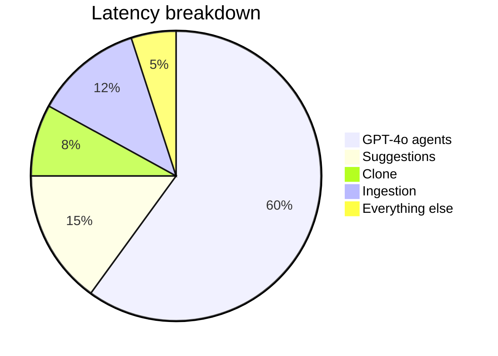
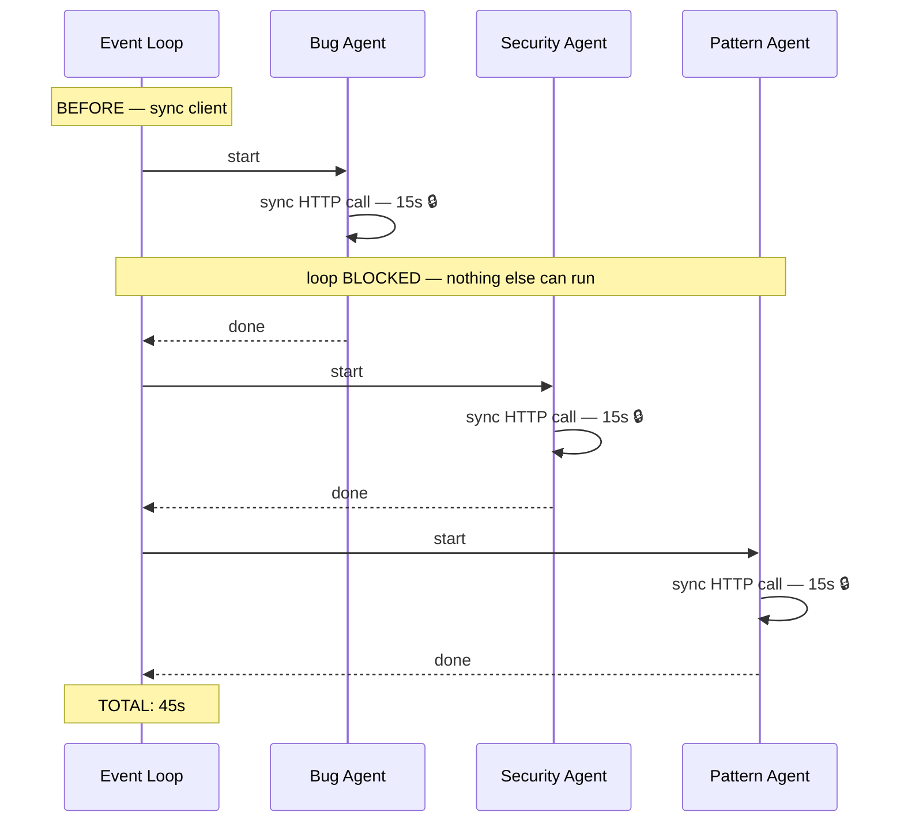
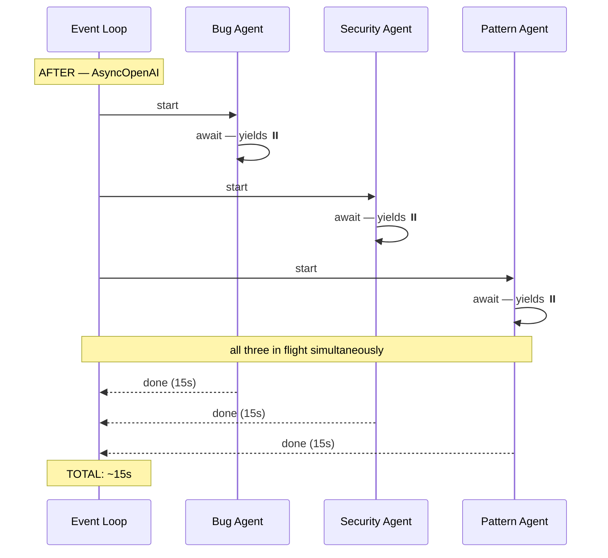
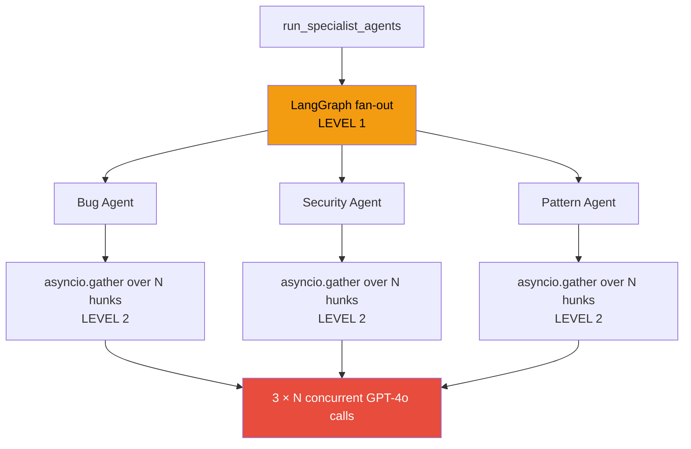

# 12 — Performance Optimization

## Executive Summary

End-to-end latency is roughly **30–90 seconds** from webhook to posted comments, dominated almost entirely by **network I/O to OpenAI**. The system is fast because of two levels of nested parallelism — and it *became* fast because of a real bug fix: the original implementation used the **synchronous** OpenAI client inside `async def` functions, so the "parallel" agents ran strictly sequentially.

That bug — **false parallelism** — is the best performance story in this project and the one to lead with.

---

## 1. Where the Time Goes

For a typical PR: 20 hunks, warm vector index, 10 findings posted.

| Stage | Time | % | Bound by |
|---|---|---|---|
| HMAC verification | ~1 ms | <0.1% | CPU |
| GitHub token exchange (×3) | ~600 ms | 1% | Network ⚠️ |
| Fetch diff | ~300 ms | 0.5% | Network |
| Shallow clone | ~2–5 s | 8% | Network + disk |
| Ingestion (incremental) | ~3–8 s | 12% | OpenAI embeddings |
| **Specialist agents** | **~15–40 s** | **60%** | **OpenAI GPT-4o** |
| Suggestion generation | ~5–10 s | 15% | OpenAI GPT-4o |
| Post to GitHub | ~500 ms | 1% | Network |
| **Total** | **~30–60 s** | | |



**The conclusion that should drive every optimisation decision:** this system is **I/O-bound on a third-party API**. Optimising Python code is almost pointless. Optimising *how many API calls you make and how concurrently* is everything.

---

## 2. The Big Story — False Parallelism

### The bug

From commit `a61bfd2`:
> *"Switch all specialist agents and pr_writer to AsyncOpenAI so GPT-4o calls are non-blocking and the parallel fan-out actually runs concurrently"*

**What the code looked like:**

```python
# BEFORE — the bug
from openai import OpenAI          # ← SYNCHRONOUS client
_client = OpenAI(api_key=...)

async def _process_hunk(hunk, collection_name):
    response = _client.chat.completions.create(...)    # ← BLOCKS the event loop
    ...
```

Everything *looked* right:
- LangGraph fanned out to three nodes from `__start__` ✅
- Each agent used `asyncio.gather` over hunks ✅
- Every function was `async def` ✅

**But `OpenAI` (not `AsyncOpenAI`) is a blocking client.** Calling it inside a coroutine doesn't yield to the event loop — it holds the single thread for the entire duration of the HTTP request.

### Why this is so insidious





**Roughly 3× faster at the agent level — and because each agent also gathers over N hunks, the real improvement was much larger.** With 20 hunks the "before" case was effectively 60 sequential API calls.

### The lesson

> `async` is not a performance feature. It's a **cooperative** concurrency model. A coroutine only yields control at an `await` on something that actually suspends. Every `async def` in my code was correct; the problem was one blocking call inside them, and one blocking call is enough to serialise everything.
>
> The reason it took me a while to spot is that nothing *failed*. No error, no warning, no exception. The results were completely correct. The only symptom was that reviews took about three times longer than my mental model said they should, and I only caught it by looking at stage timings and noticing the three agents' durations summed rather than overlapped.
>
> The general lesson: in async code, **auditing the library, not the syntax, is what matters.** `async def` around a sync call is a lie the type system won't catch. Now the first thing I check with any SDK is whether there's a distinct async client — `AsyncOpenAI` vs `OpenAI`, `httpx.AsyncClient` vs `httpx.Client`.

**This is a top-tier interview answer.** It shows debugging skill, conceptual depth, and the ability to catch silent performance bugs that don't announce themselves.

---

## 3. The Deliberate Exception — `asyncio.to_thread`

Not everything can be async. ChromaDB's Python client is synchronous with no async variant.

```python
async def run_ingestion(diff, repo_path, owner, repo_name, head_sha, config=None):
    return await asyncio.to_thread(
        _run_ingestion_sync, diff, repo_path, owner, repo_name, head_sha, config,
    )
```

**The pattern:** write the blocking code as an honest sync function, then push it to a worker thread. The event loop stays free; the calling coroutine awaits the thread's completion.

| Approach | Event loop | Verdict |
|---|---|---|
| Sync call in `async def` | 🔒 Blocked | ❌ The bug above |
| `asyncio.to_thread(sync_fn)` | ✅ Free | ✅ Used here |
| Rewrite the library as async | ✅ Free | Not feasible |

**Why this is a good design decision to highlight:** it's *honest*. Rather than wrapping blocking code in `async def` and pretending, the ingestion module is declared sync and explicitly offloaded. The code says what it is.

⚠️ **One inconsistency:** `context.py` calls `collection.query()` — a *blocking* ChromaDB call — directly inside an `async` function. That's the same class of bug as the original one, just smaller (vector search is milliseconds, not seconds). It should also go through `to_thread`. Worth volunteering as a residual issue.

---

## 4. Nested Parallelism



| Strategy | 20-hunk PR | Time |
|---|---|---|
| Fully sequential | 60 calls, one at a time | ~900 s (15 min) |
| Agent-parallel only | 3 concurrent streams of 20 | ~300 s |
| **Both levels (current)** | **60 concurrent** | **~15 s** |

**~60× faster than fully sequential.** That's the number to quote.

### The cost of this design

**60 concurrent calls with no limit.** This is the system's biggest operational risk:

| Risk | Consequence |
|---|---|
| OpenAI RPM/TPM limits | 429s → failed hunks → incomplete review |
| Unbounded cost | A 200-hunk PR is 600 calls, unthrottled |
| Thundering herd on retry | All 60 retry simultaneously |
| Memory | 60 in-flight responses buffered |

**The fix — five lines:**

```python
_SEMAPHORE = asyncio.Semaphore(10)      # max 10 concurrent OpenAI calls

async def _process_hunk(hunk, collection_name):
    async with _SEMAPHORE:
        context = await get_context_for_hunk(hunk, collection_name)
        response = await _get_client().chat.completions.create(...)
        ...
```

**Latency impact is small:** 60 calls at 10 concurrent is 6 waves × ~15s ≈ 90s versus ~15s. Slower, but *bounded* and *reliable*. And with a shared semaphore across agents you can tune the trade-off directly.

**The nuanced answer:** *"There's a real tension here — the semaphore trades latency for reliability. My instinct is that a review arriving in 90 seconds reliably beats one arriving in 15 seconds that sometimes fails half its hunks to rate limits. I'd start at a fairly high limit like 20 and tune down only if I saw 429s."*

---

## 5. Caching

### What's cached

| Layer | Mechanism | Saves | Invalidation |
|---|---|---|---|
| **OpenAI client** | Module singleton | TCP/TLS pool setup per call | Process restart |
| **ChromaDB client** | Module singleton | DB handle open per hunk | Process restart |
| **tree-sitter languages** | `_language_cache` dict | `.so` load per file | Process restart |
| **Negative language cache** | `_language_cache[x] = None` | Failed import attempts | Process restart |
| **Embeddings** | ChromaDB on disk | 💵 **Real money** | Manual |
| **Incremental ingestion** | `collection_has_data()` | Full repo re-embed | Collection empty |

### The ChromaDB singleton — from the commit message

> *"Add ChromaDB singleton to avoid recreating the client per hunk"*

**Before:** `chromadb.PersistentClient(path=...)` per call to `get_context_for_hunk`. With 20 hunks × 3 agents = **60 client instantiations per PR**, each opening the database and loading index metadata.

**After:** one client for the process lifetime.

### Negative caching — a subtle win

```python
except Exception:
    _language_cache[language] = None       # ← cache the FAILURE
    return None
```

Without this, every `.rb` file in a Ruby repo retries `importlib.import_module("tree_sitter_ruby")`. Failed imports are expensive — Python stats every directory in `sys.path`. Caching the failure turns attempt #2 onwards into a dict lookup.

### What isn't cached — the two biggest wins available

**1. Hunk embeddings are computed 3× (once per agent)**

```python
# CURRENT: 20 hunks × 3 agents = 60 embedding API calls
# Each agent independently calls get_context_for_hunk(hunk, ...)
# which embeds hunk.added_code

# FIXED: embed once, batched, share
async def precompute_hunk_embeddings(hunks) -> dict[str, list[float]]:
    texts = [h.added_code for h in hunks]
    resp = await client.embeddings.create(input=texts, model="text-embedding-3-small")
    return {f"{h.file}:{h.line_start}": d.embedding for h, d in zip(hunks, resp.data)}
```

**60 API calls → 1 batched call.** This is the single highest-leverage optimisation available and it's a genuinely easy change.

**2. Installation tokens are fetched 3× per pipeline**

The token is valid for an hour but fetched fresh in `get_pr_diff`, `clone_repo`, and `run_pr_writer`.

```python
_token_cache: dict[int, tuple[str, float]] = {}

async def get_installation_token(installation_id: int) -> str:
    cached = _token_cache.get(installation_id)
    if cached and cached[1] > time.time() + 300:      # 5-min safety margin
        return cached[0]
    ...fetch, store with expiry...
```

Saves ~400ms and two RSA signing operations per pipeline. **The 5-minute margin matters** — you don't want a token expiring mid-clone.

### Where Redis would go

| Cache | Scope | Why Redis |
|---|---|---|
| Installation tokens | Cross-instance | Multiple workers share one token |
| Embeddings by content hash | Global | Identical code across repos embedded once |
| Delivery ID dedup | Cross-instance | Idempotency needs shared state |
| Rate limit counters | Cross-instance | Per-process limits don't compose |

**The key insight:** every current cache is **in-process**. The moment you run two instances they diverge. Redis is what makes caching survive horizontal scaling — which is exactly why it's not needed yet at one instance.

---

## 6. Cost Optimisation

Cost and latency are the same problem here: both are driven by API call volume.

### Already done ✅

| Technique | Saving |
|---|---|
| `text-embedding-3-small` over `-large` | ~6.5× on embeddings |
| Batching 100 chunks/call | ~990 round trips per 1,000 chunks |
| **Incremental ingestion** | Largest single win — 5 files vs 500 |
| Skip binaries and >512 KB files | Wasted embedding avoided |
| Pattern agent skips no-context hunks | Fewer GPT-4o calls |
| Confidence filter *before* the suggester | Only ≥0.70 findings get a suggestion call |
| Shallow clone (`depth=1`) | Bandwidth, disk, and time |

**The confidence-filter ordering is a nice detail.** Suggestions are generated *after* filtering, not before. With 11 findings where 1 is dropped, that's 10 suggester calls instead of 11. Doing expensive work only on data that survives filtering is a general principle.

### Available ❌

| Optimisation | Saving |
|---|---|
| Share hunk embeddings | 60 calls → 1 |
| Cache installation tokens | 3 → 1 |
| Model routing (mini for trivial hunks) | ~90% on those hunks |
| Persistent ChromaDB volume | Avoids repeated full re-ingests |
| Skip generated files (lockfiles, `*.min.js`) | Wasted analysis |
| Cap hunks per PR | Bounds worst-case cost |

### Model routing

```python
def choose_model(hunk: DiffHunk) -> str:
    if hunk.file.endswith((".md", ".txt", ".json", ".yaml", ".lock")):
        return "gpt-4o-mini"
    if len(hunk.added_code) < 150:
        return "gpt-4o-mini"
    return "gpt-4o"
```

A docs change or a config edit doesn't need the flagship model. **Routing cheap work to cheap models is standard practice in production LLM systems** and demonstrates cost-awareness beyond just picking a smaller embedding model.

---

## 7. Profiling & Benchmarking

### The current state — and its one virtue

```python
print(f"Diff fetched: {len(diff)} characters")
print(f"Ingestion: {ingestion_result.chunks_stored} chunks ({ingestion_result.mode})")
print(f"Posting {len(to_post)} finding(s), dropped {dropped} below {CONFIDENCE_THRESHOLD:.0%}")
```

**Stage markers exist**, which is the right instinct — but there are no timings, so you can't tell *where* time goes without a stopwatch.

### Adding timing

```python
import time
from contextlib import asynccontextmanager

@asynccontextmanager
async def timed(stage: str, log):
    start = time.perf_counter()
    try:
        yield
    finally:
        log.info("stage.complete", stage=stage,
                 duration_ms=round((time.perf_counter() - start) * 1000, 1))

# usage
async with timed("ingestion", log):
    result = await run_ingestion(...)
```

**`time.perf_counter()` not `time.time()`** — `perf_counter` is monotonic and high-resolution. `time.time()` can jump backwards on NTP adjustment, producing negative durations.

### Profiling tools

| Tool | Measures | Use for |
|---|---|---|
| `cProfile` | Function call counts + cumulative time | CPU hotspots |
| `py-spy` | Sampling profiler, **no code change** | **Production** — attach to a running PID |
| `yappi` | **Async-aware** profiling | Coroutine timing |
| `memray` | Memory allocation | Leaks, large buffers |
| `tracemalloc` | Stdlib memory snapshots | Growth over time |

**`py-spy` is the one to name for production:** `py-spy top --pid 1234` profiles a live process with no instrumentation and near-zero overhead. `cProfile` is largely useless here anyway — it measures CPU, and this system spends its life waiting on network.

**`yappi` is the right choice for async**, because `cProfile` attributes time to the event loop rather than to the awaiting coroutine.

### Benchmarking methodology

```python
async def benchmark(diff: str, runs: int = 5):
    timings = []
    for _ in range(runs):
        start = time.perf_counter()
        await run_specialist_agents(diff, "bench", "o", "r")
        timings.append(time.perf_counter() - start)
    timings.sort()
    return {"p50": timings[len(timings)//2],
            "p95": timings[int(len(timings)*0.95)],
            "mean": sum(timings)/len(timings)}
```

**Report percentiles, not averages.** A mean of 30s hides that p95 is 120s. Users experience the tail, and one 2-minute review is more memorable than nine 20-second ones.

| Percentile | Meaning |
|---|---|
| p50 (median) | Typical experience |
| p95 | Bad-but-not-rare |
| p99 | Worst realistic case |

---

## 8. 📚 Database Performance Theory

> Mostly not applicable — no relational DB. But asked constantly.

### The N+1 problem — with a real example from this code

```python
# store.py — ONE delete call per file
def delete_chunks_for_files(collection, file_rel_paths):
    for file_path in file_rel_paths:
        collection.delete(where={"file": file_path})     # N round trips
```

A PR deleting 50 files makes 50 calls.

```python
# Fixed — one call
collection.delete(where={"file": {"$in": file_rel_paths}})
```

**Having a real N+1 in your own code is worth far more in an interview than reciting the ORM textbook example.**

The classic ORM version:
```python
reviews = session.query(PRReview).all()              # 1 query
for r in reviews: print(r.findings)                  # N queries
# Fix:
session.query(PRReview).options(selectinload(PRReview.findings)).all()  # 2 queries
```

### Connection pooling

Opening a Postgres connection costs 20–50ms (TCP + TLS + auth + backend fork). A pool keeps connections warm.

```python
engine = create_async_engine(URL, pool_size=20, max_overflow=10,
                             pool_recycle=1800, pool_pre_ping=True)
```

**Sizing:** ~`(cores × 2) + spindles`; practically 10–20 per instance. Too large is worse than too small — Postgres forks a process per connection, and `max_connections` defaults to 100.

### Index selectivity

An index pays off when it filters to **<10%** of rows. An index on a boolean column is usually useless — a sequential scan is cheaper than index lookup plus random heap access.

---

## 9. Other Performance Levers

### Compression

```python
from fastapi.middleware.gzip import GZipMiddleware
app.add_middleware(GZipMiddleware, minimum_size=1000)
```

**Not useful here** — responses are tiny JSON acknowledgements. It *would* matter for the deleted `/api/findings` endpoint returning large lists.

**The `minimum_size` guard matters:** compressing a 50-byte response costs more CPU than it saves in bandwidth.

### Cold start

Heavy imports (`chromadb`, `langgraph`, `openai`, 8× `tree-sitter-*`) made boot slow enough that the health check timeout had to be raised to 120s (commit `cc97f4e`).

**Mitigation — lazy imports**, which this codebase already does in places:
```python
def _get_client():
    from openai import OpenAI       # imported on first use, not at module load
```
`store.py` imports `chromadb` at module level but `context.py` imports it lazily inside `_get_chroma()`. Making that consistent would shave startup time.

### Memory

| Consumer | Size | Risk |
|---|---|---|
| Cloned repo on disk | 10–500 MB | ✅ Deleted in `finally` |
| Diff string in memory | KB–MB | Low |
| Embeddings in flight | 100 × 1536 × 4 B ≈ 600 KB/batch | Low |
| Concurrent LLM responses | 60 × ~10 KB | Low |
| ChromaDB index | Grows unbounded | ⚠️ No compaction |

**The unbounded ChromaDB growth** is aggravated by the stale-chunk bug — modified files leave orphaned vectors that are never reclaimed. See [03-Low-Level-Design.md](03-Low-Level-Design.md).

---

## 10. Interview Questions

### Q1. "Tell me about a performance problem you solved."

**Best answer:** *(The false-parallelism story from section 2 — this is your strongest performance answer. Know it cold.)*

**Follow-ups:**
- *"How did you notice?"* — Stage timings. The three agents' durations summed instead of overlapping, which is only possible if they ran sequentially.
- *"How would you prevent it recurring?"* — A lint rule or a code review checklist item: any SDK used in async code must be the async client. Some teams add a runtime assertion in development that warns if the event loop is blocked for more than N milliseconds — `asyncio`'s debug mode does exactly this with `loop.slow_callback_duration`.

---

### Q2. "Your system makes 60 concurrent API calls. Is that wise?"

**Best answer:**
> It's fast and it's fragile, and I'd fix the fragile part.
>
> The parallelism itself is right — three agents times twenty hunks, all I/O-bound. Fully sequential would be about fifteen minutes; this is about fifteen seconds. That's roughly sixty times faster and it's the difference between a tool people use and one they don't.
>
> What's wrong is that there's no ceiling. Sixty is what a twenty-hunk PR produces; a two-hundred-hunk PR produces six hundred, all at once. I'll hit OpenAI's rate limits, get 429s, and — because my retry logic is one attempt after a fixed one-second sleep — those hunks just fail. The review comes back incomplete with no indication that anything was dropped. And the cost is unbounded, which is the part that actually worries me.
>
> The fix is an `asyncio.Semaphore` around the API calls. Five lines. With a limit of ten, sixty calls become six waves of ten — about ninety seconds instead of fifteen.
>
> That's a real trade-off and I want to be clear I'm making it deliberately: I'm choosing slower and reliable over faster and sometimes-broken. A review that arrives in ninety seconds every time beats one that arrives in fifteen seconds but silently drops a third of its findings under load. I'd start the limit fairly high, maybe twenty, and tune down based on actual 429 rates rather than guessing.
>
> The better long-term answer is a proper queue with a bounded worker pool, which gives me backpressure naturally instead of bolting it on.

---

### Q3. "Where's your biggest inefficiency?"

**Best answer:**
> Each agent independently embeds the same diff hunk. All three call `get_context_for_hunk`, which embeds `hunk.added_code` to run the vector search. So for a twenty-hunk PR I make sixty embedding API calls where twenty distinct embeddings exist — and since embeddings can be batched, one call would actually do.
>
> Sixty API calls become one. That's the number.
>
> The fix is precomputing embeddings once at the start of the specialist stage and passing them into the agents, so retrieval uses a lookup instead of an API call. It's maybe twenty lines.
>
> The reason it exists is architectural: I built the agents to be fully independent so I could add or remove one without touching the others. That independence is genuinely valuable — but it means shared work gets duplicated. The fix preserves the independence by hoisting the shared computation to the orchestrator rather than coupling the agents to each other.
>
> Second place is installation tokens. I fetch one three times per pipeline — once for the diff, once for the clone, once for posting — and they're valid for an hour. A simple TTL cache with a five-minute safety margin saves two round trips and two RSA signings.
>
> Both of these are cost *and* latency wins, which is the nice thing about an I/O-bound system: the optimisations point the same direction.

**Why this scores well:** it quantifies precisely, explains *why* the inefficiency exists architecturally, and proposes a fix that preserves the original design goal.

---

### Q4. "How would you profile this in production?"

**Best answer:**
> `py-spy` first, because it attaches to a running process by PID with no code changes and near-zero overhead. `py-spy top --pid <pid>` gives a live view, and `py-spy dump` gives stack traces of every thread — which is what you want when something is hung and you need to know where.
>
> `cProfile` would be close to useless here, and it's worth saying why: it measures CPU time, and my system spends ninety-plus percent of its life waiting on network. It'd tell me my hottest function is something in the HTTP client's polling loop, which is true and completely unhelpful.
>
> For async specifically I'd use `yappi`, which is coroutine-aware. `cProfile` attributes time to the event loop rather than to the coroutine that's actually awaiting, so async call graphs come out meaningless.
>
> But honestly, before reaching for a profiler I'd add structured timing to my stage boundaries, because I already know the shape of the problem — it's I/O-bound and the question is *which* I/O. A context manager wrapping each stage, emitting `duration_ms` in a structured log, gives me a latency breakdown per PR with essentially no overhead. Then I aggregate percentiles: p50, p95, p99.
>
> And percentiles rather than averages, because users experience the tail. A mean of thirty seconds can hide a p95 of two minutes, and one two-minute review is more memorable to a developer than nine fast ones.

---

## 11. Common Mistakes

| Mistake | Consequence | Fix |
|---|---|---|
| Sync client in `async def` | Silent serialisation — no error | Async clients throughout |
| Unbounded `gather` | Rate limits, cost blowout | `Semaphore` |
| Optimising CPU in an I/O-bound system | Wasted effort | Profile first; find the real bound |
| Averages instead of percentiles | Tail latency invisible | p50/p95/p99 |
| `time.time()` for durations | Can go backwards on NTP sync | `time.perf_counter()` |
| Duplicate work across parallel branches | 3× the API calls | Hoist shared computation |
| Re-fetching cacheable credentials | Wasted round trips | TTL cache with safety margin |
| Recreating clients per call | Connection/handle churn | Singleton |
| `cProfile` on async code | Time attributed to the loop | `yappi` |
| Premature optimisation | Complexity with no gain | Measure, then optimise |

---

## 12. Cross-References

| Topic | File |
|---|---|
| Parallelism architecture | [02-System-Architecture.md](02-System-Architecture.md) |
| Async patterns in FastAPI | [05-Backend-Architecture.md](05-Backend-Architecture.md) |
| API call budget per PR | [08-API-Documentation.md](08-API-Documentation.md) |
| Cost optimisation in the AI layer | [09-AI-System.md](09-AI-System.md) |
| Scaling beyond one instance | [13-Scalability.md](13-Scalability.md) |
| The false-parallelism story as a challenge | [14-Project-Challenges.md](14-Project-Challenges.md) |

**Next:** [13-Scalability.md](13-Scalability.md)
