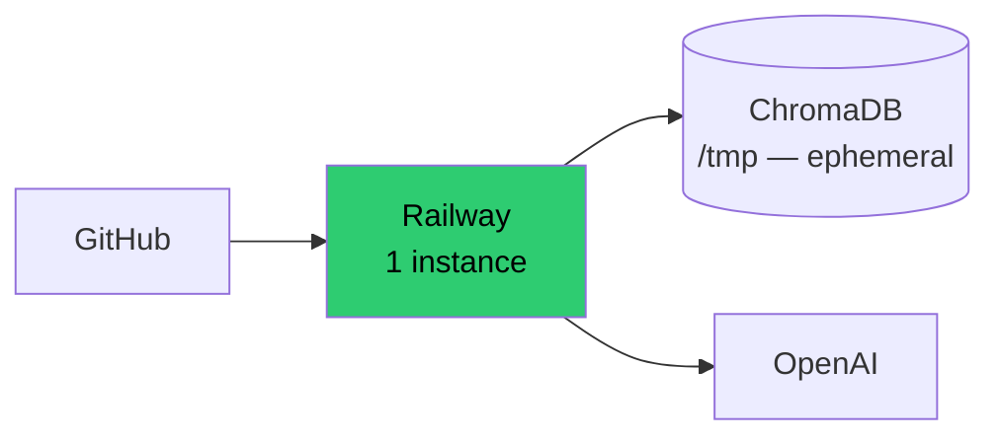
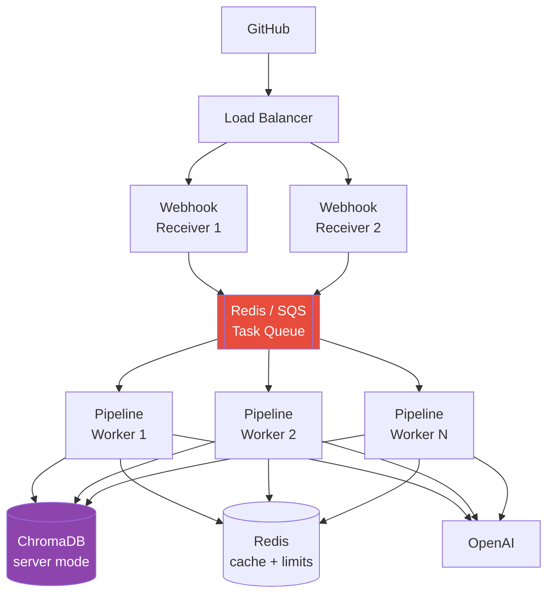
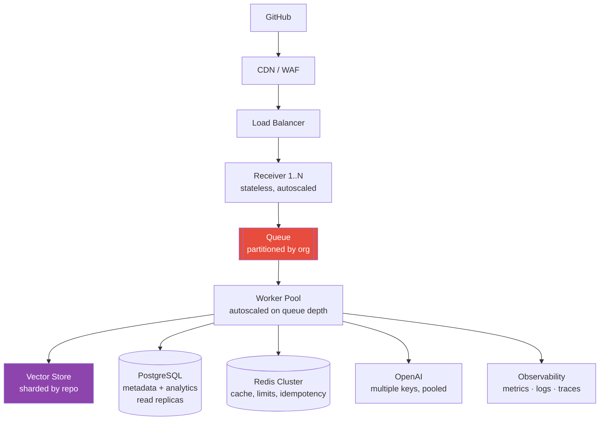
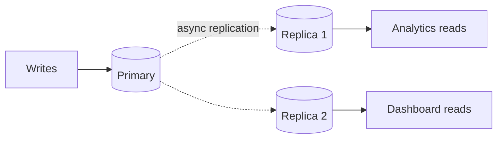
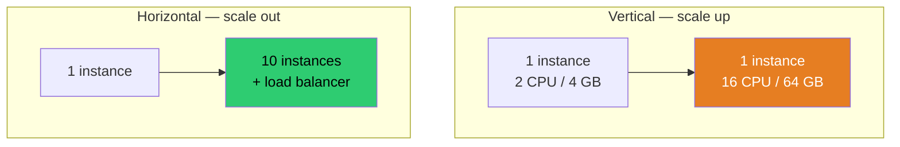

# 13 — Scalability

## Executive Summary

The current architecture is a **single process with in-memory task scheduling and an embedded, ephemeral vector store**. It works well for one developer and a handful of repositories. It breaks in a specific, predictable order as load increases — and knowing that order, with the fix at each tier, is exactly what scalability interviews test.

**The headline:** the first thing to break is **not** capacity. It's **OpenAI rate limits**, because concurrency is unbounded. That's an unusual and memorable answer.

---

## 1. Defining "Users" for This System

A "user" here isn't a person browsing pages — it's a **repository generating PR events**. The right unit is **reviews per day**.

| Tier | Repos | PRs/day | Concurrent peak | Notes |
|---|---|---|---|---|
| **A** | 1–10 | ~20 | 1–2 | Current state |
| **B** | ~100 | ~200 | 5–10 | Small company |
| **C** | ~1,000 | ~2,000 | 20–50 | Mid-size org |
| **D** | ~10,000 | ~20,000 | 100–300 | Large enterprise |
| **E** | ~100,000 | ~200,000 | 1,000+ | GitHub-Marketplace scale |

---

## 2. Tier A — 10 repos, ~20 PRs/day ✅ CURRENT



**Works fine.** PRs rarely overlap; one instance handles it comfortably.

**Already-visible cracks:**
- ChromaDB wiped on every deploy → silent full re-ingests
- In-flight reviews lost on restart
- No visibility into failures beyond stdout

---

## 3. Tier B — 100 repos, ~200 PRs/day

### 🔴 What breaks FIRST: OpenAI rate limits

**Not CPU. Not memory. Not the database.**

Ten concurrent PRs × 20 hunks × 3 agents = **600 concurrent GPT-4o requests**. Typical tier limits are in the low thousands of RPM. You will 429.

**The failure is nasty because it's silent:** the retry is one attempt after a fixed one-second sleep, so 429'd hunks just fail. `return_exceptions=True` skips them. The developer gets an **incomplete review with no indication anything was dropped** — which is worse than an error, because they'll assume the bot found nothing.

### 🟠 Second: lost work on restart

`asyncio.create_task` doesn't survive a process restart. At 200 PRs/day with regular deploys, reviews get silently dropped.

### 🟠 Third: cost visibility

No token metering. The first signal is the invoice.

### Fixes

```python
# 1. Bound concurrency
_SEMAPHORE = asyncio.Semaphore(20)
async def _process_hunk(hunk, collection_name):
    async with _SEMAPHORE:
        ...

# 2. Proper retry with backoff and jitter
from tenacity import retry, stop_after_attempt, wait_exponential_jitter, retry_if_exception_type
@retry(stop=stop_after_attempt(5),
       wait=wait_exponential_jitter(initial=1, max=60),
       retry=retry_if_exception_type(RateLimitError))
async def _call_llm(...): ...

# 3. Persistent volume
CHROMADB_PATH=/data/chromadb        # Railway volume, not /tmp

# 4. Cost metering
llm_cost = Counter("llm_cost_usd_total", "Estimated spend", ["model"])
```

**Architecture:** unchanged. Still one instance. **Tuning, not redesign.**

---

## 4. Tier C — 1,000 repos, ~2,000 PRs/day

### 🔴 What breaks: the single process

At 20–50 concurrent reviews, one Python process is saturated — not on CPU, but on **in-flight coroutines and memory for buffered responses**. Any restart drops dozens of reviews.

### The architectural change: introduce a queue



### Why the queue is the pivotal change

| Property | Before | After |
|---|---|---|
| **Durability** | Lost on restart | Persists in broker |
| **Retries** | None | Automatic with backoff + DLQ |
| **Backpressure** | Unbounded fan-out | Bounded worker pool |
| **Independent scaling** | Coupled | N receivers, M workers |
| **Visibility** | None | Queue depth as a metric |

**Queue depth becomes your key operational signal.** Rising depth means workers can't keep up — scale them. That's a metric you can autoscale on.

### The migration is genuinely cheap

```python
# Before
asyncio.create_task(_safe_run_pipeline(owner, repo, number, installation_id, head_sha))

# After
review_pr.delay(owner, repo, number, installation_id, head_sha)
```

**One line at the call site.** This works because the pipeline is already a pure function of five JSON-serialisable arguments — a deliberate design choice.

**Say this in an interview:** *"The pipeline takes five scalar arguments and returns nothing — no closures over request state, no shared objects. That wasn't accidental; it's what makes moving to a queue a one-line change rather than a rewrite. Designing for a migration you haven't made yet costs nothing if you just keep the boundary clean."*

### Other Tier C changes

| Change | Why |
|---|---|
| **ChromaDB → server mode or pgvector** | Embedded DB can't be shared across workers |
| **Distributed rate limiting** | Per-process semaphores don't compose across N workers |
| **Idempotency on `X-GitHub-Delivery`** | Retries and redeliveries must not duplicate |
| **Structured logging + tracing** | Debugging across workers needs correlation IDs |

### Distributed rate limiting

```python
async def acquire_openai_slot(redis, limit=100, window=60) -> bool:
    """Sliding-window counter shared across all workers."""
    key = f"openai:rate:{int(time.time() // window)}"
    count = await redis.incr(key)
    if count == 1:
        await redis.expire(key, window * 2)
    return count <= limit
```

**Why this is necessary:** with 5 workers each holding `Semaphore(20)`, you get 100 concurrent — but each process independently believes it's under its limit. Only shared state gives a true global cap.

---

## 5. Tier D — 10,000 repos, ~20,000 PRs/day

### 🔴 What breaks: the vector store and per-tenant fairness

**Problem 1 — vector store size.** 10,000 repos × ~5,000 chunks × 1536 dims × 4 bytes ≈ **300 GB of raw vectors**, plus HNSW graph overhead. One instance cannot hold that.

**Problem 2 — noisy neighbours.** One organisation opening 500 PRs at once starves everyone else. There is no fairness mechanism.

**Problem 3 — OpenAI limits again**, now at the account level. You need multiple keys or an enterprise agreement.

### Sharding the vector store

```python
def shard_for_repo(owner: str, repo: str, num_shards: int) -> int:
    return int(hashlib.sha256(f"{owner}/{repo}".encode()).hexdigest(), 16) % num_shards
```

**Shard by repository** — the natural partition key, because every query is already scoped to one repo. No cross-shard queries are ever needed. That's the ideal sharding situation.

| Strategy | Pros | Cons |
|---|---|---|
| **Hash on repo** ✅ | Even distribution, no cross-shard queries | Resharding is painful |
| Range on owner | Locality per org | Hot spots on large orgs |
| **Consistent hashing** ✅✅ | Adding a shard moves only 1/N of keys | More complex |

**Consistent hashing matters at this tier:** with plain modulo hashing, going from 10 to 11 shards remaps ~91% of keys. Consistent hashing (a hash ring with virtual nodes) remaps only ~1/11. That's the difference between a re-index that takes a weekend and one that takes a month.

### Per-tenant fairness

```python
# Weighted fair queueing — cap concurrent reviews per organisation
MAX_CONCURRENT_PER_ORG = 10

async def can_start(redis, owner: str) -> bool:
    count = await redis.get(f"active:{owner}") or 0
    return int(count) < MAX_CONCURRENT_PER_ORG
```

Or separate queues per priority tier, with workers consuming proportionally.

### Full Tier D architecture



### Database replication (if Postgres is added)



**Replication lag is the trap.** Async replication means a replica may be milliseconds to seconds behind. Write a finding, immediately read it from a replica, get nothing — the classic **read-after-write** inconsistency. Fix: route reads that must see your own writes to the primary, or use synchronous replication for those paths at a latency cost.

---

## 6. Tier E — 100,000 repos, ~200,000 PRs/day

At this scale the constraints stop being architectural and become **economic and contractual**.

### 🔴 What breaks: unit economics

At roughly $0.10–0.50 per review, 200,000 reviews/day is **$20,000–100,000 per day**. LLM inference is the entire cost structure.

| Lever | Saving |
|---|---|
| **Model routing** — mini for trivial hunks | 50–80% |
| **Self-hosted fine-tuned model** | 90%+ at high volume |
| **Semantic caching** — identical hunks across forks | 10–30% |
| **Prompt caching** — shared system prompt prefix | 50% on input tokens |
| **Tiered service** — deep review only for paid tiers | Aligns cost with revenue |

**Prompt caching is worth naming specifically:** the system prompt is identical across every call to a given agent. Providers offer discounts on cached prefixes. With a ~500-token system prompt across millions of calls, that's substantial.

### Microservices — but only now


**The justification is different resource profiles, not code organisation:**

| Service | Bottleneck | Scaling signal |
|---|---|---|
| Webhook | Network | Requests/sec |
| Ingestion | CPU (tree-sitter) + memory | Queue depth |
| Analysis | External API concurrency | LLM rate-limit headroom |
| Publisher | GitHub API limits | Queue depth |

**The critical caveat to state:**
> I'd resist microservices until this point, and I'd want to be explicit about why. Splitting a 1,900-line monolith into services buys you distributed transactions, network partitions, versioned inter-service contracts, and distributed tracing as *mandatory* rather than optional. That's a large tax.
>
> The only justification is genuinely divergent scaling profiles — ingestion is CPU-and-memory-bound while analysis is bound by external API concurrency. When one service needs 50 replicas and another needs 3, co-locating them wastes a lot of compute. That's an economic argument, and it only becomes true at very large scale.
>
> Before that, the monolith with a queue gets you most of the benefit — independent scaling of receivers and workers — for almost none of the cost.

---

## 7. The Breaking-Point Summary Table

| Tier | Load | 🔴 Breaks first | Fix | Redesign? |
|---|---|---|---|---|
| **A** | 20 PRs/day | Nothing | — | — |
| **B** | 200 PRs/day | **OpenAI rate limits** | Semaphore + backoff + persistent volume | ❌ Tuning |
| **C** | 2,000 PRs/day | **Single process / lost work** | Queue + workers + shared vector store | ✅ Moderate |
| **D** | 20,000 PRs/day | **Vector store size + noisy neighbours** | Sharding + fair queueing + replicas | ✅ Significant |
| **E** | 200,000 PRs/day | **Unit economics** | Model routing, caching, self-hosting, microservices | ✅ Major |

**Memorise this table.** It's the spine of any scalability answer for this project.

---

## 8. Horizontal vs Vertical Scaling



| | Vertical | Horizontal |
|---|---|---|
| Method | Bigger machine | More machines |
| Ceiling | Hardware limit | Effectively none |
| Cost curve | Superlinear | Roughly linear |
| Downtime to scale | Usually yes | No |
| Fault tolerance | ❌ Single point of failure | ✅ Redundant |
| Complexity | Low | Needs statelessness |

**The blocker for horizontal scaling here is state:**

| State | Problem | Fix |
|---|---|---|
| `asyncio.create_task` in memory | Not shared, not durable | Queue |
| Embedded ChromaDB on local disk | Each instance diverges | Server mode / pgvector |
| In-process singletons/caches | Not shared | Redis |
| `_language_cache` | Harmless — deterministic, rebuildable | Leave it |

**The general rule:** *make the compute stateless; push state to a shared store.* Then horizontal scaling is just "run more copies."

**Notice the last row** — not all in-process state is a problem. The tree-sitter language cache is deterministic and cheap to rebuild, so duplicating it per instance is fine. Distinguishing harmful state from harmless state is a nuance worth showing.

---

## 9. Load Balancing

| Algorithm | Behaviour | Fit here |
|---|---|---|
| Round robin | Cycle through | ✅ Fine — webhook receivers are uniform |
| Least connections | Fewest active | ✅ Better if durations vary |
| IP hash | Sticky by client IP | ❌ All traffic is from GitHub — would pin everything to one instance |
| Weighted | By capacity | ✅ For mixed instance sizes |

**The IP-hash trap is a good detail:** all requests originate from GitHub's IP ranges. IP-hash would map nearly all traffic to one instance — a load balancer that doesn't balance. It's a nice example of why you have to know your traffic shape.

**Health checks are what make LB work:** the balancer must remove unhealthy instances. This is where a proper **readiness** probe matters — the current `GET /` returns 200 even with a broken OpenAI key, so the balancer would keep routing to a broken instance.

---

## 10. CDN

**Not applicable.** There is no static content and no browser client. A CDN caches static assets near users; this system serves only a webhook endpoint hit by GitHub's servers.

**Where a CDN edge *would* help:** DDoS absorption and WAF filtering in front of the public webhook endpoint at Tier D+. That's edge security, not content delivery.

**Clean answer:** *"No — a CDN caches static assets close to end users, and I have neither static assets nor end users in browsers. At large scale I'd want a WAF or edge proxy in front of the webhook endpoint, but that's for DDoS absorption and rate limiting, not caching."*

---

## 11. Interview Questions

### Q1. "What happens if traffic increases 100×?"

**Best answer:**
> Let me be specific about what breaks and in what order, because the first thing isn't what people usually expect.
>
> **At roughly 10× — a couple hundred PRs a day — the first thing to break is OpenAI rate limits, not my infrastructure.** My concurrency is unbounded: three agents times N hunks, all fired at once. Ten concurrent PRs at twenty hunks each is six hundred simultaneous GPT-4o calls. I'll get 429s.
>
> And the failure mode is the bad kind — silent. My retry is one attempt after a fixed one second, and `return_exceptions=True` skips failed hunks. So the developer gets an incomplete review with no indication anything was dropped. They'll assume the bot found nothing, which is worse than an error.
>
> The fix is tuning, not redesign: a semaphore to bound concurrency, `tenacity` for exponential backoff with jitter respecting `Retry-After`, and a persistent volume so I stop paying for repeated full re-ingests.
>
> **At roughly 100× — a couple thousand a day — the single process breaks.** Twenty to fifty concurrent reviews saturate one Python process, and any restart silently drops all of them because `asyncio.create_task` lives in process memory.
>
> That's where the architecture genuinely changes: a queue. Redis with Celery, or SQS with workers. It buys me four things — durability across restarts, retries with a dead-letter queue, backpressure through a bounded worker pool, and independent scaling of receivers versus workers. Queue depth also becomes my autoscaling signal.
>
> The nice thing is the migration is one line at the call site, because my pipeline is already a pure function of five JSON-serialisable arguments — no closures over request state. That was deliberate.
>
> I'd also need ChromaDB in server mode rather than embedded, because multiple workers can't share a local-disk database, and distributed rate limiting in Redis, because per-process semaphores don't compose — five workers each thinking they're under the limit gives you five times the limit.

---

### Q2. "How would you shard the vector store?"

**Best answer:**
> By repository, hashing `owner/repo` — and it's an unusually clean sharding problem because of how my queries work.
>
> Every single query is already scoped to one repository. I store one ChromaDB collection per repo, and the pattern agent needs *this* repo's conventions specifically — cross-repo context would be actively wrong, not just unnecessary. So there is no query that ever needs to span shards. That's the ideal case: no scatter-gather, no distributed joins, no cross-shard transactions.
>
> I'd use consistent hashing rather than plain modulo, and that distinction matters a lot at this scale. With `hash(repo) % num_shards`, going from ten shards to eleven remaps about ninety-one percent of repositories — you'd be re-embedding almost your entire corpus. Consistent hashing with virtual nodes remaps roughly one-eleventh. That's the difference between a resharding operation that takes a weekend and one that takes a month and costs a fortune in embedding calls.
>
> The hot-spot risk is a very large monorepo — one repo with a million chunks unbalances its shard regardless of how good the hash is. I'd handle that by splitting oversized repos across shards by directory prefix, since I can route the query using the file path from the diff.
>
> Honestly, though, at Tier D I'd seriously evaluate pgvector instead of self-managed sharding. Postgres gives me partitioning, replication, backups, and transactional metadata in one system that operations teams already know how to run. Self-managed vector sharding is a lot of undifferentiated infrastructure work.

---

### Q3. "When would you move to microservices?"

**Best answer:**
> Much later than most people would, and for a specific reason rather than a general preference.
>
> The wrong reasons: code organisation — I can get that with modules and I already have, my agent packages are cleanly separated. Team autonomy — that's Conway's Law and it's real, but I'm one developer. "It's more modern" — not a reason.
>
> The right reason is **divergent resource profiles**. Ingestion is CPU-and-memory-heavy — tree-sitter parsing and large file buffers. Analysis is bound almost entirely by external API concurrency and barely uses CPU. Publishing is bound by GitHub's rate limits. When ingestion needs fifty replicas and publishing needs three, co-locating them means paying for fifty copies of a service that only needs three. That's an economic argument, and it only becomes true at high volume.
>
> What I'd resist is jumping there directly, because the tax is real: distributed transactions, network partitions as a normal condition, versioned contracts between services, and distributed tracing going from nice-to-have to mandatory. Debugging goes from reading one log to correlating four.
>
> The intermediate step gets most of the benefit for almost none of the cost: a monolith plus a queue. I can already scale webhook receivers and pipeline workers independently, because they're separate processes running the same codebase consuming from a shared broker. That covers Tier C and most of Tier D.
>
> So: monolith to Tier B, monolith-plus-queue through Tier C and D, and microservices only at Tier E when the resource profiles diverge enough that co-location is genuinely wasteful.

**Why this scores at senior level:** it names the wrong reasons explicitly, gives one specific right reason, quantifies the tax, and identifies a cheaper intermediate step.

---

### Q4. "What's your single biggest scalability risk?"

**Best answer:**
> Unbounded concurrency, and I'd argue it's a bigger risk than any capacity limit because it's a *cost* risk rather than a *performance* risk.
>
> Three agents times N hunks with no ceiling. A capacity problem announces itself — things get slow, you scale up. A cost problem doesn't announce itself at all. Someone opens a PR touching two hundred files, my system fires six hundred concurrent GPT-4o calls, and I find out on the invoice. There's no circuit breaker, no per-PR token budget, and no cost metric to alert on.
>
> That's the asymmetry that worries me: the worst case isn't bounded by my infrastructure, it's bounded by how large a PR someone opens. And PR size is entirely outside my control.
>
> The fixes are cheap and layered. A semaphore bounds concurrency. A per-PR token budget caps the worst case — after N hunks, stop analysing and note in the comment that the PR was truncated. A cost counter with an alert makes it visible. And a circuit breaker that trips on sustained 429s stops me hammering a rate-limited API.
>
> None of that is hard. It's on my list precisely because the failure mode is financial and silent, which is the combination I least want.

---

## 12. Common Mistakes

| Mistake | Consequence | Fix |
|---|---|---|
| Assuming CPU breaks first | Optimise the wrong thing | Profile; here it's third-party rate limits |
| In-memory task scheduling at scale | Silent work loss on restart | Durable queue |
| Embedded DB with multiple instances | Divergent state | Shared/server-mode store |
| Per-process rate limits across N workers | N× the intended limit | Shared counter in Redis |
| Modulo sharding | Resharding remaps ~everything | Consistent hashing |
| IP-hash LB with single-source traffic | No balancing at all | Round robin / least connections |
| Microservices too early | Distributed-systems tax with no benefit | Monolith + queue first |
| No per-tenant limits | Noisy neighbours starve everyone | Fair queueing |
| Ignoring replication lag | Read-after-write inconsistency | Route critical reads to primary |
| No cost ceiling | Unbounded financial exposure | Token budget + alerting |

---

## 13. Cross-References

| Topic | File |
|---|---|
| Current architecture | [02-System-Architecture.md](02-System-Architecture.md) |
| Vector store details | [04-Database-Design.md](04-Database-Design.md) |
| Concurrency implementation | [12-Performance-Optimization.md](12-Performance-Optimization.md) |
| Deployment platforms | [10-Deployment-and-DevOps.md](10-Deployment-and-DevOps.md) |
| Full system design interview | [19-System-Design-Expansion.md](19-System-Design-Expansion.md) |
| Roadmap priorities | [20-Future-Improvements.md](20-Future-Improvements.md) |

**Next:** [14-Project-Challenges.md](14-Project-Challenges.md)
