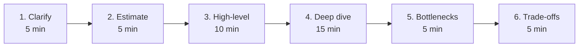
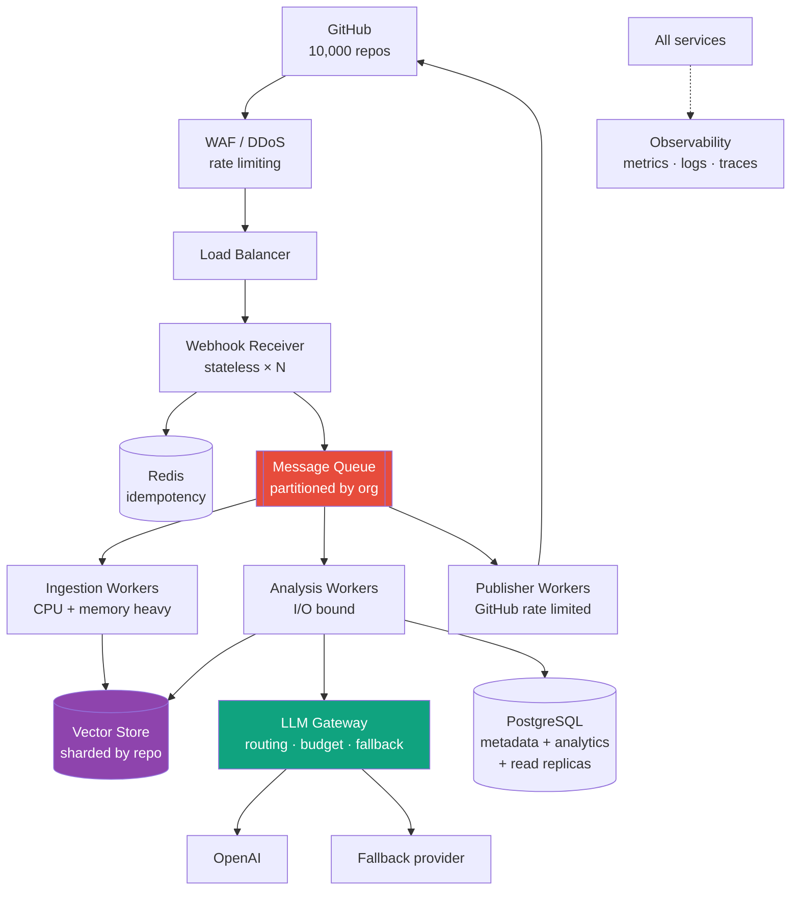
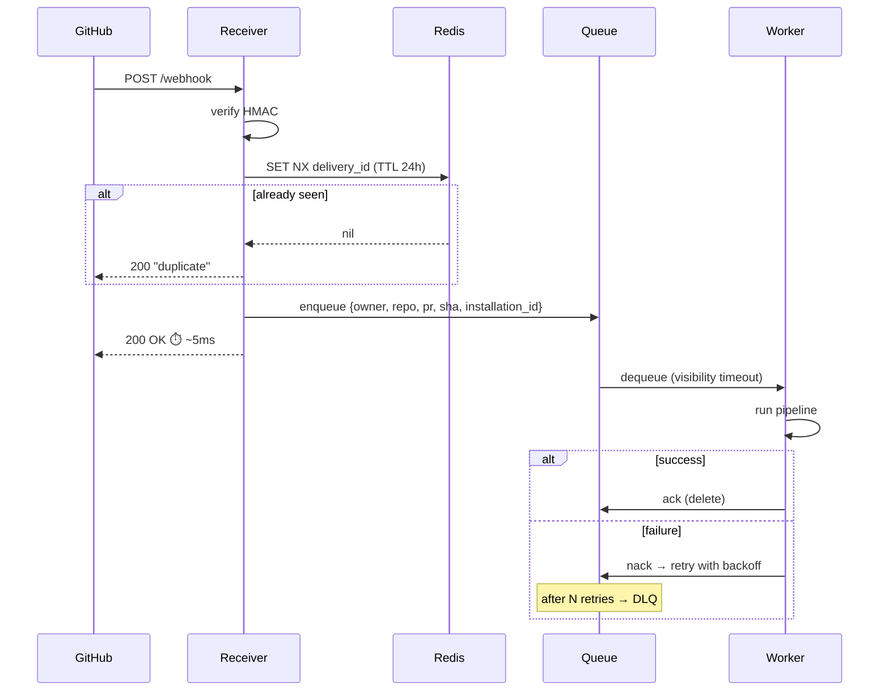

# 19 — System Design Expansion

## Executive Summary

The full system design interview: **"Design an AI code review system for 10,000 repositories."** This walks the standard structure — requirements → estimation → high-level design → deep dives → bottlenecks → trade-offs — using your project as the starting point and scaling it up.

**Your advantage over other candidates:** you've built the small version. You can say "here's what I actually did, here's where it breaks, here's what replaces it" instead of designing from theory.

---

## 1. The Interview Structure



**The most common failure is skipping step 1.** Candidates start drawing boxes before knowing what they're building. Spend the five minutes.

---

## 2. Step 1 — Clarifying Questions

Ask these. Out loud. Before drawing anything.

**Functional**
- Which VCS providers — GitHub only, or GitLab and Bitbucket too?
- Review on PR open only, or every push?
- Advisory comments, or can it block merges?
- Do we support monorepos? What's the largest expected PR?
- Multi-tenant with isolation guarantees, or single-org?

**Scale**
- 10,000 repos — how many PRs per day? *(Assume ~2 per repo → 20,000/day)*
- Peak-to-average ratio? *(Assume 5× during business hours)*
- Average PR size? *(Assume 200 lines, 20 hunks)*
- Repository size distribution? Any monorepos?

**Non-functional**
- Latency target from push to comments? *(Assume < 2 min p95)*
- Availability target? *(99.9% — this is advisory tooling, not payments)*
- Cost ceiling per review?
- Data residency or compliance requirements? *(Big one — can code leave the customer's region?)*

**Assumptions to state explicitly**
> "I'll assume GitHub only, review on open and push, advisory comments not blocking, 20,000 reviews per day with 5× peaks, a 2-minute p95 latency target, and 99.9% availability. Tell me if any of those are wrong."

---

## 3. Step 2 — Back-of-Envelope Estimation

### Traffic

```
20,000 reviews/day ÷ 86,400s        ≈ 0.23 reviews/sec average
Peak at 5×                          ≈ 1.2 reviews/sec
Each review ≈ 90s of processing
Concurrent reviews at peak          ≈ 1.2 × 90 ≈ 108
```

**~110 concurrent reviews at peak.** That's the number that sizes everything.

### API calls

```
Per review: 20 hunks × 3 agents      = 60 LLM calls
           + 20 embeddings (shared)  = 20
           + ~10 suggestions          = 10
                                      ≈ 90 calls/review

Peak: 1.2 reviews/s × 90            ≈ 108 API calls/sec
Daily: 20,000 × 90                  = 1.8M calls/day
```

**This immediately tells you: a single OpenAI account will not survive.** You need multiple keys, a provisioned-throughput agreement, or self-hosted inference.

### Storage

```
Per repo:  ~5,000 chunks
Per chunk: 1536 dims × 4 bytes       = 6 KB vector
          + ~2 KB source text
          + ~0.5 KB metadata          ≈ 8.5 KB

Per repo:  5,000 × 8.5 KB            ≈ 42 MB
10,000 repos:                         ≈ 420 GB
+ HNSW graph overhead (~50%)          ≈ 630 GB
```

**~630 GB of vector data.** Too large for one node — this drives the sharding decision.

### Cost

```
Per review (rough): ~$0.15 in LLM calls
20,000/day                           ≈ $3,000/day
                                      ≈ $90,000/month
```

**State this explicitly.** Cost is the dominant design constraint at this scale, and naming it early shows commercial awareness. Most candidates never mention money.

### Bandwidth

```
Clone: ~50 MB average × 20,000/day   = 1 TB/day ingress
```

Worth noting: at this volume, **caching clones** or using GitHub's tarball API instead of git clone becomes worth evaluating.

---

## 4. Step 3 — High-Level Design



### Narrate the components

| Component | Responsibility | Scaling signal |
|---|---|---|
| **WAF** | DDoS absorption, IP rate limiting | — |
| **Webhook receivers** | Verify HMAC, dedupe, enqueue. Stateless | Requests/sec |
| **Redis idempotency** | Reject duplicate `X-GitHub-Delivery` | — |
| **Queue** | Durability, retries, backpressure, fairness | Queue depth |
| **Ingestion workers** | Clone, chunk, embed, store | Queue depth + CPU |
| **Analysis workers** | RAG + LLM agents | LLM rate-limit headroom |
| **Publisher workers** | Post to GitHub | GitHub API budget |
| **LLM gateway** | Model routing, budget enforcement, fallback | — |
| **Vector store** | Sharded per-repo embeddings | Storage + QPS |
| **PostgreSQL** | Metadata, analytics, feedback labels | Read QPS |

### The three components that don't exist in your current system

Call these out explicitly — it shows you know what scaling adds:

1. **The queue** — converts fire-and-forget into durable, retryable, backpressured work.
2. **The LLM gateway** — a single choke point for cost control, model routing, and provider failover. Without it, cost governance is scattered across every call site.
3. **Sharding** — 630 GB doesn't fit on one node.

---

## 5. Step 4 — Deep Dives

### Deep dive A: Why the queue is the pivotal change



**Four properties you get:**

| Property | Why it matters here |
|---|---|
| **Durability** | Deploys stop silently dropping in-flight reviews |
| **Retries with backoff + DLQ** | Transient OpenAI failures recover instead of failing permanently |
| **Backpressure** | Bounded worker pool caps concurrency naturally — this is what fixes my unbounded fan-out |
| **Independent scaling** | Receivers scale on RPS, workers scale on queue depth |

**The point to land:** *"The property I actually need most isn't durability — it's backpressure. My current system fires 150 concurrent LLM calls on a large PR with nothing capping it. A queue with a bounded worker pool gives me that for free rather than bolting on a semaphore."*

**Partition by organisation** so one org's 500-PR merge storm can't starve everyone else.

### Deep dive B: Sharding the vector store

```python
def shard_for_repo(owner: str, repo: str, ring: ConsistentHashRing) -> int:
    return ring.get_node(f"{owner}/{repo}")
```

**Shard by repository.** This is an unusually clean sharding problem and you should say why:

> Every query is already scoped to one repository. The pattern agent needs *this* repo's conventions specifically — cross-repo context would be actively wrong, not merely unnecessary. So no query ever spans shards. No scatter-gather, no distributed joins, no cross-shard transactions.

**Consistent hashing, not modulo.** With `hash(repo) % N`, going from 10 to 11 shards remaps ~91% of repositories — you'd re-embed nearly your entire corpus at enormous cost. Consistent hashing with virtual nodes remaps ~1/11.

**The hot-spot risk:** a single enormous monorepo unbalances its shard regardless of hash quality. Handle by splitting oversized repos across shards by directory prefix — routable, since you have the file path from the diff.

**The alternative worth raising:** at this scale, seriously evaluate **pgvector**. Postgres gives partitioning, replication, backups, and transactional metadata in one system that ops teams already know how to run. Self-managed vector sharding is a lot of undifferentiated infrastructure work.

### Deep dive C: The LLM gateway and cost control

At $90,000/month, cost governance needs a home.

```python
class LLMGateway:
    async def complete(self, request: LLMRequest) -> LLMResponse:
        # 1. Budget enforcement — before spending anything
        if not await self.budget.check(request.org_id):
            raise BudgetExceeded(request.org_id)

        # 2. Model routing — cheap work to cheap models
        model = self.route(request)

        # 3. Distributed rate limiting
        async with self.limiter.acquire(model):
            try:
                response = await self.primary.call(model, request)
            except (RateLimitError, ServiceUnavailable):
                response = await self.fallback.call(model, request)   # 4. failover

        # 5. Metering — every call, attributed
        await self.meter.record(request.org_id, model, response.usage)
        return response

    def route(self, req: LLMRequest) -> str:
        if req.file.endswith((".md", ".json", ".yaml", ".lock")):
            return "gpt-4o-mini"
        if len(req.code) < 150:
            return "gpt-4o-mini"
        return "gpt-4o"
```

**Five responsibilities in one place.** Without a gateway, budget checks and rate limits get scattered across every call site and drift.

**Cost reduction levers, ordered by impact:**

| Lever | Saving | Effort |
|---|---|---|
| Model routing (mini for trivial hunks) | 50–80% on those hunks | Low |
| Prompt caching (shared system prompt prefix) | ~50% of input tokens | Low |
| Semantic caching (identical hunks across forks) | 10–30% | Medium |
| Cap hunks analysed per PR | Bounds worst case | Low |
| Self-hosted fine-tuned model | 90%+ | Very high |

**Prompt caching is worth naming specifically** — the system prompt is identical across every call to a given agent, and providers discount cached prefixes. With a ~500-token system prompt across 1.8M daily calls, that's significant.

### Deep dive D: Multi-tenancy and isolation

**The requirement:** Company A's code must never appear in Company B's prompts.

| Layer | Mechanism |
|---|---|
| **Storage** | Separate collection/namespace per repo — physical isolation, not a `where` filter |
| **Compute** | Worker processes one review at a time; no cross-request state |
| **Queue** | Partitioned by org |
| **Cache keys** | Always include org ID |
| **Logs** | Never log source code contents |

**The design principle worth stating:**
> I'd choose physical isolation over filter-based isolation. One collection with a `repo` metadata filter would work, but it depends on *every* query remembering the filter — and one forgotten `where` clause becomes a cross-tenant data leak. Separate collections make that class of bug structurally impossible. For multi-tenant systems handling customer source code, I want isolation that survives a developer mistake.

**Compliance escalation:** enterprises will ask whether their code leaves their region, or leaves their infrastructure at all. That pushes toward regional deployments and, for the highest tier, self-hosted inference — which changes the whole cost model.

---

## 6. Step 5 — Bottlenecks and Failure Modes

| Bottleneck | Symptom | Mitigation |
|---|---|---|
| **LLM rate limits** | 429s, incomplete reviews | Multiple keys, provisioned throughput, gateway limiter, backoff |
| **Cost** | Budget overrun | Model routing, per-org budgets, hunk caps |
| **Vector store QPS** | Slow retrieval | Shard, replicate hot shards, cache frequent queries |
| **GitHub API limits** | Failed posting | Per-installation budget, batch, respect `Retry-After` |
| **Queue backlog** | Reviews arrive late | Autoscale workers on depth; shed low-priority load |
| **Noisy neighbour** | One org starves others | Per-org concurrency caps, fair queueing |
| **Clone bandwidth** | 1 TB/day ingress | Cache clones, use tarball API, shallow + sparse checkout |
| **Cold shard** | Slow first review | Pre-warm on installation |

### Graceful degradation ladder

State this — it shows you think about *degrading* rather than *failing*:

```
Full service        → 3 agents, full RAG context, fix suggestions
Under LLM pressure  → drop the suggester (saves ~15% of calls)
Heavier pressure    → security agent only (most valuable per dollar)
Heavier still       → queue and delay, post "review pending"
Total LLM outage    → post "review unavailable" — VISIBLE, not silent
```

**The last line matters most.** Silent failure is worse than visible failure: a developer who sees nothing assumes the bot found no problems.

---

## 7. Step 6 — Trade-offs to Volunteer

| Decision | Chose | Gave up |
|---|---|---|
| Queue over direct processing | Durability, retries, backpressure | Latency (~1–2s), operational complexity |
| Sharding over one big store | Scales past 630 GB | Resharding pain, operational surface |
| Multiple LLM providers | Failover, negotiating leverage | Prompt behaviour differs per provider |
| Model routing | 50–80% cost saving | Quality variance across hunks |
| Advisory only | Safe, adoptable | Findings can be ignored |
| Physical tenant isolation | Leak-proof by construction | More collections to manage |
| Monolith + queue over microservices | Simplicity | Can't scale stages independently — until Tier E |

---

## 8. Follow-Up Questions and How to Answer

### "How do you measure whether it's any good?"

> This is the question I'd have wanted asked earlier in my own project, because it's my biggest gap.
>
> Offline: an evaluation suite of diffs with known planted issues, run nightly, tracking precision, recall, and F1. Critically including **negative cases** — clean refactors that should produce zero findings. Without those you optimise purely for recall and your false-positive rate explodes silently.
>
> Online: **developer behaviour is the ground truth.** Did they resolve the comment, apply the suggestion, or dismiss it without action? That's an implicit label available from the GitHub API. With enough of those you can plot precision against the confidence threshold and pick it empirically instead of guessing — or fit a calibration curve mapping raw LLM scores to empirical probabilities.
>
> The product metric I'd actually optimise: **suggestion acceptance rate.** It captures correctness and usefulness in one number. A finding that's technically right but nobody acts on isn't delivering value.
>
> In my current system I have none of this. My 0.70 threshold is a tuned heuristic, and I can't tell you whether a prompt change made things better or worse. That's the single biggest thing I'd fix.

### "How do you handle a 10,000-file PR?"

> Refuse to review it fully, and be transparent about that.
>
> The naive path is catastrophic: 10,000 files at maybe 3 hunks each times 3 agents is 90,000 LLM calls for one PR. That's thousands of dollars and hours of processing.
>
> I'd cap it — analyse the N highest-value hunks and post a comment saying the PR was too large for full review, with what was covered. Prioritise by heuristic: source files over lockfiles and generated code, larger diffs over one-line changes, and files matching security-sensitive patterns like `auth`, `crypto`, or `payment` first.
>
> There's also a product angle worth raising: a 10,000-file PR is usually itself a problem. Surfacing "this PR is too large to review meaningfully, consider splitting it" is arguably more valuable feedback than any individual finding.

### "What if OpenAI goes down entirely?"

> Layered response. Circuit breaker trips after N consecutive failures, so I stop hammering a dead API. Fail over to a secondary provider — which is exactly why an LLM gateway matters, it's the one place that decision lives. Work stays queued so it processes on recovery rather than being lost.
>
> And most importantly: **post a visible "review unavailable" comment.** Silent failure means developers assume the bot found no problems. Visible failure means they know to review manually.
>
> The multi-provider requirement has a real cost though: prompts don't transfer cleanly between providers. Tool-calling formats differ, and calibration differs — a confidence of 0.8 from one model doesn't mean the same as 0.8 from another. So I'd need per-provider prompt variants and per-provider thresholds, which roughly doubles the prompt maintenance burden. That's the honest cost of failover.

### "How would you support GitLab and Bitbucket?"

> An adapter layer. The pipeline core — chunk, embed, retrieve, analyse, filter — is provider-agnostic. What's provider-specific is webhook verification, diff fetching, cloning, and comment posting.
>
> I'd define a `VCSProvider` interface with those four operations and implement it per provider. My current code is already close: `github_client.py` and `pr_writer/` are the only modules touching GitHub specifics.
>
> The hard part isn't the interface, it's the semantic differences. GitLab calls them merge requests. Comment positioning APIs differ — GitHub wants a line number and side, GitLab wants a position object with old and new line references. And GitLab's suggestion syntax differs from GitHub's, so the one-click fix feature needs a per-provider formatter.

---

## 9. The Whiteboard Sequence

Draw in this order, narrating as you go:

1. **GitHub** (left edge) — "10,000 repos, 20,000 PRs a day"
2. **Load balancer → Webhook receivers** — "stateless, scale on RPS"
3. **Redis** below receivers — "idempotency on delivery ID"
4. **Queue** (large, central, red) — "this is the pivotal component"
5. **Three worker pools** — "different resource profiles, scale independently"
6. **Vector store** (sharded — draw 3 cylinders) — "630 GB, sharded by repo"
7. **LLM Gateway** — "routing, budget, failover — one choke point for cost"
8. **PostgreSQL + replicas** — "metadata and, importantly, feedback labels"
9. **Arrow back to GitHub** from publisher
10. **Observability** box touching everything

**Then say:** *"Let me call out the three things here that don't exist in the version I actually built: the queue, the LLM gateway, and sharding. Everything else scales by adding instances."*

---

## 10. Common Mistakes

| Mistake | Fix |
|---|---|
| Drawing before clarifying | Spend 5 minutes on requirements |
| No numbers | Estimate traffic, storage, and **cost** |
| Never mentioning cost | At $90k/month it's the dominant constraint |
| Over-engineering immediately | Start simple, scale on identified bottlenecks |
| Microservices by default | Justify with divergent resource profiles |
| Ignoring failure modes | Design the degradation ladder |
| No trade-offs stated | Every choice gives something up |
| Forgetting multi-tenancy | Customer source code demands isolation |
| Not measuring quality | For an ML system this is *the* question |
| Modulo sharding | Consistent hashing |

---

## 11. Cross-References

| Topic | File |
|---|---|
| Current architecture | [02-System-Architecture.md](02-System-Architecture.md) |
| Tier-by-tier breaking points | [13-Scalability.md](13-Scalability.md) |
| AI internals to scale | [09-AI-System.md](09-AI-System.md) |
| Vector store details | [04-Database-Design.md](04-Database-Design.md) |
| Cost optimisation | [12-Performance-Optimization.md](12-Performance-Optimization.md) |

**Next:** [20-Future-Improvements.md](20-Future-Improvements.md)
