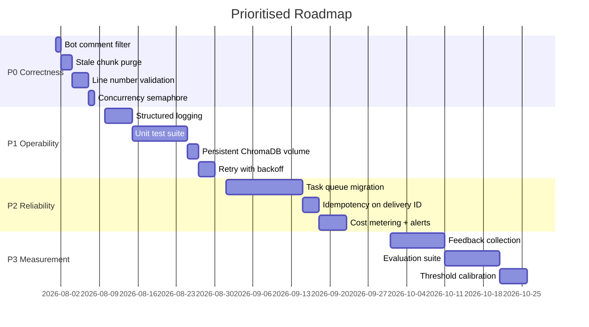

# 20 — Future Improvements

## Executive Summary

A prioritised, honest register of everything wrong with this system and what to do about it. **Sixteen confirmed defects** found auditing the codebase, plus a roadmap.

**Why this file matters for interviews:** most candidates cannot name a single bug in their own project. Being able to produce a ranked list with locations and fixes proves you've read your own code critically — which is exactly the skill a code review tool is supposed to embody.

---

## 1. The Complete Bug Register

| # | Issue | Location | Severity | Effort | Fix |
|---|---|---|---|---|---|
| 1 | Deletes **all** bots' comments, not just its own | `pr_writer/agent.py:30` | 🔴 High | 1 line | Filter on bot login, not `user.type` |
| 2 | Stale chunks accumulate in the vector index | `ingestion/agent.py:51` | 🔴 High | 2 lines | Purge modified files before upsert |
| 3 | LLM line numbers never validated → 422 kills all comments | `pr_writer/agent.py:79` | 🔴 High | ~15 lines | Cross-check against `parse_diff_hunks` |
| 4 | Unbounded concurrency (150+ simultaneous LLM calls) | All agents | 🔴 High | 5 lines | `asyncio.Semaphore` |
| 5 | `create_task` reference discarded — GC can collect it | `main.py:161` | 🟠 Med | 3 lines | Module-level set + done-callback |
| 6 | Dedup keys on exact `line_start`, misses overlaps | `models/findings.py:33` | 🟠 Med | ~10 lines | Reuse the bug agent's interval logic |
| 7 | N+1 delete calls | `ingestion/store.py:77` | 🟠 Med | 1 line | `$in` operator |
| 8 | Installation token fetched 3× per pipeline | `github_client.py:32` | 🟠 Med | ~10 lines | TTL cache with 5-min margin |
| 9 | Same hunk embedded 3× (once per agent) | `specialist/context.py` | 🟠 Med | ~20 lines | Precompute and share |
| 10 | No pagination when listing comments | `pr_writer/agent.py:18` | 🟡 Low | ~10 lines | Follow `Link` headers |
| 11 | Blocking calls inside `async def` | `context.py:44`, `repo_manager.py:25` | 🟡 Low | 2 lines | `asyncio.to_thread` |
| 12 | `confidence: float` unbounded | `models/findings.py:14` | 🟡 Low | 1 line | `Field(ge=0.0, le=1.0)` |
| 13 | Exceptions silently dropped in `gather` | All agents | 🟡 Low | 3 lines | Log the exception objects |
| 14 | Token embedded in clone URL — log leak risk | `repo_manager.py:23` | 🟡 Low | ~10 lines | Env-based git credentials |
| 15 | `FINDINGS_SCHEMA` duplicated 3× | 3 agent files | 🟡 Low | ~200 lines removed | Base class |
| 16 | Dead `alembic/` directory | `backend/alembic/` | 🟢 Cosmetic | delete | `rm -rf` |

**Total for the four 🔴 items: about 25 lines of code.** That's the striking part — the highest-impact fixes are all small.

---

## 2. The Four Critical Fixes, In Detail

### Fix #1 — Stop deleting other bots' comments

```python
# CURRENT — matches Dependabot, Codecov, Renovate, everything
if c.get("user", {}).get("type") == "Bot"

# FIXED
BOT_LOGIN = f"{os.getenv('GITHUB_APP_NAME')}[bot]"
if c.get("user", {}).get("login") == BOT_LOGIN
```

**Why it's serious:** the failure is completely silent. No error, no log. Another team's Dependabot alerts quietly stop existing and the cause is invisible.

**The generalisable lesson:** filtering by **category** when you mean **identity**. "Delete all bot comments" reads naturally and would pass code review. What was meant is "delete comments authored by me."

### Fix #2 — Purge stale chunks

```python
# CURRENT — only deleted files are purged
if deleted_paths:
    delete_chunks_for_files(collection, deleted_paths)

# FIXED — modified files too, delete-then-insert
if deleted_paths:
    delete_chunks_for_files(collection, deleted_paths)
if modified_paths:
    delete_chunks_for_files(collection, modified_paths)
```

**Why:** chunk IDs are `sha256(file:start_line:end_line)`. When someone adds five lines above a function, that function gets a **new ID** and the old row is orphaned forever. Over many PRs the index fills with phantom chunks describing deleted code — and the pattern agent, whose job is comparing against codebase conventions, starts retrieving conventions that no longer exist.

**Alternative:** content-address on `sha256(chunk.text)` so identical code keeps its ID regardless of position. Still needs purging when text changes, so delete-before-insert is cleaner.

### Fix #3 — Validate line numbers before posting

```python
def validate_finding_lines(findings: list[Finding], diff: str) -> list[Finding]:
    valid = [(h.file, h.line_start, h.line_end) for h in parse_diff_hunks(diff)]
    kept = []
    for f in findings:
        if any(f.file == file and start <= f.line_end <= end
               for file, start, end in valid):
            kept.append(f)
        else:
            logger.warning("finding.line_out_of_diff",
                           file=f.file, line=f.line_end, title=f.title)
    return kept
```

**Why this is the highest-value fix:** GitHub validates a review's inline comments **atomically**. One comment targeting a line outside the diff returns 422 and **zero comments post** — all ten findings collapse into a single flat summary with no code context.

**The frustrating part:** the ground truth already exists. `parse_diff_hunks()` returns exactly which lines are in the diff, and it's used to *build* the prompts. The output is simply never checked against it.

**The principle missed:** validation was applied on the *input* side — HMAC verification, Pydantic on LLM output — and forgotten on the *output* side, where untrusted data leaves the system.

### Fix #4 — Bound concurrency

```python
_SEMAPHORE = asyncio.Semaphore(10)

async def _process_hunk(hunk, collection_name):
    async with _SEMAPHORE:
        context = await get_context_for_hunk(hunk, collection_name)
        response = await _get_client().chat.completions.create(...)
```

**Why:** 3 agents × N hunks with no cap. A 50-hunk PR is 150 concurrent GPT-4o calls; a 200-hunk PR is 600.

**The trade-off to state explicitly:** 60 calls at 10 concurrent is ~90 seconds instead of ~15. Slower, but bounded. *A review that arrives reliably in 90 seconds beats one that arrives in 15 and silently drops a third of its findings to rate limits.*

---

## 3. Roadmap



### P0 — Correctness (~1 week)

The four fixes above. ~25 lines total, highest impact per unit of effort.

### P1 — Operability (~3 weeks)

| Item | Why |
|---|---|
| **Structured logging** (`structlog`) | Concurrent reviews currently interleave into unreadable output |
| **Unit tests** on pure functions | ~80% of correctness risk, zero mocking, zero cost |
| **Persistent ChromaDB volume** | Stop paying for repeated full re-ingests after every deploy |
| **`tenacity` retry** with backoff + jitter | One fixed 1s retry doesn't survive a real outage |
| **Dependency pinning** | Builds aren't currently reproducible |

### P2 — Reliability (~4 weeks)

| Item | Why |
|---|---|
| **Task queue** (Celery + Redis) | Durability, retries, backpressure, independent scaling |
| **Idempotency** on `X-GitHub-Delivery` | Redeliveries currently duplicate everything |
| **Cost metering + alerting** | Unbounded spend is the biggest operational risk |
| **Readiness probe** | Current health check returns 200 with a broken OpenAI key |

### P3 — Measurement (~4 weeks) ⭐ The most important section

**This is the gap that makes everything else guesswork.**

| Item | Why |
|---|---|
| **Feedback collection** | Poll the GitHub API for whether comments were resolved, suggestions applied, or dismissed. **This is the ground truth the project has never had.** |
| **Evaluation suite** | Fixed diffs with planted issues, nightly, tracking precision/recall/F1 — including negative cases |
| **Threshold calibration** | Sweep 0.5–0.9 against real labels, pick the F1 maximum instead of guessing at 0.70 |

**Why P3 matters most:**
> Right now I cannot tell you whether a prompt change made the system better or worse. Every unit test could pass while the prompts silently degrade. My 0.70 threshold is a tuned heuristic, not a statistically justified cutoff. Until I can measure quality, every other improvement is faith-based.

---

## 4. Feature Ideas (P4+)

| Feature | Value | Complexity |
|---|---|---|
| **Episodic memory** — "I flagged this in PR #4 and it was dismissed, don't flag it again" | 🔴 High — directly attacks false positives | Medium |
| **Model routing** — mini for trivial hunks | 50–80% cost saving | Low |
| **Reply to human questions** on findings | High — makes the bot conversational | Medium |
| **Multi-provider support** (GitLab, Bitbucket) | Market reach | Medium |
| **Cross-hunk reasoning** — "this duplicates a function added 3 hunks earlier" | Medium — a real current blind spot | High |
| **Per-repo configuration** (`.reviewrc.yml`) — thresholds, disabled categories | High — adoption | Low |
| **Test-coverage agent** — flag untested new code | Medium | Low (agents are pluggable) |
| **Self-hosted model** | 90%+ cost saving at volume | Very high |

**Episodic memory is the highest-value feature**, and worth explaining why:

> The single biggest threat to a review bot is being muted. That happens when it repeats findings developers have already rejected. Right now I have zero memory across reviews — I'll flag the same "issue" on every PR forever, even after being told it's wrong five times.
>
> Storing dismissed findings keyed by repo, file pattern, and category, then suppressing matches, would directly reduce the false positives that matter most: the ones a human has explicitly rejected. It's also self-improving without any model training — the system gets more accurate the more it's used.

---

## 5. What I'd Deliberately Not Build

Being able to name what you'd *decline* is as valuable as a roadmap.

| Not building | Why |
|---|---|
| More agents | I can't measure whether the three I have are good |
| A dashboard | GitHub's UI is better; I'd only rebuild what I deleted |
| Kubernetes | Massive operational burden for a single service |
| Microservices | 1,900 lines doesn't need distribution |
| Fine-tuning | Only pays off at volume I don't have, and I'd need labelled data first |
| Blocking merges (`REQUEST_CHANGES`) | Irresponsible until precision is measured |
| Multi-LLM support | Doubles prompt maintenance for marginal benefit at my scale |

**The unifying principle:** almost everything on this list is blocked by the same thing — **I can't measure quality.** Adding capability before you can measure whether capability helps is how projects accumulate complexity without improving.

---

## 6. Interview Questions

### Q1. "What would you improve?"

**Best answer:**
> I keep a ranked list. Four things are high severity and — the striking part — they total about twenty-five lines of code.
>
> **Line-number validation.** GitHub validates a review's inline comments atomically, so one hallucinated line number returns 422 and *zero* comments post. Ten findings collapse into a single flat summary with no code context. The frustrating part is that I already parse the diff into exact line ranges to build the prompts — I just never check the model's output against them. Fifteen lines.
>
> **A bounded semaphore.** Three agents times N hunks with no cap. A fifty-hunk PR fires a hundred and fifty concurrent GPT-4o calls. That's a rate-limit problem and, more importantly, an unbounded cost problem. Five lines.
>
> **Stale chunk purging.** My chunk IDs encode line numbers, so when code shifts, old vectors are orphaned and never deleted. The index slowly fills with phantom code, which particularly hurts the pattern agent since it's retrieving conventions that no longer exist. Two lines.
>
> **A one-line filter fix.** My stale-comment cleanup matches `user.type == "Bot"`, which is every GitHub App — so I silently delete Dependabot's and Codecov's comments too.
>
> But if you asked what I'd fix *first* strategically rather than tactically, it's not any of those. **It's that I can't measure quality.** I have no labelled dataset, so my 0.70 confidence threshold is a tuned guess and I genuinely cannot tell you whether a prompt change improves or degrades the system. Everything else is faith-based until that's fixed. I'd collect developer responses — resolved, applied, dismissed — from the GitHub API as implicit labels, then calibrate the threshold empirically.

---

### Q2. "How do you decide what to work on next?"

**Best answer:**
> Three criteria, weighted in this order: **blast radius when it fails**, **effort**, and **whether it unblocks other work**.
>
> That's why my ordering is correctness, then operability, then reliability, then measurement — even though measurement is arguably the most valuable. The correctness fixes are twenty-five lines total with high impact, so they're free wins I shouldn't defer. Operability comes next because I can't debug what I can't see, and right now two concurrent reviews interleave their logs into unreadable output.
>
> I weight **silent failures above loud ones.** My comment-deletion bug destroys other tools' comments with no error at all — nobody would ever notice from logs. That ranks above things that fail visibly, because a visible failure gets fixed and a silent one erodes trust invisibly.
>
> What I explicitly deprioritise is features. It's tempting to add a fourth agent or multi-provider support, but adding capability before you can measure whether capability helps is how projects accumulate complexity without improving. Almost everything on my "wouldn't build" list is blocked by the same root cause — I can't measure quality — which is a signal that measurement is the real bottleneck even though it's not first in my sequence.

---

### Q3. "You found sixteen bugs in your own code. Doesn't that concern you?"

**Best answer:**
> The opposite — I'd be far more concerned if I'd found none.
>
> Sixteen issues in nineteen hundred lines is a fairly normal density for code written solo without tests or review. What would worry me is a codebase where nobody could name a single defect, because that means nobody has looked critically.
>
> There's also something specific here: I built a code review tool and then reviewed my own code with the same rigour I'd expect from it. Several of these are exactly the categories my own agents are designed to catch — an N+1 pattern, unbounded concurrency, a filter that's too broad. If I couldn't find them, I'd have less confidence the tool finds them in other people's code.
>
> The pattern I found most useful wasn't any individual bug — it was noticing that **two unrelated bugs had the same root cause.** My webhook loop guard filters events by *type* when I meant *identity*, and my comment cleanup filters users by *type* when I meant *identity*. Same conceptual error in two completely different places. Spotting that was worth more than either individual fix, because now I know it's a mistake I'm prone to.
>
> And I'd note the severity distribution: four high, five medium, seven low or cosmetic. Nothing here is a data-loss or security breach. The high-severity ones are correctness and cost issues, which are exactly what you'd expect to find in a system whose weakest area is testing.

**Why this scores well:** it reframes bug-finding as a strength, connects it to the project's own purpose, and demonstrates pattern recognition across defects rather than just enumeration.

---

## 7. Cross-References

| Topic | File |
|---|---|
| Bug locations in context | [16-Code-Walkthrough.md](16-Code-Walkthrough.md) |
| The stories behind them | [14-Project-Challenges.md](14-Project-Challenges.md) |
| Decisions to revisit | [15-Design-Decisions.md](15-Design-Decisions.md) |
| Scaling roadmap | [13-Scalability.md](13-Scalability.md) |
| Testing plan | [11-Testing.md](11-Testing.md) |

**Next:** [21-Interview-Cheat-Sheet.md](21-Interview-Cheat-Sheet.md)
