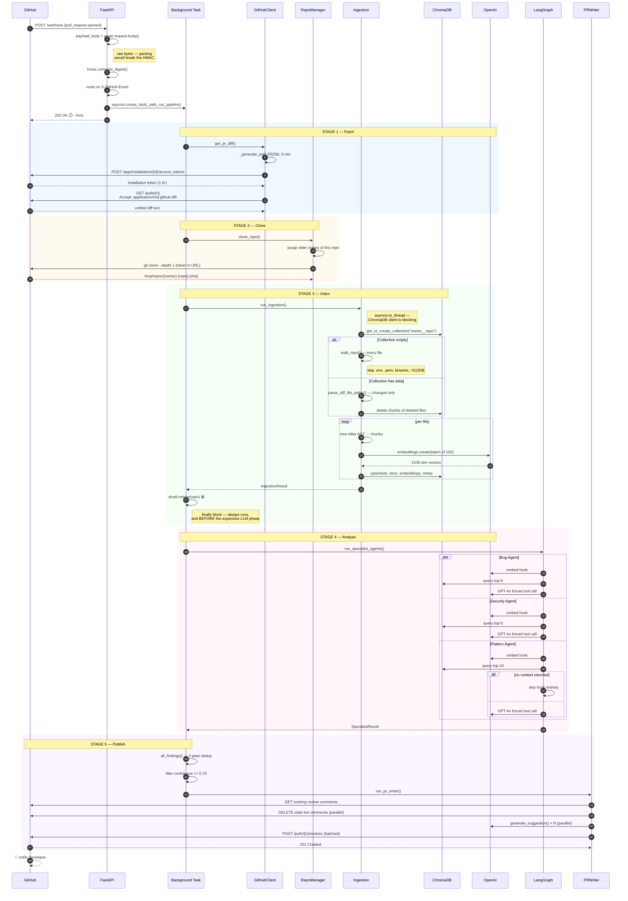
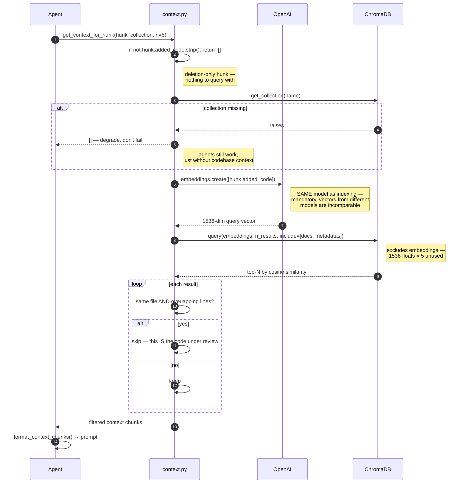
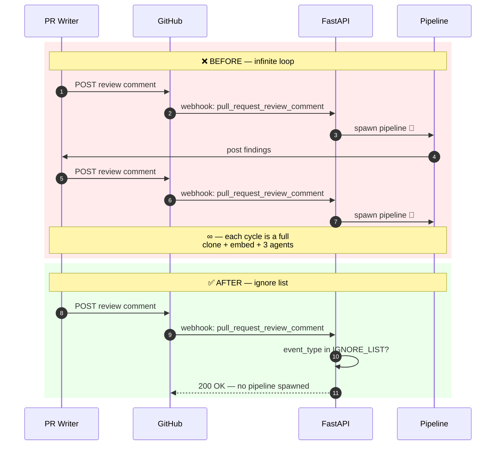
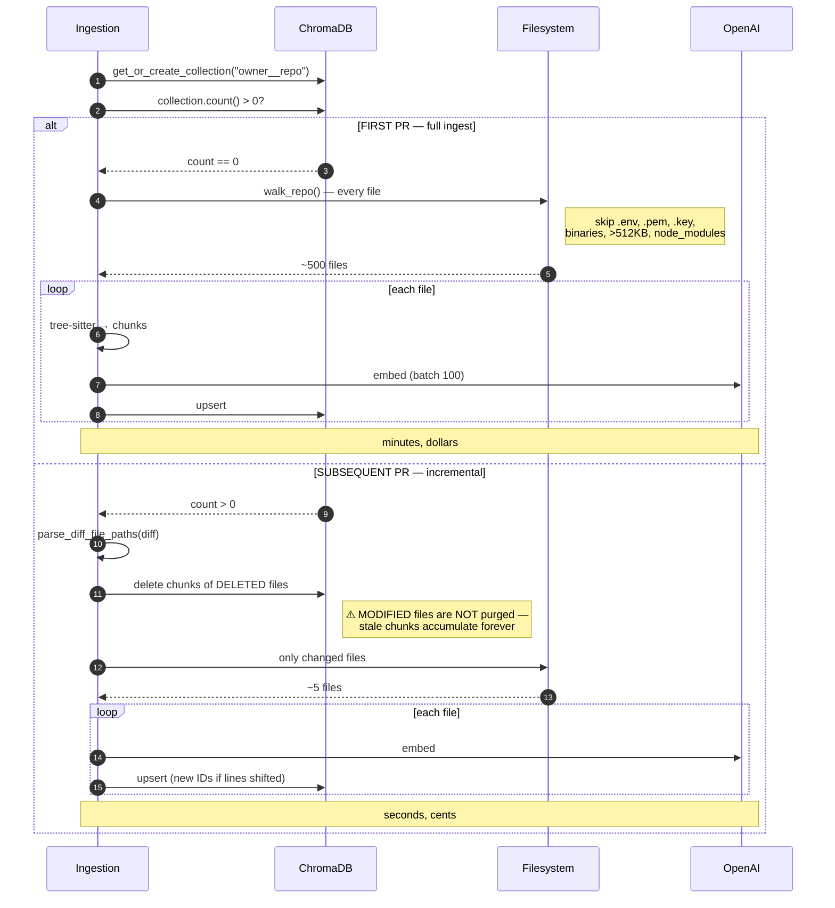
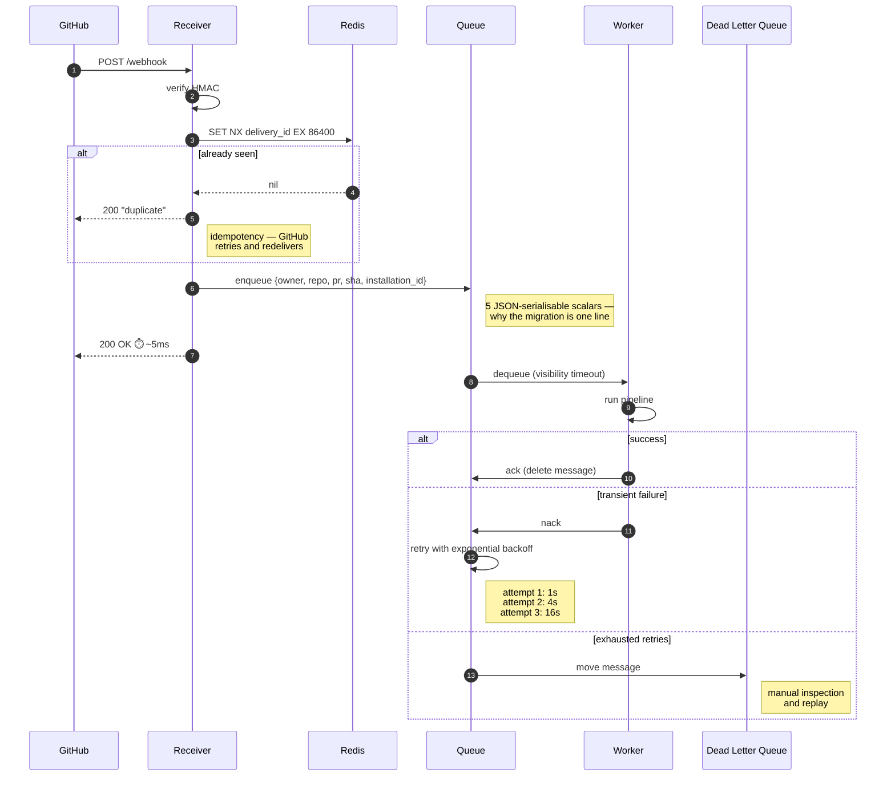
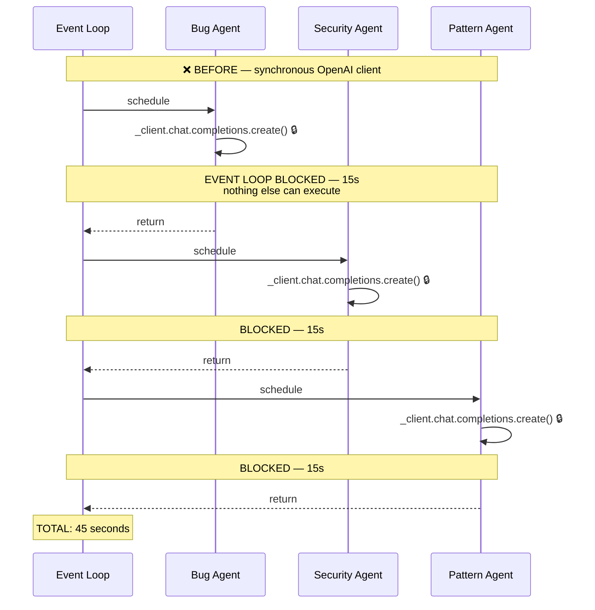
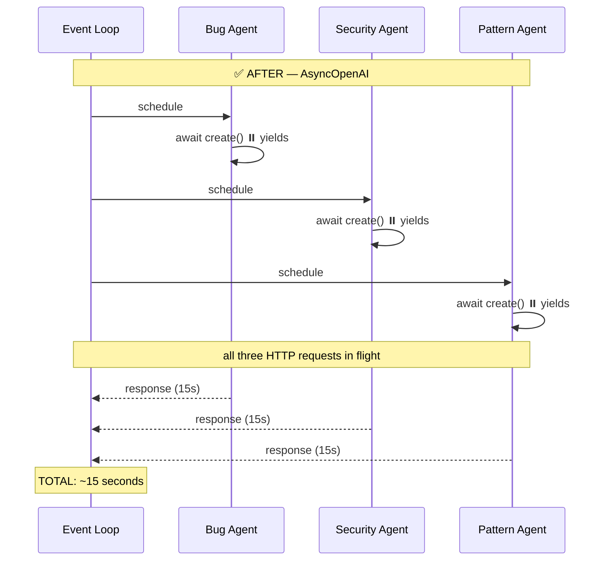

# Sequence Diagrams — Detailed Flows

Detailed sequence diagrams for every major flow, each with a walkthrough of the critical steps.

---

## 1. Complete Happy Path

The full pipeline, end to end.



### Critical steps explained

| Step | Why it matters |
|---|---|
| `request.body()` before parsing | HMAC must cover the exact bytes GitHub sent |
| 200 OK before any work | GitHub times out at ~10s; pipeline takes ~90s |
| `Accept: vnd.github.diff` | Content negotiation — same URI, different representation |
| `--depth 1` | Only current file contents matter; seconds vs minutes |
| `asyncio.to_thread` | ChromaDB is blocking; offload instead of blocking the loop |
| `rmtree` before the LLM phase | Disk held for ~10s of ingestion, not ~60s of agent work |
| Pattern agent skips empty context | No evidence, no judgement — reduces false positives |
| Filter *before* suggestions | Don't pay for suggestions on findings you'll drop |

---

## 2. Authentication — Both Directions

```mermaid
sequenceDiagram
    autonumber
    participant App as Our Service
    participant PK as Private Key (PEM)
    participant GH as GitHub

    rect rgb(255, 245, 245)
    Note over App,GH: INBOUND — is this really GitHub?
    GH->>App: POST /webhook<br/>X-Hub-Signature-256: sha256=abc...
    App->>App: body = await request.body()
    App->>App: expected = "sha256=" + HMAC-SHA256(secret, body)
    App->>App: hmac.compare_digest(expected, received)
    Note right of App: constant-time —<br/>== would leak byte position<br/>via response latency
    alt match
        App-->>GH: 200 OK
    else mismatch
        App-->>GH: 401 Unauthorized
    end
    end

    rect rgb(245, 245, 255)
    Note over App,GH: OUTBOUND — are we really the App?
    App->>PK: read key
    alt production
        PK-->>App: base64 env var → decode
        Note right of App: PEM is multi-line;<br/>env vars mangle newlines
    else local
        PK-->>App: read .pem file
    end
    App->>App: payload = {iat: now-60, exp: now+540, iss: APP_ID}
    Note right of App: iat backdated for clock skew<br/>exp = 9 min (max 10)
    App->>App: jwt.encode(payload, key, algorithm="RS256")
    Note right of App: RS256 asymmetric — GitHub verifies<br/>with the public key, cannot forge
    App->>GH: POST /app/installations/{id}/access_tokens<br/>Authorization: Bearer <JWT>
    GH->>GH: verify signature with stored public key
    GH-->>App: {token: "ghs_...", expires_at, permissions}
    App->>GH: any API call<br/>Authorization: Bearer <installation token>
    end
```

**The key distinction:** the JWT proves **identity** ("I am App #123456"); the installation token grants **authorisation** ("I may act on this installation's repos"). An App installed on 500 orgs gets 500 independently-scoped tokens, so a leak has a blast radius of one installation for one hour.

---

## 3. RAG Retrieval for a Single Hunk



**The self-match filter is the most important step.** The index holds the *pre-change* version of the file being reviewed, and semantically that's the nearest neighbour of the modified code. Without the filter, the agent compares the code to itself.

⚠️ **Refinement:** the filter runs after retrieval, so 3 self-matches out of 5 leaves only 2 chunks. Over-fetching (n=10, filter, take 5) would be more robust.

---

## 4. Error Handling and Degradation

```mermaid
sequenceDiagram
    autonumber
    participant GH as GitHub
    participant FA as FastAPI
    participant BG as Pipeline
    participant AG as Agents
    participant PW as PRWriter

    GH->>FA: POST /webhook
    FA-->>GH: 200 OK

    FA->>BG: _safe_run_pipeline()

    rect rgb(255, 250, 240)
    Note over BG: LEVEL 4 — resource cleanup
    BG->>BG: try: clone + ingest
    BG->>BG: finally: rmtree(ignore_errors=True)
    Note right of BG: runs whether or not<br/>ingestion succeeded
    end

    rect rgb(255, 245, 245)
    Note over AG: LEVEL 3 — per-hunk isolation
    BG->>AG: run_bug_agent()
    AG->>AG: gather(*hunks, return_exceptions=True)
    Note right of AG: one hunk failing returns an<br/>exception OBJECT, not a raise
    AG->>AG: [f for r in results if isinstance(r, list)]
    Note right of AG: ⚠️ exceptions silently dropped —<br/>should be logged
    end

    rect rgb(245, 245, 255)
    Note over AG: LEVEL 2 — per-agent isolation
    alt agent throws
        AG-->>BG: AgentOutput(findings=[], error="...")
        Note right of AG: other 2 agents unaffected
    end
    end

    rect rgb(245, 255, 245)
    Note over PW,GH: LEVEL 1 — posting fallback
    BG->>PW: run_pr_writer()
    PW->>GH: POST /pulls/{n}/reviews
    alt 422 Unprocessable
        GH-->>PW: 422
        Note right of PW: GitHub validates the batch ATOMICALLY —<br/>one bad line number rejects ALL comments
        PW->>GH: POST /issues/{n}/comments (summary)
        Note right of PW: degraded but not silent
    else 201
        GH-->>PW: 201 Created
    end
    end

    rect rgb(250, 240, 240)
    Note over BG: LEVEL 0 — pipeline catch-all
    alt anything else raises
        BG->>BG: print("Pipeline error: ...")
        Note right of BG: webhook already 200'd;<br/>never 5xx to GitHub
    end
    end
```

**The five-level philosophy:** partial output beats no output at every level. But note the weakness — a *fully* failed review is completely silent. The developer sees nothing and concludes the bot found no problems, which is worse than an error message.

---

## 5. The Infinite Feedback Loop (the bug, and the fix)



**The current fix is blunt:** it ignores the event *type*, which also ignores review comments from **humans**. So the bot can't see when a developer replies to a finding with a question.

**The better fix filters on actor identity:**
```python
if payload.get("sender", {}).get("login") == f"{APP_NAME}[bot]":
    return {"status": "ok", "event": "self-generated"}
```

**Note this is the same conceptual error** as `_delete_bot_comments` filtering on `user.type == "Bot"` — **filtering by category when identity was meant.**

---

## 6. Incremental vs Full Ingestion



**Incremental ingestion is the single biggest cost optimisation in the system** — 5 files instead of 500 per PR.

**Two problems:**
1. **The stale-chunk bug** — modified files are upserted without purging, and since chunk IDs encode line numbers, shifted code leaves orphaned vectors forever.
2. **Ephemeral storage** — Railway wipes `/tmp/chromadb` on every deploy, so the collection empties and the next PR silently pays for a full re-ingest.

---

## 7. Scaled Architecture — Queue Flow



**Four properties the queue buys:** durability (survives restarts), retries with a DLQ, **backpressure** (a bounded worker pool caps concurrency), and independent scaling.

**The one that matters most here is backpressure** — the current unbounded fan-out that fires 150 concurrent LLM calls is a direct consequence of having nothing to bound it.

---

## 8. Async: The False Parallelism Bug





**Why it was hard to spot:** nothing failed. No error, no warning, no exception. Output was completely correct. The only symptom was that stage timings **summed** instead of overlapping.

**The lesson:** `async` is a *cooperative* model. A coroutine only yields at an `await` on something that genuinely suspends. One blocking call serialises everything — and `async def` wrapped around a sync call is a lie the type checker won't catch.

---

**See also:** [mermaid-diagrams.md](mermaid-diagrams.md) · [whiteboard-guide.md](whiteboard-guide.md)
